> [!NOTE]
> **Heimdall** is an industrial management system developed as a Bachelor of Science (BSc) Thesis project at the University of Pécs, Faculty of Engineering and Information Technology (PTE MIK).

> [!WARNING]
> ### ⚠️ Pre-Alpha Advisory: AI-Assisted Engineering, Security Notice & Breaking Changes
> - **Early Development Phase:** This project is in an active, experimental pre-alpha stage. Core components, data contracts, and workflows are subject to **constant breaking changes** without backwards compatibility guarantees.
> - **Heavily AI-Generated Codebase:** Substantial portions of this repository—including backend services, frontend logic, infrastructure definitions, and test suites—are engineered and iterated upon with autonomous AI agents and large language models.
> - **High Likelihood of Security Vulnerabilities:** The code may contain unvetted implementations, hardcoded development defaults, or exploitable security flaws. **Do NOT deploy or expose this platform in production, internet-facing environments, or live operational technology (OT/ICS) networks** without exhaustive manual code review, hardening, and independent penetration testing.

# Heimdall - Industrial Management & Telemetry System

Heimdall is a multi-tenant industrial asset management, configuration tracking, and real-time monitoring platform tailored for manufacturing environments. It bridges the gap between **Information Technology (IT)** and **Operational Technology (OT)** by tracking client PCs, Industrial PCs (IPCs), Soft-PLCs (Beckhoff TwinCAT), hardware PLCs, robot controllers, specialized autonomous equipment, software assets, and spatial factory layouts.

---

## Technical Highlights

- **Backend:** .NET 10 Web API (C# 14) with an embedded MQTT 5 broker; agents send protobuf messages over MQTT (no gRPC). Unchanged PLC blocks are filtered before processing.
- **Data Access & Schema Strategy:** Entity Framework Core 10 with Npgsql, PostgreSQL 18 JSONB columns, GIN indexing, and dual-schema separation (`auth` for Better-Auth, `backend` for Heimdall domain).
- **Graph-Relational Domain Model:** Flexible many-to-many relationship topology linking Production Stations with one or more controlling IPCs/PLCs and equipment interconnects.
- **Frontend:** Nuxt 4 (Nuxt 4 Directory Structure), Vue 3, Tailwind CSS v4, shadcn-vue, and Vitest.
- **Client Offloading:** Server-side aggregation, filtering, and caching via Nuxt Nitro BFF (Backend-for-Frontend) routes.
- **Enterprise Dataset & Simulated AD:** Canonical plant fixtures (`fixtures/enterprise_plant_dataset.json`), mock directory REST endpoints (`/api/ad-mock/v1.0/*`), and RFC 4511 LDAP search engine.
- **Better-Auth & Directory Security Group Org Governance:** Dynamic tenant organization mapping and auto-provisioning driven by directory claims, with an interactive claims evaluation sandbox.
- **Universal Tag-Context Omnisearch:** server-side, tenant-scoped search (`GET /api/v1/search`, PostgreSQL `ILIKE` + `pg_trgm`) over stations, controllers, tickets, people and inventory, with entity scoping (`@machine`, `#ticket`, `!controller`, `*part`), keyboard navigation and a client-side ranking fallback.
- **Enterprise Notification Center & Optimistic UI:** In-app notification popover, sticky toast notifications, browser Web Notifications, and automatic state rollback on server rejection.
- **Unified Cryptographic Audit Feed:** Complete audit trail tracking entity state changes, security group assignments, decommissioning records, and automated PLC auto-closure.
- **Industrial Maintenance Lifecycle & Action QR:** Canonical 5-state Kanban lifecycle (`Open`, `InProgress`, `Pending`, `Resolved`, `Closed`), machine watchdog auto-closure (`/auto-close`), kiosk retract (`/retract`), orthogonal escalation, typed `PendingReason` flags, technician delegation hierarchy, and ISO/IEC 18004 action QR codes rendered as SVG (`qrcode` library, `app/utils/qrSvgRenderer.ts`).
- **Live Station Telemetry & Digital Twin:** PLC block → change gate → `StationTelemetryExtractor` → snapshot (memory + Redis) → org-scoped SignalR events (`StationTelemetryReceived`, `StationOscillationReceived`), rendered as plant-map HUD overlays and 3D digital twin cards. All KPIs, trends, and fleet summaries come from stored snapshots and tickets. Where no data source exists they return `null` instead of synthetic values.
- **Sandboxed Lua Automation:** MoonSharp-based scripting persisted in `backend.lua_scripts`. Scripts react to `TelemetryChange` events. `LuaSandboxGuard` enforces per-instruction deadlines, cancellation, allocation budgets, and a re-entrancy depth limit.
- **OT Integrations:** Git-based PLC version control integration blueprint and native OPC UA Server API (`opc.tcp://`).
- **Security & Compliance:** TISAX (VDA ISA 6.0 / High Protection) compliance framework. Per-request tenant scoping (`TenantScopeMiddleware`) and org-scoped SignalR groups. One PKI trust store for AD-issued and Heimdall-issued certificates (Heimdall CA self-signed or subordinate to an enterprise CA); kiosk terminals identified by computer certificates at a TLS-terminating proxy; plugins signed by the installing user and countersigned by the server.
- **Durable Edge Agent:** atomic, checksummed persistence that survives power loss and BSODs, client-side sanity checks, crash records, and lifecycle reports that tell a planned shutdown from a crash or power loss (MQTT last will included).

---

## Screenshots & Demo Gallery

> Screenshots captured from a live development instance running against the canonical 100-machine enterprise plant dataset, 60 synthetic users, and 8 automated production lines.

<table>
<tr>
<td align="center" width="50%">
<a href="docs/media/01_sign_in.png">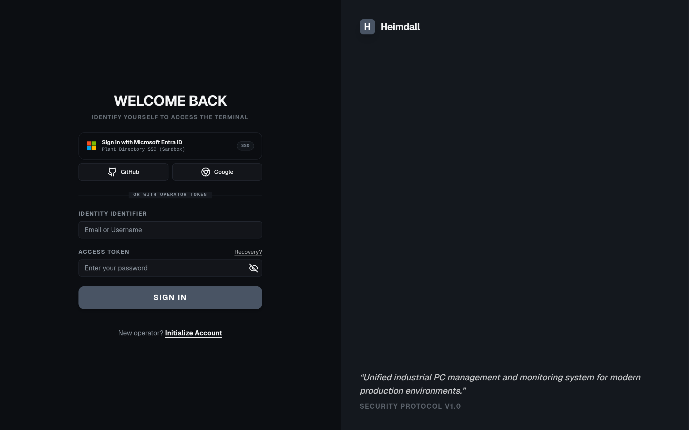</a>
<br/><sub><b>🔐 Sign-In — Entra ID SSO, GitHub & Google OAuth, Credential</b></sub>
</td>
<td align="center" width="50%">
<a href="docs/media/02_dashboard.png">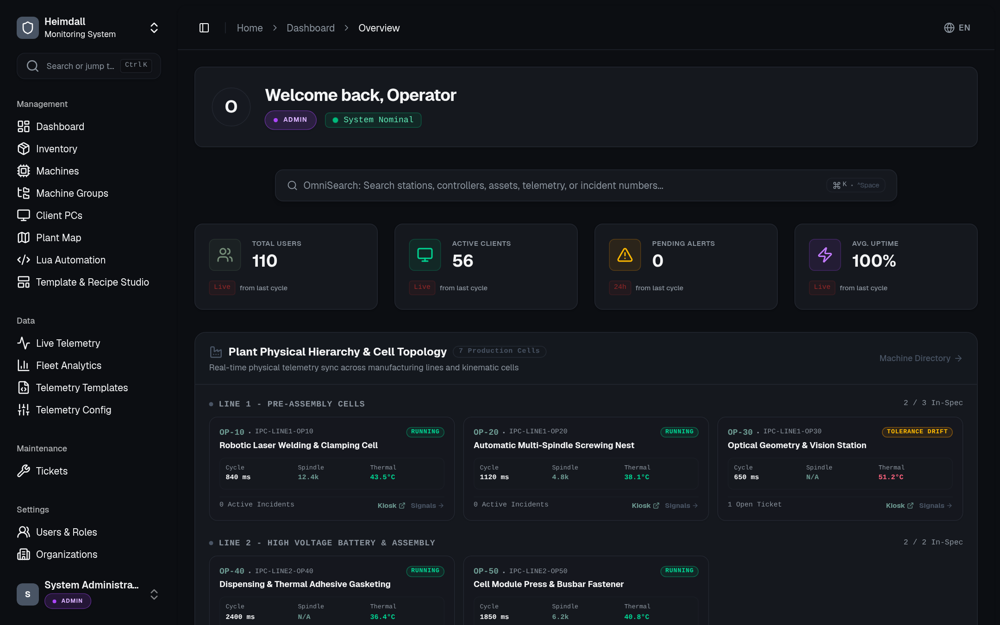</a>
<br/><sub><b>📊 Main Dashboard — KPI Overview, Edge Controllers, Audit Feed</b></sub>
</td>
</tr>
<tr>
<td align="center" width="50%">
<a href="docs/media/03_machines_list.png">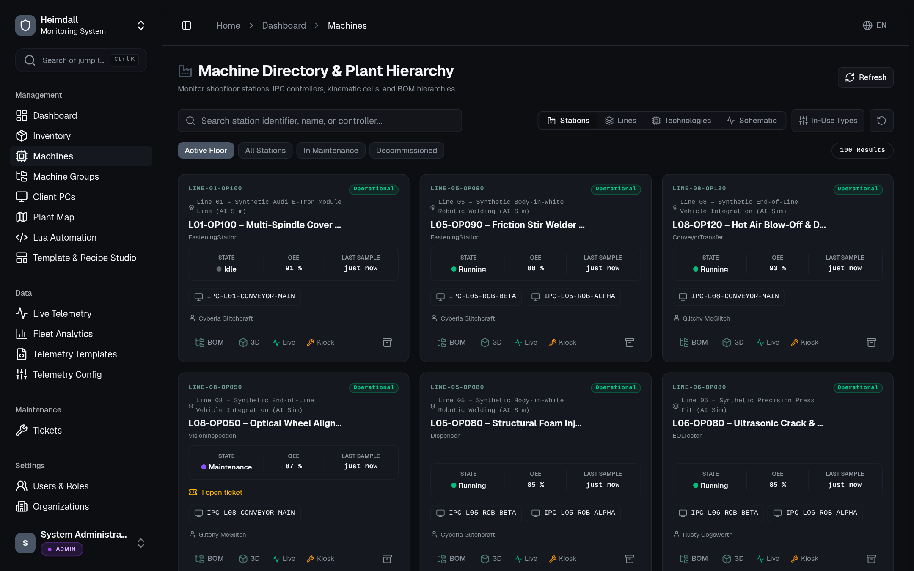</a>
<br/><sub><b>🏭 Production Machinery — 100 Stations, 8 Automated Lines, Live Topology</b></sub>
</td>
<td align="center" width="50%">
<a href="docs/media/04_tickets_kanban.png">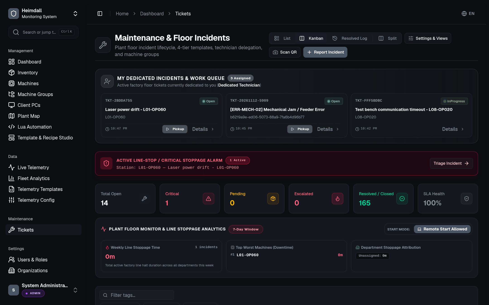</a>
<br/><sub><b>🔧 Maintenance & Incident Management — Kanban, SLA, Technician Delegation</b></sub>
</td>
</tr>
<tr>
<td align="center" width="50%">
<a href="docs/media/05_security_groups.png">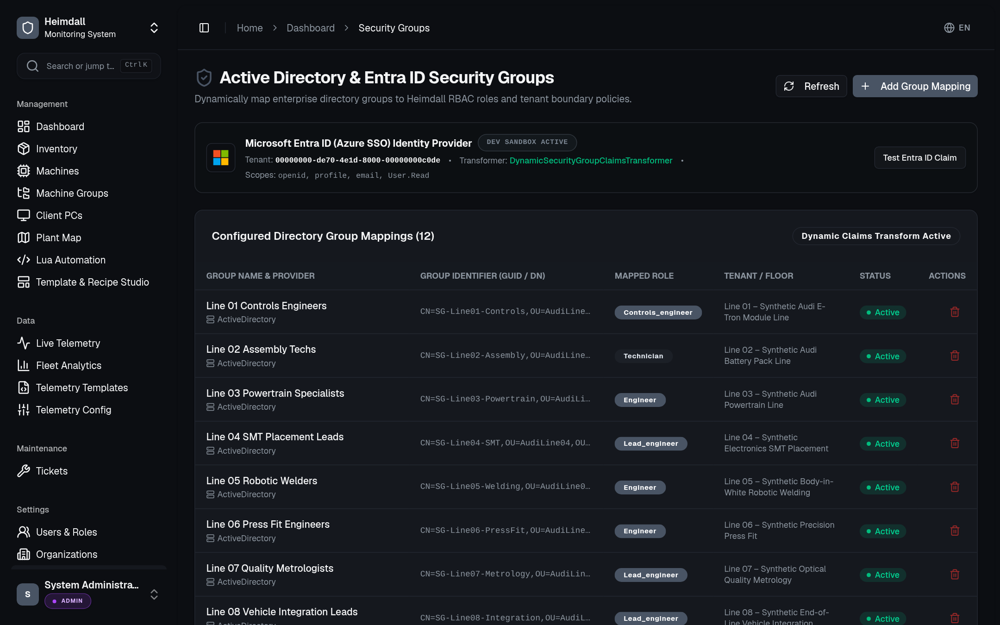</a>
<br/><sub><b>🛡️ Security Groups — AD/Entra ID Group → RBAC Role → Org Mapping</b></sub>
</td>
<td align="center" width="50%">
<a href="docs/media/06_organizations.png">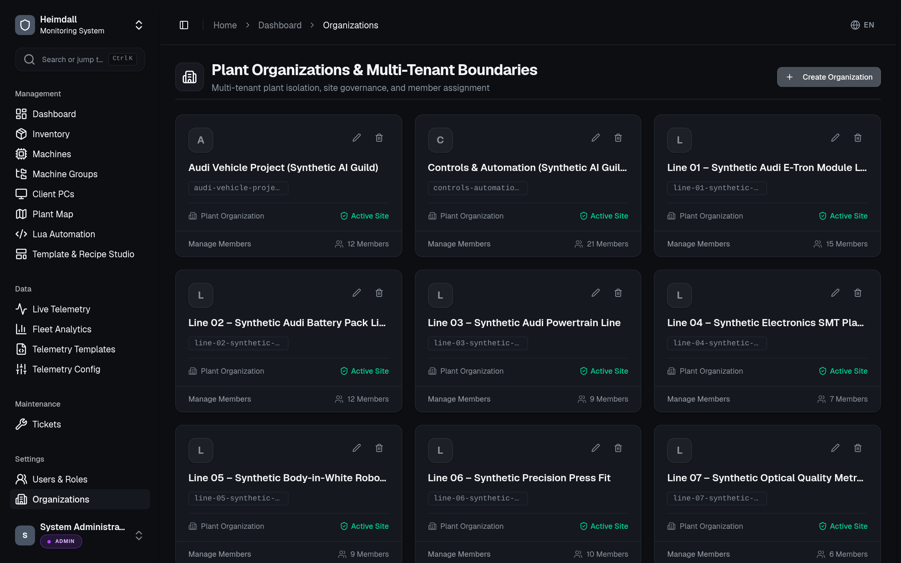</a>
<br/><sub><b>🏢 Tenant Organizations — 16 Multi-tenant Floors & Engineering Guilds</b></sub>
</td>
</tr>
<tr>
<td align="center" width="50%">
<a href="docs/media/07_clients.png">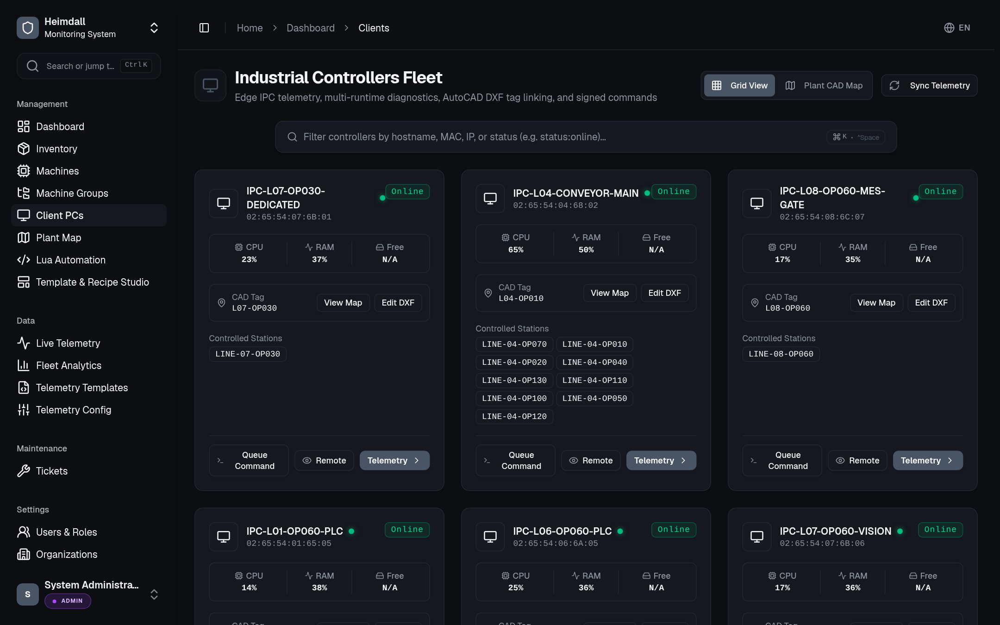</a>
<br/><sub><b>🖥️ Edge IPC Client Registry — 56 Controllers, TwinCAT, MES, PKI</b></sub>
</td>
<td align="center" width="50%">
<a href="docs/media/08_inventory.png">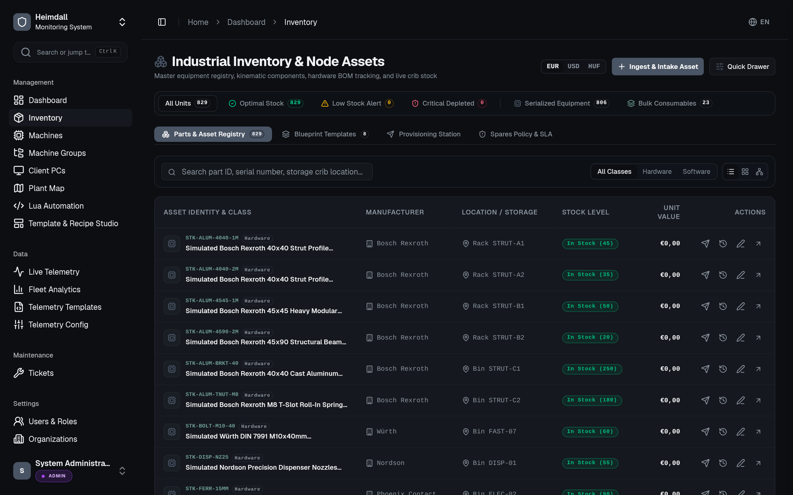</a>
<br/><sub><b>📦 Spare Parts Inventory — 550 Serialized Parts, Bulk Consumables</b></sub>
</td>
</tr>
<tr>
<td align="center" width="50%">
<a href="docs/media/09_settings.png">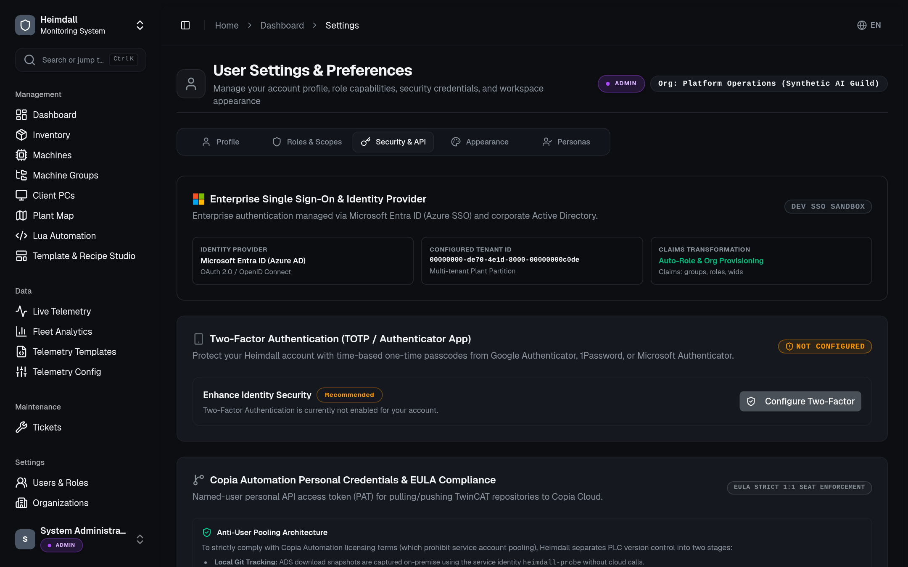</a>
<br/><sub><b>⚙️ Account Settings — MFA Policy, PKI, Role-Based Access Thresholds</b></sub>
</td>
<td align="center" width="50%">
<!-- Placeholder for future video demo -->
<br/><br/>
<b>🎬 Video Walkthrough</b><br/>
<sub>Coming soon — full platform walkthrough including live telemetry ingestion, CAD floor plan navigation, QR action scanning, and real-time Kanban SignalR updates.</sub>
<br/><br/>
</td>
</tr>
</table>

---

## Repository Structure

```
heimdall/
├── src/                     # Core Application Modules
│   ├── agent/               # .NET 10 Worker Service Daemon (References App.Contracts only)
│   ├── backend/             # Backend API and Infrastructure layers
│   │   ├── App.Backend.Api/ # ASP.NET Core Web API, embedded MQTT broker & ingestion, SignalR hub
│   │   └── App.Infrastructure/ # Data Repositories & External Service Integrations
│   ├── frontend/
│   │   └── web/             # Nuxt 4 Web Dashboard & Nitro BFF
│   └── shared/
│       ├── App.Contracts/   # Protobuf MQTT payloads, PLC TypeSystem, certificate & plugin-signature helpers (NO DB)
│       ├── App.Shared/      # Domain Entities, EF Core DbContext, Migrations
│       └── lua/             # Lua scripting engine, sandbox guard & UI extension models
├── docs/                    # Structured Documentation Hub
│   ├── architecture/        # System, Agent, Encryption, Compliance, Protocols
│   ├── api/                 # API Reference, Contracts, Recipe Specification
│   ├── guide/               # Developer Guide, User Guide
│   ├── academic/            # Bachelor's Thesis Research Notes & Academic Formulations
│   └── plc/                 # TwinCAT 3 POU and Interface specifications
├── fixtures/                # Canonical enterprise plant dataset (JSON)
├── seed_data/               # Enterprise seed pipeline & topology
│   └── demo/                # Story-driven "Nordvik NV1" demo dataset (plant, people, tickets, telemetry, Lua)
├── scripts/                 # Demo loader, packaging & dev certificate helpers
├── infra/
│   ├── database/            # PostgreSQL 18 + Redis Docker Compose, TLS entrypoint, init scripts
│   └── windows/             # Windows 10 IoT VM container for agent tests, kiosk overlay launcher
├── simulators/
│   ├── active_directory/    # Standalone mock Active Directory / Graph server (port 5088)
│   └── fleet/               # Edge fleet simulator, mock CMI runner & simulated PC Docker containers
├── tools/
│   ├── cad/                 # Synthetic DXF CAD floor plan generator
│   ├── completions/         # Shell completions (bash/zsh)
│   ├── dev_manager.py       # Unified development service orchestrator & monitor
│   └── generate_sequence_diagrams.py # Code-to-Mermaid sequence diagram generator
├── tests/                   # Unified Verification Suites
│   ├── backend/             # xUnit integration & unit tests (backend + agent)
│   ├── frontend/unit/       # Vitest unit tests
│   └── e2e/                 # Playwright browser automation tests
└── justfile                 # Modern command runner for dev, staging, testing, and production
```


---

## Architecture Overview

Agents on the industrial PCs publish protobuf messages over **MQTT 5** to the broker embedded in the backend; there is no gRPC and no mTLS on the telemetry path. Browsers talk to the Nuxt BFF over HTTPS and receive live updates from the backend's SignalR hub. Certificates (AD-issued or Heimdall-issued) identify kiosk workstations at the reverse proxy and sign plugins.

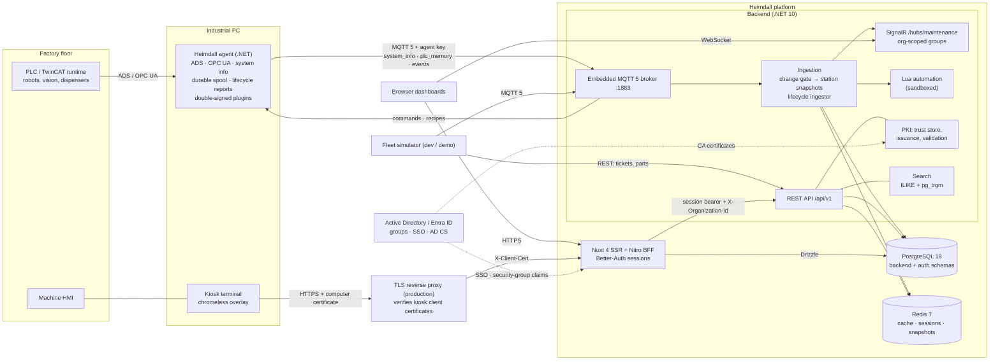

A station can be controlled by several IPCs and an IPC can serve several stations (many-to-many `StationControllers`); each station has one reporting controller.

### Telemetry and lifecycle flow

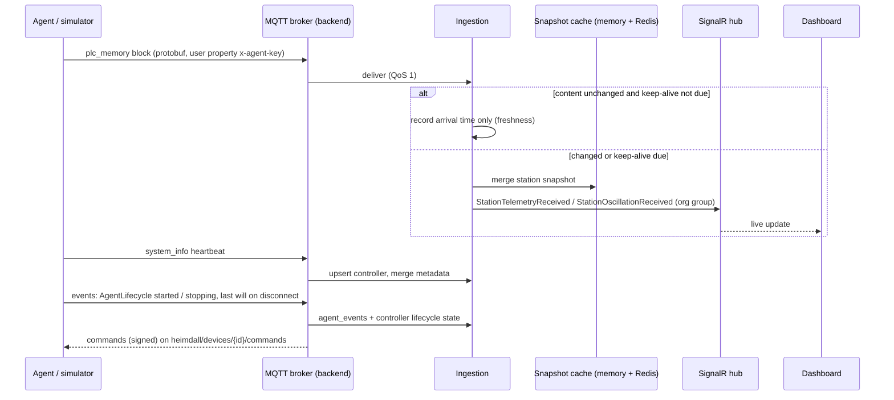

---

## Quickstart & Local Development

### Prerequisites

Ensure you have the following installed on your machine:
- **.NET 10 SDK** (`dotnet`) **and the ASP.NET Core 10 runtime** (`dotnet --list-runtimes` must list `Microsoft.AspNetCore.App 10.x`; on Arch it is the separate `aspnet-runtime` package)
- **Bun** 1.2+ (`bun`)
- **Python 3.12+** (with `venv`)
- **Docker & Docker Compose** (v2 plugin, daemon running)
- **[just](https://github.com/casey/just)** command runner
- **OpenSSL** (for the local Postgres TLS certificate)

Free ports required: `3000` (Nuxt), `5099` (REST API + Swagger), `5001` (secondary API port), `1883` (embedded MQTT broker), `5432` (PostgreSQL), `6379` (Redis); optional: `5050` (pgAdmin, `just pgadmin`), `5055` (simulator control API). Run `just dev-setup --check-only` to verify prerequisites and ports.

---

### 1. Database Infrastructure Setup

Navigate to `infra/database`:

```bash
cd infra/database
mkdir -p data logs certs secrets init
echo "postgres" > secrets/pg_user.txt
echo "supersecret" > secrets/pg_pw.txt

# Generate SSL certificates for local HTTPS Postgres
openssl req -new -x509 -days 365 -nodes -text -out certs/server.crt \
  -keyout certs/server.key -subj "/CN=localhost"

# Enforce strict file permissions required by PostgreSQL
chmod 600 certs/server.key

# Start PostgreSQL 18 container
docker compose up -d
cd ../..
```

---

### 2. Database Migrations & Local Tooling

Restore local .NET tools and run database migrations:

```bash
# Restore local EF Core CLI tool
dotnet tool restore

# Run EF Core backend migrations
dotnet ef database update --project src/shared/App.Shared --startup-project src/backend/App.Backend.Api

# Install frontend dependencies (also runs `nuxt prepare` via postinstall)
cd src/frontend/web
bun install
cd ../../..
```

---

### 3. Python Simulator Setup

Initialize the Python virtual environment and install simulator requirements:

```bash
# Create virtual environment
python3 -m venv venv

# Activate and install dependencies
source venv/bin/activate
pip install -r simulators/fleet/requirements.txt
deactivate

# Generate synthetic DXF factory layout
venv/bin/python tools/cad/generate_plant_dxf.py
```

---

### 4. Command Orchestration with `just`

Heimdall provides a modern, fast [just](https://github.com/casey/just) command runner for development, staging, testing, and production orchestration:

```bash
# Display all available recipes
just --list

# Start development stack and launch the interactive full-screen TUI (default)
just dev

# Launch TUI dashboard directly (interfaced directly via just commands)
just tui

# Restart or stop individual services without detaching/killing the TUI
just restart-service backend
just stop-service frontend

# Check service health and port matrix
just status

# Run test suites (all, backend, frontend, windows, seed, smoke, staging)
just test
just test-staging

# Boot Staging Environment (mirrors production security, NO dev features, ONLY debug)
just staging-up
just staging-status
just staging-down

# Boot Production Stack
just prod-up
just prod-status
just prod-down
```

> [!TIP]
> For in-depth production deployment procedures, Linux filesystem installation hierarchy (`/opt/heimdall`, `/etc/heimdall`, `/var/lib/heimdall`), and environment configuration references, consult the **[Production & Staging Guide](docs/guide/PRODUCTION_AND_STAGING_GUIDE.md)**.

---

### 4.1 Environment Configuration Files

Heimdall includes pre-configured environment templates at the repository root:
- **[`.env.example`](.env.example)**: Comprehensive configuration template documenting every variable across the stack.
- **[`.env.dev`](.env.dev)**: Local development defaults (`HEIMDALL_ENABLE_DEV=true`, `HEIMDALL_ENABLE_DEBUG=true`).
- **[`.env.staging`](.env.staging)**: Staging configuration (`HEIMDALL_ENABLE_DEV=false`, `HEIMDALL_ENABLE_DEBUG=true`, `heimdall_staging_db`).

> [!IMPORTANT]
> Dev-only conveniences are enabled only by an explicit `HEIMDALL_ENABLE_DEV=true`. These include the BFF's anonymous "System Administrator" fallback, the demo kiosk tokens, and the `mock_auth` route-guard bypass. A non-production `NODE_ENV` alone no longer enables them.
> Kiosk terminals (`/api/terminal/*`) authenticate with one of the following:
> - a token from `HEIMDALL_TERMINAL_TOKENS` (comma-separated, ≥ 16 characters each; generate with `openssl rand -hex 24`)
> - a computer certificate verified by the TLS-terminating proxy and forwarded in `X-Client-Cert` (only with `HEIMDALL_TRUST_CLIENT_CERT_HEADER=true` and the proxy listed in `HEIMDALL_TRUSTED_PROXIES`); it must chain to the PKI trust store and map to a controller bound to the requested station
> - in development only (`HEIMDALL_ENABLE_DEV=true`, never under `NODE_ENV=production`) the terminal needs no authentication
> - an operator session

---

### 5. Demo Dataset (Nordvik NV1)

A small, fully fictional, story-driven dataset for presentations lives in [`seed_data/demo/`](seed_data/demo/README.md). The loader is idempotent and refuses to run unless `HEIMDALL_ENABLE_DEV=true`. It also refuses Production/Staging environments and database names that look like prod or staging.

```bash
just demo-check      # Validate JSON, references, enums; dry-run against the dev DB (rolled back)
just demo-seed       # Load / refresh the dataset into heimdall_dev_db (+ demo-only logins)
just demo-runtime    # With the backend running: register demo Lua scripts and replay telemetry
just demo-reset      # Delete only demo rows and reload them
```

See the [demo walkthrough](seed_data/demo/README.md) for personas, demo logins, and the presentation script.

## Running Verification Tests

```bash
# 0. Run Unified Verification Suite (seed validation, backend, frontend)
just test

# 1. Run .NET backend and agent unit & integration tests (xUnit, ~665 tests)
dotnet test Heimdall.sln

# 2. Run Nuxt frontend unit test suites (Vitest, ~1100 tests)
cd src/frontend/web && bun run test

# 3. Run Python fleet simulator & mock CMI runner tests (48 tests)
./venv/bin/python3 -m unittest discover -s simulators/fleet -p "test_*.py"

# 4. Run dev tooling tests (process supervision, log pipe)
python3 -m unittest discover -s tests -p "test_*.py"

# 5. Run Sequence Diagram validation (Mermaid code-to-diagram check)
python3 tools/generate_sequence_diagrams.py --check

# 6. Run Playwright end-to-end browser tests
cd src/frontend/web && bun x playwright test
```


---

## Enterprise Integrations & Governance

Heimdall includes built-in enterprise tooling for manufacturing IT/OT environments:
- **Canonical Plant Dataset:** Driven by `fixtures/enterprise_plant_dataset.json`, defining 16 tenant organizations, 10 directory security groups, 60 consolidated users, 14 VLAN-partitioned OUs (VLANs 10–60), 56 edge IPC controllers, and 100 plant machines across 8 automated lines.
- **Simulated Directory & Mock Graph:** Emulates directory query protocols (`/api/ad-mock/v1.0/*`) and RFC 4511 LDAP directory search endpoints, plus a standalone Python server on port 5088 (`simulators/active_directory/mock_ad_server.py`).
- **Mock CMI Runner & Edge PC Containers:** Emulates Windows WMI (`wmic`) and PowerShell (`Get-CimInstance`) queries on Linux edge containers (`simulators/fleet/docker-compose.simulated-pc.yml`), exposing hardware diagnostics on port 8080.
- **Better-Auth & Directory Security Group Org Governance:** Evaluates directory claims to dynamically provision organizations and assign tenant roles (`owner`, `admin`, `member`) via `/dashboard/security-groups`.
- **MFA Policy & PKI Certificate Assignment:** Enforces configurable MFA timeout rules per role (e.g., sys admin always, engineers weekly, technicians monthly) and assigns project root CA certificates to hosts by Active Directory OU.

---

## Security & Compliance (TISAX)

Heimdall is designed in accordance with **VDA ISA 6.0 (TISAX High Protection Needs)** guidelines:
- Multi-tenant data segregation with EF Core Global Query Filters (`OrganizationId`). `TenantScopeMiddleware` sets the active organization from the `OrgId` claim on every request. Non-admins without an organization see only global rows.
- Org-scoped real-time delivery: SignalR broadcasts go only to `org:{orgId}` and `platform-admins` groups, never to all clients.
- Hardened BFF → backend proxy:
  - rejects path traversal, including encoded traversal
  - derives `X-Organization-Id` from the session only
  - retries only idempotent methods
  - leaves internal URLs out of error responses
- Sandboxed Lua execution with instruction deadlines, allocation budgets, and removed unsafe globals (`collectgarbage`, `string.dump`, `_MOONSHARP`).
- Server-assigned IDs and tenants on create endpoints (mass-assignment whitelisting).
- Role-Based Access Control (RBAC) powered by Better-Auth (`auth` schema).
- Immutable system and security audit event logging (`agent_events`).
- Cryptographically signed agent command payloads (`Signature` ECDSA/RSA validation).
- Secret management via file-based secrets (`infra/database/secrets`), zero plain-text passwords in code.

---

## Documentation Index

Comprehensive technical documentation is maintained in the [`docs/`](docs/Home.md) directory:

- [Documentation Index](docs/Home.md) - Master documentation directory and overview.
- [Master Sequence Diagrams Gallery](docs/architecture/SEQUENCE_DIAGRAMS.md) - Mermaid sequence diagrams for telemetry, maintenance lifecycle, AD discovery, PKI enrollment, and agent loops.
- [System Architecture & Data Model](docs/architecture/SYSTEM_ARCHITECTURE.md) - Graph-relational Many-to-Many (M:N) domain model, database schemas, and caching architecture.
- [Edge Agent & Protocols](docs/architecture/EDGE_AGENT_AND_PROTOCOLS.md) - Edge daemon lifecycle, DAG recipe merger, 4-tier bandwidth throttling, offline SQLite spooling, and industrial protocol drivers (TwinCAT ADS, EtherCAT, OPC UA, Modbus TCP).
- [Security, Encryption & Compliance](docs/architecture/SECURITY_AND_COMPLIANCE.md) - AES-256-GCM field-level encryption, signed remote command execution, PII exclusion engine, and TISAX (VDA ISA 6.0) / GDPR mappings.
- [Frontend, Real-Time PWA & Spatial UI](docs/architecture/FRONTEND_AND_PWA.md) - Nuxt architecture, Nitro BFF proxying, SignalR live Kanban ticketing, offline IndexedDB sync, AutoCAD DXF floor plan engine, and dynamic asset templating.
- [API & Interface Reference](docs/api/API_REFERENCE.md) - Complete REST API endpoints, MQTT topics and protobuf payloads, SignalR hub events, DTOs, and OPC UA address space.
- [Developer & Operations Guide](docs/guide/DEV_GUIDE.md) - Local setup, environment prerequisites, building, testing, database migrations, and Docker workflows.
- [User & Operator Guide](docs/guide/USER_GUIDE.md) - Plant floor operator guide for dashboard monitoring, spatial CAD inspection, and mobile maintenance ticketing.
- [Thesis Presentation Slide Deck](docs/presentation.md) - Comprehensive slide deck for BSc defense.

---

## License & Commercial Licensing

Heimdall is dual-licensed:

- **Free & Open Source Community Edition:** [GNU Affero General Public License v3.0 (AGPL-3.0-or-later)](LICENSE). Free for individual engineers, researchers, and open-source contributors. In accordance with Section 13 of the AGPLv3, if you run a modified version of Heimdall across a network, the corresponding source code must be made available under the AGPLv3.
- **Commercial Enterprise License:** For industrial enterprises, manufacturing OEMs, and organizations that require deploying Heimdall on factory floor networks without AGPL-3.0 copyleft obligations, or who require closed-source proprietary extensions, dedicated support SLAs, and warranty indemnification, a Commercial Enterprise License is available. Inquire via the repository maintainer.


