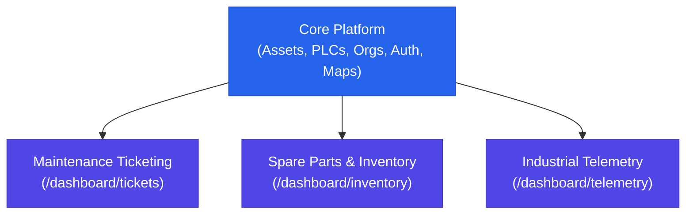

# Heimdall Modular Feature Architecture & Decoupling Specifications

## 1. Overview & Architectural Principles

Heimdall employs a **modular feature architecture** designed around strict unidirectional dependencies. The platform is architected to operate in varying industrial deployment footprints—ranging from full-scale plant monoliths down to lean edge gateways or specialized dispatch terminals.

### Core Tenet: Inward Dependency Rule
All addon modules depend strictly on the **Core Platform**. No addon module directly imports or requires another addon module, and the Core Platform contains zero dependencies on any addon.



---

## 2. Module Manifests & Contracts

Each module is governed by a manifest specification (`PlatformModuleManifest`) detailing its identity, version, managed routes, and API prefixes:

| Module ID | Module Name | Type | Managed UI Routes | Managed API Endpoints | Default State |
| :--- | :--- | :--- | :--- | :--- | :--- |
| `core` | Core Platform | Foundation | `/dashboard`, `/dashboard/machines`, `/dashboard/machine-groups`, `/dashboard/clients`, `/dashboard/map`, `/dashboard/users`, `/dashboard/organizations`, `/dashboard/security-groups`, `/dashboard/admin/system-settings`, `/dashboard/settings` | `/api/machines`, `/api/users`, `/api/organizations`, `/api/auth` | **Always Active** |
| `ticketing` | Maintenance Ticketing | Addon | `/dashboard/tickets`, `/dashboard/delegations` | `/api/tickets`, `/api/delegations` | Enabled |
| `inventory` | Inventory & Spare Parts | Addon | `/dashboard/inventory` | `/api/inventory`, `/api/parts` | Enabled |
| `telemetry` | Industrial Telemetry | Addon | `/dashboard/telemetry`, `/dashboard/analytics` | `/api/telemetry`, `/api/kpi` | Enabled |

---

## 3. Minimal Mode Deployment Profiles

Heimdall can be tailored to constrained environments or specific shopfloor roles:

1. **Standard Full Monolith**:
   - `enableTicketing: true`, `enableInventory: true`, `enableTelemetry: true`
   - Complete unified plant suite.

2. **Telemetry + Ticketing (Lean No-Inventory)**:
   - `enableTicketing: true`, `enableInventory: false`, `enableTelemetry: true`
   - Targeted for automated facilities where spare parts are managed exclusively by external ERP (e.g. SAP PM).

3. **Maintenance Dispatch Terminal**:
   - `enableTicketing: true`, `enableInventory: false`, `enableTelemetry: false`
   - Lightweight kiosk display for shopfloor work order tracking and technician dispatch.

4. **Industrial Edge Telemetry Appliance**:
   - `enableTicketing: false`, `enableInventory: false`, `enableTelemetry: true`
   - Edge server performing real-time signal processing, metric trend detection, and recipe tool wear forecasting.

5. **Strict Lean Core**:
   - `enableTicketing: false`, `enableInventory: false`, `enableTelemetry: false`
   - Minimal device registry and plant network map gateway.

---

## 4. Multi-Layer Gating & Enforcement

Module decoupling is enforced across three distinct architectural layers:

### A. Navigation Layer (`AppSidebar.vue`, `menus.ts`)
Navigation items and navigation groups declare their `requiredModule`. The sidebar computed property `visibleNavMenu` dynamically removes items whose module is disabled. Empty navigation groups are omitted automatically.

### B. Client Routing Layer (`moduleGating.global.ts`)
A global Nuxt route middleware intercepts route transitions. Navigating directly (e.g. via URL bookmark) to a route belonging to a disabled module safely redirects the user to `/dashboard?module_disabled=<module>` rather than triggering runtime render errors.

### C. Server / BFF API Layer (`02.moduleGating.ts`, `featureFlags.ts`)
Nitro server middleware intercepts all `/api/*` traffic:
- Incoming calls to disabled module endpoints immediately return `503 Service Unavailable` with a descriptive payload:
  ```json
  {
    "statusCode": 503,
    "statusMessage": "Service Unavailable: Module 'ticketing' is currently disabled on this instance."
  }
  ```

---

## 5. Configuration & Governance

### Environment Variables
Heimdall supports multiple mechanisms for configuring and toggling modules via environment variables:

1. **Individual Module Flags** (supports truthy `true`, `1`, `yes`, `on`, `enabled` and falsy `false`, `0`, `no`, `off`, `disabled`):
   - `HEIMDALL_MODULE_TICKETING` / `HEIMDALL_ENABLE_TICKETING` / `ENABLE_TICKETING`: Toggle Maintenance Ticketing.
   - `HEIMDALL_MODULE_INVENTORY` / `HEIMDALL_ENABLE_INVENTORY` / `ENABLE_INVENTORY`: Toggle Inventory & Spare Parts.
   - `HEIMDALL_MODULE_TELEMETRY` / `HEIMDALL_ENABLE_TELEMETRY` / `ENABLE_TELEMETRY`: Toggle Industrial Telemetry.

2. **Deployment Profile Presets** (`HEIMDALL_MODULE_PRESET` or `HEIMDALL_PRESET`):
   - `all` / `full` / `monolith`: Standard Full Monolith (all modules active).
   - `telemetry-ticketing`: Telemetry + Ticketing active (Inventory disabled).
   - `ticketing-only` / `dispatch`: Maintenance Ticketing only.
   - `telemetry-only` / `edge`: Industrial Telemetry only.
   - `core-only` / `lean` / `minimal`: Core Platform only (all addon modules disabled).

3. **Inclusion and Exclusion Lists**:
   - `HEIMDALL_MODULES` / `HEIMDALL_ENABLED_MODULES`: Comma-separated list of enabled modules (e.g. `core,ticketing`). Unlisted modules are disabled.
   - `HEIMDALL_DISABLED_MODULES` / `HEIMDALL_DISABLE_MODULES`: Comma-separated list of disabled modules (e.g. `inventory,telemetry`).

*Note: Explicit individual module flags always take highest precedence over presets and lists.*

### Runtime Governance UI
System Administrators can inspect and toggle modules dynamically in `/dashboard/admin/system-settings` under **Modular Feature Governance**. Preconfigured presets allow one-click alignment to target shopfloor deployment profiles.
