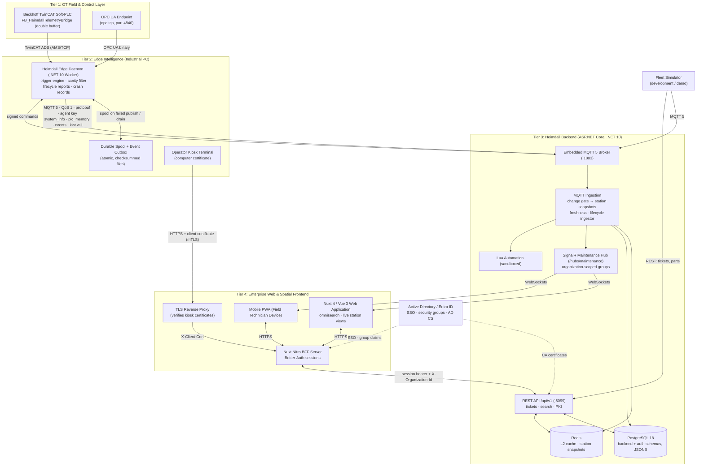
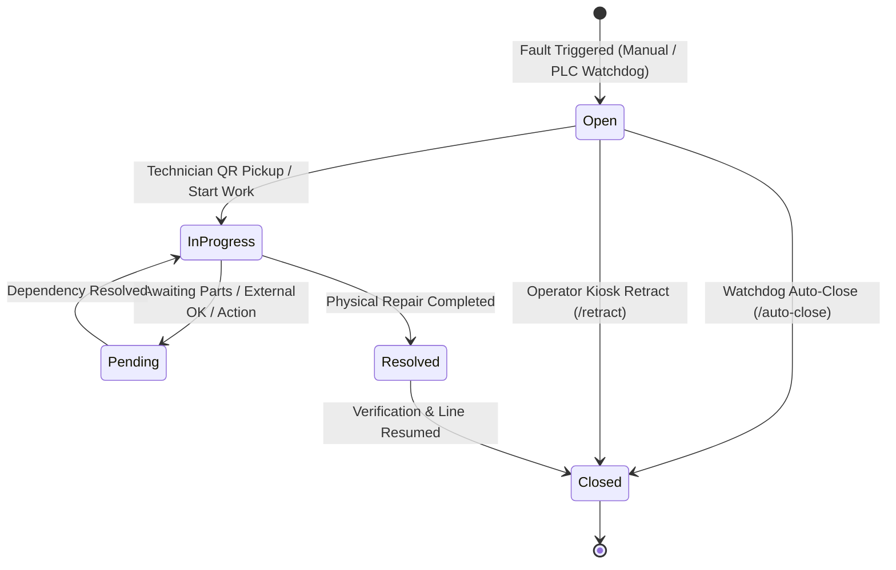

# Bachelor's Thesis Research Notes & Technical Foundations

> **Document Type:** Academic Research Notes, Architecture Specification & Literature Compendium  
> **Project:** Heimdall Industrial OT/IT Platform  
> **Target Degree:** Bachelor of Science (BSc) Thesis in Computer Science / Electrical & Software Engineering  
> **Institution:** University of Pécs, Faculty of Engineering and Information Technology (PTE MIK)  
> **Author:** Heimdall Project Core Engineering  
> **Status:** Active Reference & Academic Outline

---

## Abstract

Modern industrial manufacturing environments increasingly demand real-time visibility, automated telemetry acquisition, and synchronized maintenance orchestration across complex, heterogeneous cyber-physical systems (CPS). Historically, operational technology (OT) and information technology (IT) have operated within strictly partitioned silos defined by the traditional Purdue Enterprise Reference Architecture (ISA-95). Legacy supervisory control and data acquisition (SCADA) and manufacturing execution systems (MES) struggle to integrate high-frequency machine telemetry with flexible web-based user interfaces and predictive maintenance pipelines.

This research document details the architectural foundation, engineering principles, and implementation strategies of **Heimdall**: a unified edge-to-cloud telemetry, asset management, and reactive incident orchestration platform. The system bridges OT field devices (Beckhoff TwinCAT Soft-PLCs, Siemens S7, KUKA industrial robotics, and OPC UA endpoints) with modern IT services: all of them are tracked as assets, and live process data arrives as TwinCAT ADS-style PLC memory blocks published by edge agents or, in development and demonstrations, by a fleet simulator. Key contributions explored herein include:
1. A cross-platform .NET 10 Edge Daemon that publishes protobuf messages over MQTT 5 to a broker embedded in the backend, with a durable store-and-forward spool (atomic, checksummed records), lifecycle reports backed by an MQTT last will, crash records, and signature-verified remote commands.
2. An event-driven ASP.NET Core backend featuring an embedded MQTT 5 broker, a change gate that drops unchanged PLC memory blocks, per-station telemetry freshness, PostgreSQL 18 JSONB persistence with dual-schema security isolation, multi-tier Redis/Memory caching, real-time SignalR state broadcasting, sandboxed Lua scripting, and a PKI for AD-issued and Heimdall-issued certificates.
3. A responsive Nuxt 4 / Vue 3 web interface utilizing a Nitro Backend-for-Frontend (BFF) with Better-Auth sessions and organizations, server-side tag-context omnisearch with FZF-style client-side ranking as fallback, batched live station updates, and optimistic UI updates backed by automatic rollback.
4. An automated incident lifecycle engine supporting QR action pickup (ISO/IEC 18004 codes rendered as SVG) with reaction-time capture, machine-driven watchdog auto-closure (`/auto-close`), and kiosk retraction (`/retract`).

---

## Table of Contents

1. [Background & Industrial Context](#1-background--industrial-context)
   - 1.1 [Industry 4.0 & Cyber-Physical Systems (CPS)](#11-industry-40--cyber-physical-systems-cps)
   - 1.2 [The Purdue Model (ISA-95) & The Unified Namespace (UNS)](#12-the-purdue-model-isa-95--the-unified-namespace-uns)
   - 1.3 [The IT/OT Convergence Imperative](#13-the-itot-convergence-imperative)
2. [Problem Statement & Industrial Challenges](#2-problem-statement--industrial-challenges)
   - 2.1 [Fieldbus & Protocol Heterogeneity](#21-fieldbus--protocol-heterogeneity)
   - 2.2 [Network Unreliability, Jitter & Air-Gapped Topologies](#22-network-unreliability-jitter--air-gapped-topologies)
   - 2.3 [High-Frequency Sampling vs. Ingestion Bottlenecks](#23-high-frequency-sampling-vs-ingestion-bottlenecks)
   - 2.4 [Disjointed Maintenance & Incident Workflows](#24-disjointed-maintenance--incident-workflows)
   - 2.5 [Industrial Cybersecurity & Compliance (TISAX, IEC 62443)](#25-industrial-cybersecurity--compliance-tisax-iec-62443)
3. [Heimdall Architectural Design](#3-heimdall-architectural-design)
   - 3.1 [Distributed Multi-Tier Topology](#31-distributed-multi-tier-topology)
   - 3.2 [Edge Daemon Subsystem (.NET 10 Worker)](#32-edge-daemon-subsystem-net-10-worker)
   - 3.3 [Backend Ingestion & MQTT Ingestion Engine](#33-backend-ingestion--mqtt-ingestion-engine)
   - 3.4 [Data Modeling: Graph-Relational M:N Topology & Dual-Schema Isolation](#34-data-modeling-graph-relational-mn-topology--dual-schema-isolation)
   - 3.5 [Web Frontend & Nitro BFF Architecture](#35-web-frontend--nitro-bff-architecture)
   - 3.6 [Tag-Context Omnisearch Engine](#36-tag-context-omnisearch-engine)
   - 3.7 [Reactive Maintenance & Incident State Machine](#37-reactive-maintenance--incident-state-machine)
4. [Critical Analysis & Engineering Evaluation](#4-critical-analysis--engineering-evaluation)
   - 4.1 [Anti-Patterns Identified and Refactored](#41-anti-patterns-identified-and-refactored)
   - 4.2 [Store-and-Forward vs. Real-Time Streaming Trade-offs](#42-store-and-forward-vs-real-time-streaming-trade-offs)
   - 4.3 [Optimistic UI Verification & Rollback Guarantees](#43-optimistic-ui-verification--rollback-guarantees)
   - 4.4 [Known Limitations of the Current Implementation](#44-known-limitations-of-the-current-implementation)
5. [Academic & Industry References](#5-academic--industry-references)

---

## 1. Background & Industrial Context

### 1.1 Industry 4.0 & Cyber-Physical Systems (CPS)
The Fourth Industrial Revolution (Industry 4.0) represents the convergence of digital computing, cloud infrastructure, and operational machinery into smart, autonomous Cyber-Physical Systems (CPS). In a modern smart factory, physical production equipment—such as multi-axis CNC milling centers, robotic welding cells, and automated optical inspection (AOI) lines—is no longer isolated. Instead, machines continuously generate multidimensional time-series data reflecting operating temperatures, harmonic vibration envelopes, pneumatic and hydraulic pressures, and cycle execution times.

Transforming this raw telemetry into actionable intelligence enables:
- **Condition-Based Monitoring (CBM):** Real-time tracking of asset operating parameters against safe operating envelopes.
- **Predictive Maintenance (PdM):** Algorithmic identification of mechanical and electrical wear before catastrophic failure occurs, mitigating unplanned downtime.
- **Overall Equipment Effectiveness (OEE) Optimization:** Continuous mathematical derivation of Availability, Performance, and Quality KPIs across plant cells.

### 1.2 The Purdue Model (ISA-95) & The Unified Namespace (UNS)
Historically, industrial automation was structured according to the **Purdue Enterprise Reference Architecture (PERA)**, standardized under ANSI/ISA-95 (IEC 62264):

```
┌─────────────────────────────────────────────────────────────────────────┐
│ Level 4: Enterprise Resource Planning (ERP, SAP, Business Logistics)    │
├─────────────────────────────────────────────────────────────────────────┤
│ Level 3: Manufacturing Operations Management (MES, Scheduling, Quality) │
├─────────────────────────────────────────────────────────────────────────┤
│ Level 2: Supervisory Control & Data Acquisition (SCADA, HMI, Alarms)    │
├─────────────────────────────────────────────────────────────────────────┤
│ Level 1: Basic Control (Programmable Logic Controllers - PLCs, IPCs)    │
├─────────────────────────────────────────────────────────────────────────┤
│ Level 0: Physical Process (Sensors, Actuators, Motors, Toolholders)     │
└─────────────────────────────────────────────────────────────────────────┘
```

While the Purdue Model established strict security zoning and deterministic traffic isolation, it created severe data friction:
1. **Hierarchical Point-to-Point Coupling:** Telemetry generated at Level 0/1 had to be manually translated through Level 2 SCADA, aggregated into Level 3 MES, and batch-loaded into Level 4 ERP.
2. **Loss of High-Fidelity Signal:** Lower-level drivers often downsampled or discarded critical high-frequency transient anomalies (e.g. 10 kHz vibration bursts or micro-stoppages) to accommodate legacy polling cycles.
3. **Emergence of the Unified Namespace (UNS):** Modern industrial architectures advocate for an event-driven, decoupled ecosystem where edge devices publish semantically structured data directly into a shared broker or ingestion engine, democratizing access across all organizational tiers. Heimdall adopts the publish side of this pattern: agents publish to the MQTT topic hierarchy `heimdall/devices/{machine_identifier}/{channel}` on a broker embedded in the backend. In the current system the backend's ingestion service is the only consumer of these topics, so the broker is a device-to-platform channel rather than a plant-wide UNS.

### 1.3 The IT/OT Convergence Imperative
Operational Technology (OT) prioritizes **availability, determinism, and physical safety**, traditionally operating under 24/7/365 lifecycles where software updates are rare and downtime is unacceptable. Conversely, Information Technology (IT) prioritizes **confidentiality, agility, rapid iteration, and horizontal scalability**. 

Bridging this gap requires platforms that respect OT constraints (zero interference with PLC real-time scan cycles, strict bandwidth management, read-only fieldbus taps) while delivering IT capabilities (rich web dashboards, automated notifications, cryptographic access control, and containerized deployment).

---

## 2. Problem Statement & Industrial Challenges

### 2.1 Fieldbus & Protocol Heterogeneity
Manufacturing shop floors contain a heterogeneous mixture of vendors, legacy revisions, and proprietary protocols:
- **Beckhoff TwinCAT (ADS):** Communicates via AMS Net ID routing and TwinCAT ADS (Automation Device Specification) over TCP/IP, accessing symbolic variables in soft-PLC memory.
- **Siemens SIMATIC S7:** Relies on ISO-on-TCP (RFC 1006) and PROFINET, requiring DB block offsets or S7-comm handshakes.
- **OPC Unified Architecture (OPC UA):** An open standard (IEC 62541) offering platform-independent, object-oriented information modeling, but often incurring significant memory and configuration overhead on resource-constrained embedded controllers.
- **Modbus TCP:** A simple, ubiquitous industrial protocol lacking native metadata, requiring explicit register mapping (holding registers, input registers, coils).
- **Industrial Robotics (KUKA, ABB, Fanuc):** Uses specialized Cartesian and joint telemetry packages, frequently lacking standardized REST or gRPC APIs.

Without a unified abstraction layer, platform maintainers must write bespoke integration code for every workstation on the factory floor.

### 2.2 Network Unreliability, Jitter & Air-Gapped Topologies
Industrial factory environments present hostile network conditions:
- **Electromagnetic Interference (EMI):** High-power arc welding, frequency inverters, and heavy motor drives generate electrical noise that degrades Wi-Fi and industrial Ethernet runs.
- **Air-Gapped Subnets:** OT networks are frequently partitioned across isolated Virtual LANs (VLANs) with restrictive egress routing.
- **Downtime and Failures:** Telemetry collector nodes may experience transient network disconnects during machine reconfiguration or switch reboots. If edge devices fail to spool telemetry locally, critical fault data generated immediately prior to a line stoppage is permanently lost.

### 2.3 High-Frequency Sampling vs. Ingestion Bottlenecks
A production plant with 100 machines and 50 data points per machine, sampled at 100 Hz, generates:
$$\text{Throughput} = 100 \times 50 \times 100 = 500,000 \text{ samples/second}$$
Transmitting and storing half a million raw records per second into a conventional relational database creates immediate CPU, network, and I/O bottlenecks. 
An industrial edge telemetry system must perform **in-situ edge filtering**, computing:
- Deadband evaluation (only reporting when values deviate by more than $\Delta$).
- Cryptographic or fast content hashing (e.g. SHA-256 or `xxHash64`) to suppress transmission or reprocessing of static process state values while preserving heartbeat liveness.

### 2.4 Disjointed Maintenance & Incident Workflows
When a machine faults on the factory floor, existing enterprise ticketing platforms (e.g. Jira, SAP PM) suffer from critical operational disconnects:
1. **Lack of Instant Machine State:** Tickets are filed manually with vague descriptions ("Line 2 stopped"), lacking the exact function block error code, PLC state, and sensor telemetry snapshot captured at the millisecond of failure.
2. **No Reaction Time Traceability:** Without physical kiosk scanning or action QR codes, management cannot accurately measure the delta between when an alarm fired and when a technician arrived on site ($\Delta t_{\text{reaction}}$).
3. **Manual Overhead for Self-Clearing Faults:** Transient errors (e.g. safety light curtain momentarily interrupted) that clear themselves often leave orphaned "Open" tickets, cluttering the Kanban board and degrading data integrity.

### 2.5 Industrial Cybersecurity & Compliance (TISAX, IEC 62443)
Automotive and mission-critical manufacturing mandates strict cybersecurity compliance under **TISAX (Trusted Information Security Assessment Exchange / VDA ISA 6.0 Level 3)** and **IEC 62443**:
- **Field-Level Encryption:** Sensitive process recipes and diagnostic logs must be encrypted at rest using AES-256-GCM.
- **Command Authenticity:** Any remote control command dispatched to an industrial PC (e.g., triggering a diagnostic snapshot, rebooting a runtime service) must carry an asymmetric cryptographic signature (ECDSA/RSA) verifiable by the edge daemon.
- **PII Scrubbing:** Diagnostic snapshots must actively sanitize process argument strings, user directories, and sensitive system artifacts to prevent GDPR violations.

---

## 3. Heimdall Architectural Design

### 3.1 Distributed Multi-Tier Topology

Agents on the industrial PCs publish protobuf messages over **MQTT 5** to a broker embedded in the backend; browsers reach the backend through the Nuxt BFF and receive live updates from the SignalR hub. There is no gRPC and no transport-level mTLS on the telemetry path: mutual TLS is used only between kiosk terminals and the TLS-terminating reverse proxy, and certificates otherwise identify users, computers and plugin signers (section 3.3).



*The Tier 1 edges show the agent's protocol endpoints. In the current implementation they are protocol-level simulations (an in-process ADS server and a minimal OPC UA client, see 3.2); plant-scale data in development and demonstrations comes from the fleet simulator, which publishes `system_info` and `plc_memory` over MQTT like an agent (without lifecycle reports).*

### 3.2 Edge Daemon Subsystem (.NET 10 Worker)
The edge daemon (`App.Agent.Daemon`) is engineered as a lightweight, cross-platform background worker, published as self-contained single-file executables for `linux-x64` and `win-x64` and run as a systemd unit or a Windows service. It references only `App.Contracts` (protobuf messages, MQTT topic names, certificate and plugin-signature helpers), preserving total architectural decoupling from backend database entities.

Key edge mechanisms include:
- **Lock-Free Atomic Double-Buffering:** In TwinCAT environments, `FB_HeimdallTelemetryBridge.TcPOU` (PLC-side reference implementation in `docs/plc`) exposes a double-buffered shared memory struct with a sequence counter, preventing race conditions between the hard real-time PLC task (e.g. a 1 ms scan) and the non-deterministic OS daemon.
- **Protocol Endpoints:** The daemon speaks TwinCAT ADS (AMS/TCP framing, with an in-process ADS simulation server on port 48898 that starts only with development features enabled) and contains a minimal OPC UA binary client (port 4840) that performs the HEL/ACK handshake and falls back to simulated values when no server answers. Modbus TCP support is limited to register decoding helpers (word and byte order, contiguous register batching); no vendor ADS client, Siemens S7 or robot driver is integrated. PLC memory is published as typed `AdsPlcMemoryBlock` messages (raw bytes plus a structured value), currently only in that development mode, where it is read from the simulation server.
- **MQTT 5 Transport:** Reports are serialized as protobuf and published with QoS 1 (`MqttAgentClient`, MQTTnet) to `heimdall/devices/{machine_identifier}/{system_info|plc_memory|events}` on the backend's embedded broker (port 1883). The daemon authenticates with the shared agent key (MQTT credentials `heimdall_agent` / agent key, and the MQTT 5 user property `x-agent-key` on every publish, the last will included) and subscribes to its own `commands` topic.
- **Trigger-Based Reporting & Sanity Checks:** Every 10 s (±10 % jitter, after a random start-up spread of up to 3 s) a trigger engine decides whether to report: a 60 s heartbeat, threshold breaches (OS drive at or below 15 GB / 5 GB free, PLC temperature at or above 75 °C), TwinCAT run-state changes, and on-demand requests. Heartbeats omit the unchanged hardware and software inventory slices. A client-side sanity filter rejects reports without a usable identity, corrects implausible timestamps and percentages, and bounds the payload size before anything is published or spooled.
- **Deadband & Delta Memory Evaluator:** A recipe runtime is implemented and unit-tested inside the daemon: a multi-recipe merger deduplicates probes and keeps the strictest interval, `DeadbandEvaluator` applies absolute or percentage deadbands, hashes structured values with `xxHash64` and forces a heartbeat after `maxQuietPeriodMs`, and `PriorityBandwidthThrottler` batches four priority tiers with gzip compression for batches of 256 bytes or more. These classes are not yet registered in the daemon's host; in the running system, unchanged PLC blocks are filtered by the backend's change gate instead (section 3.3).
- **Durable Store-and-Forward Spool:** When a system-info report cannot be published, the daemon writes it to a local spool. Instead of the SQLite WAL database of the original design, the implemented spool (`DurableRecordQueue`) is a directory with one file per record: each record is written to a temporary file, flushed to disk and atomically renamed, inside a SHA-256 checksum envelope, and a disk quota (`MaxSpoolDiskMb`, default 500 MB) evicts the oldest records first. After the next report that gets through (reports are attempted at least once per 60 s heartbeat), a single-flight drain replays the spool oldest-first; a record torn by a power loss or BSOD is moved to `corrupt/` and skipped, and a record whose consumer fails three times is set aside as poison. Lifecycle events use a second durable queue (the event outbox). PLC memory blocks are not spooled, and spool files are not yet encrypted.
- **Lifecycle, Crash & Identity Resilience:** `AgentLifecycleService` reports `started` (classifying how the previous run ended: orderly OS shutdown, service stop, agent crash, killed process, or unexpected shutdown such as a power loss or an OS crash), `online` after reconnects and `stopping` on the `events` topic, and registers a `connection_lost` report as the MQTT last will, which the broker publishes when the daemon disappears without a goodbye. `CrashRecorder` writes a durable record of unhandled exceptions, and repeated abnormal ends delay the collectors by a back-off of up to 5 minutes. The machine identifier (MQTT topic segment and controller key) is resolved once from the SMBIOS UUID, Windows `MachineGuid` or Linux `machine-id`, persisted, and placeholder UUIDs shared by many boards and virtual machines are rejected. Configuration, identity and spool files are written atomically with checksums, and every recovered defect is reported to the server.
- **Cryptographic Command Validation:** Commands are queued in the backend and delivered on the device's MQTT `commands` topic when its next `system_info` report arrives. Each `ServerCommand` carries an RSA-SHA256 (PKCS#1 v1.5) signature that the daemon verifies against its configured server public key before execution, preventing unauthorized control actions; a command is rejected when no key is configured (fail-secure) unless unsigned commands are explicitly allowed for development. Outside development mode, plugins additionally need two signatures, the installing user's and the server's countersignature, both chaining to the daemon's trusted CA bundle.

### 3.3 Backend Ingestion & MQTT Ingestion Engine
The central backend (`App.Backend.Api`) is built upon ASP.NET Core (.NET 10 / C# 14) and serves the REST API (`/api/v1`) and the SignalR hub on port 5099:
- **Embedded MQTT 5 Broker:** An MQTTnet broker runs inside the backend process on TCP port 1883 and, when an agent key is configured, checks it when a client connects. `MqttIngestionHostedService` connects to it as a client, subscribes at QoS 1 to `heimdall/devices/+/system_info`, `plc_memory`, `telemetry` and `events`, parses each protobuf payload in its own dependency-injection scope and passes it to the ingestion service; payloads that cannot be parsed are quarantined in `malformed_telemetry_quarantine`.
- **Design Evolution (gRPC to MQTT):** The first implementation ingested over gRPC (`SystemInfoCollectorService`, HTTP/2 with mTLS, ports 5001/5099). In September 2026 the gRPC host was replaced by the embedded broker, the monolithic collector was split into the transport-independent `TelemetryIngestionService`, and the `.proto` files were kept as pure message contracts (`GrpcServices="None"`). The final design relies on four MQTT 5 properties: (1) the **last will**, which the broker publishes when an agent's connection is lost, giving an OFFLINE signal without polling; (2) the **topic hierarchy** with wildcard subscriptions, so one subscription covers every device while commands travel back on each device's own topic over the agent's outbound connection; (3) **QoS 1 acknowledgements**, from which the agent decides whether a report must be spooled; (4) **user properties**, which carry the agent key on every publish, the last will included.
- **Telemetry Ingestion Service (`ITelemetryIngestionService`):** Validates the agent key, upserts the controller and its inventory from `system_info` reports, stores agent events and lifecycle reports (`AgentLifecycleIngestor`, deduplicated by event id), and returns queued commands on the device's `commands` topic. PLC memory blocks pass a **change gate** (`PlcMemoryChangeGate`): a SHA-256 hash of the block without its timestamp is compared with the last forwarded state held in the two-level cache, and an unchanged block is dropped unless the 10 s keep-alive is due, so it causes no database write and no broadcast. Forwarded blocks become station snapshots (`StationTelemetryExtractor`, cached in memory and Redis), are broadcast as `StationTelemetryReceived` / `StationOscillationReceived` to the owning organization's SignalR group (plus `platform-admins`), and feed Lua `TelemetryChange` scripts; controller metadata is persisted at most every 30 s unless the block descriptor changes. Batches on the `telemetry` topic are acknowledged but not yet decoded. Statistical anomaly detection (Z-scores; warning above |z| = 2.5, critical above 3.0) runs at query time on trend series in `PredictiveMaintenanceService`, not during ingestion.
- **Per-Station Freshness (`StationFreshness.cs`):** Every arriving PLC block counts as a sample, including blocks the change gate drops. Each station's sample interval $T_{\text{sample}}$ is learned as the median of its last 15 gaps, and the station turns `STALE` after three missed samples, $t_{\text{stale}} = \text{clamp}(3\,T_{\text{sample}},\ 3\,\text{s},\ 5\,\text{min})$, or after 60 s while no interval is known. A station is `OFFLINE` when every bound controller's agent has sent its last will or stopped gracefully and no data arrived since. With 4 s sampling the threshold is about 12 s at no extra traffic; a 5 s threshold would need sampling every 1.7 s or faster, about 2.4 times the MQTT and SignalR traffic (`docs/TODO/TODO.md`).
- **Sandboxed Lua Scripting:** MoonSharp scripts (`backend.lua_scripts`) react to `TelemetryChange` events, compute KPIs (a "New KPI" wizard offers OEE, availability, scrap rate, MTBF and cycle-time deviation) and contribute UI extensions (action buttons, badges, banner alerts); `LuaSandboxGuard` enforces instruction deadlines, cancellation, allocation budgets and a re-entrancy depth limit.
- **PKI Service:** One trust store (`trusted_ca_certificates`) holds AD-issued and Heimdall-issued CA certificates. The Heimdall CA is self-signed or subordinate to an enterprise / AD CA (CSR flow); user certificates map to Better-Auth users by UPN or e-mail, computer certificates to controllers by machine URI, host name or thumbprint. Plugins are signed by the installing user and countersigned by the server, and kiosk terminals authenticate with computer certificates at the TLS-terminating reverse proxy, the only place where mutual TLS is used.
- **Multi-Tier Caching Architecture:**
  - *L1 Memory Cache (`IMemoryCache`):* In-process caching for hot metadata, authorization claims, and configuration flags (<1 ms latency).
  - *L2 Distributed Cache (`StackExchange.Redis`):* Centralized Redis instance caching inventory trees, machine status summaries, active ticket metrics, station telemetry snapshots and the change-gate state; when Redis is unreachable, the service falls back to L1. Pattern-based invalidation (`inventory:*`, `tickets:*`) currently clears only the in-process tier, because no Redis connection multiplexer is registered (an open item in `docs/TODO/TODO.md`).

### 3.4 Data Modeling: Graph-Relational M:N Topology & Dual-Schema Isolation
Industrial assembly lines do not map cleanly to rigid 1:1 hierarchical trees. In real-world automation:
- A single complex production station (e.g. Battery Module Pack EOL) may be orchestrated by **multiple controlling IPCs and Soft-PLCs**.
- Conversely, a high-performance industrial server running virtualized Soft-PLCs may control **multiple adjacent workstations**.

Heimdall models this as a **Graph-Relational Many-to-Many (M:N) Topology**:
- `Machine` (Production Station) represents the physical kinematic station on the plant CAD layout.
- `ClientPc` represents the physical or virtual computing node executing the OS and soft-PLC runtimes.
- An explicit relational join entity (`StationController`, table `StationControllers`) records the control role (e.g. `Primary`, `Secondary`, `Gateway`, `Safety`) with JSONB metadata, while a separate `EquipmentInterconnect` entity models the bus between two pieces of equipment (`EtherCAT`, `PROFINET`, `OPC UA`, `Modbus TCP`, ...).

**Database Schema Isolation (PostgreSQL 18):**
- Schema `auth`: Dedicated tables managed by Better-Auth through Drizzle migrations (`user`, `session`, `account`, `verification`, `organization`, `member`, `invitation`); its organizations are the tenants.
- Schema `backend`: Enterprise domain entities managed by EF Core migrations (`inventory_items` with table-per-type children such as `stations`, plus `client_pcs`, `StationControllers`, `maintenance_tickets`, `agent_events`, `queued_agent_commands`, `trusted_ca_certificates`). Tenant isolation is enforced here: EF Core global query filters on `organization_id` and the per-request `TenantScopeMiddleware`.
- Semi-structured payloads (inventory and station metadata, controller `system_metadata` including the last PLC block descriptor and the agent lifecycle state) leverage native PostgreSQL `JSONB` columns with GIN indexes. Live station snapshots are held in the cache (memory + Redis), not in PostgreSQL, and there is no time-series store yet.

### 3.5 Web Frontend & Nitro BFF Architecture
The web layer (`src/frontend/web`) utilizes Nuxt 4 (with compatibility version 4 and descriptive CS file routing) and Vue 3:
- **Nitro BFF Proxy:** Browser REST traffic goes to the Nitro BFF (dedicated `/api/*` routes and the generic `/api/proxy/*` pass-through to `/api/v1/*`), which forwards the Better-Auth session token as a bearer token (validated by the backend) and derives the tenant organization header (`X-Organization-Id`) from that session only (a client-supplied header is never forwarded) before proxying to the internal .NET API.
- **Better-Auth Identity:** Sessions, organizations (tenants), SSO (Entra ID, GitHub, Google) and TOTP multi-factor authentication with a role-based re-authentication policy; directory security-group claims map users to organizations and roles.
- **Live Updates:** The browser connects directly to the backend's SignalR hub (`/hubs/maintenance`) over WebSockets, and the server places each connection in its organization's group. Station events are merged per station and committed at most every 250 ms (`useStationTelemetry.ts`); before this change every hub message replaced the whole station-KPI map, which re-rendered all station cards about 60 times a second with 100 simulated stations (`CHANGELOG.md`).
- **Shadcn Vue & Tailwind CSS v4:** Accessible, dark-mode-first component system with full keyboard navigation and high visual contrast for factory floor displays.
- **Offline Progressive Web App (PWA):** Utilizes service workers and local storage to allow mobile technicians to view cached tickets and spare parts and to draft tickets offline in air-gapped factory areas; the drafts are synchronized when the connection returns.
- **Operator Kiosk Terminals:** A compact, always-on-top overlay (`?overlay=1`) on the machine HMI. In production, the TLS-terminating reverse proxy verifies the workstation's computer certificate and passes it to the BFF (`X-Client-Cert`), which asks the backend PKI (`POST /api/v1/pki/workstation-identity`) for the mapped controller; the terminal then serves only the stations bound to that controller.

### 3.6 Tag-Context Omnisearch Engine
To enable rapid navigation across tens of thousands of factory assets, the platform combines a server-side, tenant-scoped search (`GET /api/v1/search`, `GlobalSearchService`: PostgreSQL `ILIKE`, with `pg_trgm` word similarity for typos where the extension is installed; proxied by the BFF as `/api/search`) with a specialized tag-context search engine in the browser (`useHeimdallSearch`, `AutoTagEngine`), whose client-side ranking is the fallback:
- **Engine Choice:** PostgreSQL was kept over OpenSearch, Meilisearch and Typesense after a measured evaluation (`docs/TODO/search.TODO.md`): on the development data set, one global search over all five entity kinds took 4.3 ms (2.9 ms with prepared statements) without any additional runtime.
- **FZF-Inspired Fuzzy Scoring:** Client-side, Damerau-Levenshtein edit distance is combined with substring matching and fzf-style bonuses for word boundaries, camel case and consecutive matches, with gap penalties (`fuzzy.ts`, `fzfSearch.ts`).
- **Prefix Scoping Tokens:**
  - `@station` / `@machine`: Restricts query space to machines and stations (`[MCH]`).
  - `#ticket`: Restricts query space to maintenance tickets (`[TKT]`).
  - `!controller` / `!ipc`: Restricts query space to edge controllers and IPCs (`[IPC]`).
  - `*part` / `*inventory`: Restricts query space to inventory spare parts (`[PART]`).
  - `%alarm`: Restricts query space to units currently in fault, warning, or line-stop condition.
- **Auto-Tag Tokenizer:** Automatically detects known industrial entities (e.g. manufacturer names "Beckhoff", technology categories "Robotics", part categories "Servo") as the user types, converting them into interactive filter pills.
- **Cross-Domain Ranking:** Global search lists stations, controllers, tickets and people before inventory. Page-scoped searches rank the active page's entity first, while matches from the page's secondary indexing tables appear in a distinct, secondary result tier.

### 3.7 Reactive Maintenance & Incident State Machine
The maintenance subsystem implements a canonical 5-state lifecycle:



- **Machine-Raised Tickets (`/api/v1/tickets/machine-raised`):** A machine-side client opens a ticket for a fault condition; the assignee is resolved from the delegation rules.
- **Action QR Pickup:** Each ticket carries a QR code with the pickup intent (`heimdall://ticket/{id}/pickup`), and printable action codes for the `/mobile/action` landing page encode further intents such as `report-incident` or `check-in`. The codes follow ISO/IEC 18004 and are rendered as SVG by the `qrcode` encoder, which replaced an earlier zero-dependency in-house encoder (Galois Field GF(256) Reed-Solomon arithmetic) so that phone cameras and handheld scanners decode them reliably (standard error correction, alignment patterns, format bits and quiet zone). When a technician scans the code, the pickup (`/api/v1/tickets/{id}/qr-pickup`) transitions the ticket to `InProgress`, sets the assigned technician, and computes the exact reaction time ($\Delta t = t_{\text{scan}} - t_{\text{created}}$, stored as `ReactionTimeMinutes`).
- **PLC Auto-Closure (`/api/v1/tickets/{id}/auto-close`):** When a machine-side watchdog detects that a fault condition (e.g. thermal overload, pressure drop) has normalized, it invokes the auto-close endpoint; in the current system the fleet simulator plays this role, both for transient alarms that clear before pickup and for the final close after verification. The ticket transitions to `Closed`, an open line stop is ended with its duration recorded, and `StatusChanged` / `TicketUpdated` are broadcast via SignalR to the owning organization; when the call goes through the BFF, a transition comment and a change-history entry are added as well.
- **Kiosk Retract (`/api/v1/tickets/{id}/retract`):** Operators can immediately retract tickets opened by accident or resolved without technical intervention; the ticket is closed with the retraction reason, and the BFF adds a change-history entry and a comment.
- **Orthogonal Escalation:** Tickets can be escalated (e.g. to Dedicated Shift Engineer or Plant Director) at any lifecycle stage without destroying the underlying Kanban status.

---

## 4. Critical Analysis & Engineering Evaluation

### 4.1 Anti-Patterns Identified and Refactored
During the iterative development of Heimdall, several anti-patterns common in industrial telemetry platforms were identified and resolved:

| Anti-Pattern | Manifestation | Resolution in Heimdall |
| :--- | :--- | :--- |
| **Chatty Database Ingestion** | Inserting every single sensor data point into individual SQL rows in real time. | Backend change gate (SHA-256 content hash, 10 s keep-alive) drops unchanged PLC blocks before any database write or broadcast; controller metadata is persisted at most every 30 s; live station state is kept in cached snapshots (memory + Redis) instead of SQL rows; agents report on triggers and omit unchanged inventory slices. |
| **Direct DB Coupling in Edge Daemon** | Referencing Entity Framework Core directly from edge daemons, leaking database schemas to the factory edge. | Edge daemons reference only `App.Contracts` and exchange protobuf messages with the backend over MQTT 5 (plus two REST calls for crash dumps and recipe-change notices). |
| **Broadcast Notification Purge Bug** | Calling `clearNotifications(userId)` dropped broadcast notifications because `n.userId && n.userId !== userId` was falsy for broadcast items (`userId == null`). | Fixed filtering condition to `n.userId !== userId`, preserving system broadcast alerts across user-scoped clear operations. |
| **Phantom UI State on Server Failure** | Updating UI state optimistically without tracking previous state, leaving the user with false data if the backend rejects the change. | `useMaintenance.updateStatus` captures the previous status and pending fields, restores them when the request fails and rethrows, so the calling view shows an error toast. |
| **Hardcoded Industrial Topology** | Assuming a strict 1:1 relationship between an IPC and a production machine. | Introduced the Graph-Relational M:N schema allowing multi-controller stations and multi-station servers. |
| **Unstable Edge Identity** | Deriving the machine identifier on every start, falling back to `"{MachineName}-{OSVersion}"` when the hardware query failed, and accepting placeholder SMBIOS UUIDs shared by many boards and VMs: a machine reappeared as a new device, or several machines collided on one identity. | The identifier is resolved once and persisted (`state/identity.json`), and placeholder UUIDs are rejected (`MachineIdentity.cs`). |
| **Render Storm on Live Telemetry** | Replacing the whole station-KPI map on every SignalR message re-rendered all station cards about 60 times a second with 100 simulated stations. | Updates are merged per station and committed at most every 250 ms (`useStationTelemetry.ts`). |

### 4.2 Store-and-Forward vs. Real-Time Streaming Trade-offs
A fundamental trade-off in industrial telemetry lies between **instantaneous delivery** and **guaranteed delivery**:
- Pure WebSockets or raw MQTT brokers without persistence risk silent data drops when networks fail during critical line stoppage events. Heimdall's embedded broker is such a broker: clients connect with clean sessions and the broker has no persistent storage.
- Heimdall balances this through a tiered pipeline:
  1. Trigger-based reporting at the edge (60 s heartbeat, threshold and state-change triggers) behind a client-side sanity filter.
  2. MQTT 5 publishes at QoS 1 (at-least-once) over one outbound TCP connection per agent; the broker's acknowledgement tells the agent whether a report arrived.
  3. A durable local spool for system-info reports that could not be published (atomic, checksummed records, oldest-first drain) and a durable outbox for lifecycle events, while the MQTT last will reports agents that vanish without a goodbye.
  4. A server-side change gate that drops unchanged PLC blocks (10 s keep-alive) but still counts their arrival for freshness.
- The delivery guarantee is bounded rather than absolute: records beyond the spool quota (500 MB by default) are evicted oldest-first, records damaged by a power loss are skipped, and PLC memory blocks are not spooled at all, so a network partition loses the PLC samples taken during it. The change gate saves database writes and broadcasts but not network traffic, because unchanged blocks are still transmitted; moving that filter to the edge (the existing `DeadbandEvaluator`) would save the traffic as well.

### 4.3 Optimistic UI Verification & Rollback Guarantees
In manufacturing execution software, operator trust is paramount. If an operator clicks "Reserve Ticket" or "Decommission Machine" and the user interface updates, but an asynchronous network timeout or RBAC rejection occurs silently in the background, the operator may proceed with dangerous physical maintenance under false assumptions.

Heimdall enforces **Verifiable Optimism** for ticket status changes (`useMaintenance.updateStatus`):
1. Visual state mutates immediately to provide instant feedback.
2. The previous state (status, pending reason, pending details) is captured before the request is sent.
3. If the server returns a 4xx/5xx status code or the request fails:
   - The captured state is restored and the ticket metrics are recalculated.
   - The error is rethrown, and the calling view shows an error toast.

An earlier generic helper (`runOptimisticAction`), which also raised a notification for the rolled-back action, was removed in October 2026 when modal overlays and alert pop-ups were replaced by dedicated pages and workbenches; the rollback now lives in the ticket composable, and no audit-log entry is written for it.

### 4.4 Known Limitations of the Current Implementation
The evaluation also records where the implementation stops short of the design (sources: `docs/TODO/TODO.md`, `docs/TODO/telemetry.TODO.md`):
- **Ingestion throughput:** MQTT messages are processed one at a time. With 100 stations sampled every 4 s, the debug backend uses about 75–100 % of one core and falls 20–50 s behind under load; because freshness is measured when a block is processed, such a backlog makes old data look fresh.
- **Live fan-out:** SignalR sends every station event to every dashboard of the organization (about 23 KiB/s and 60 messages/s per dashboard for 100 stations); the browser batches rendering, not bandwidth.
- **Scale-out:** The station arrival map behind freshness lives in one backend process; other instances fall back to the snapshot timestamp and the 60 s rule.
- **Transport security:** The embedded broker listens on plain TCP and all agents share one agent key. The agent can present a client certificate over TLS (`AuthType` `HeimdallCert` / `UserCert`), but the embedded broker exposes no TLS endpoint. Spool files are plaintext (`SpoolEncryptionMode` is not implemented), and the CA trust bundle is not yet distributed to agents automatically.
- **Edge acquisition:** Production PLC drivers (a vendor ADS client, a full OPC UA session and subscription stack, Siemens S7, robot controllers) are not integrated, batches on the `telemetry` topic are acknowledged without being decoded, and there is no time-series store: trends rely on an in-process buffer of 200 samples per station metric.

---

## 5. Academic & Industry References

### 5.1 Standards & Industrial Specifications
1. **ANSI/ISA-95.00.01-2010 (IEC 62264-1):** *Enterprise-Control System Integration – Part 1: Common Object Models and Attributes.* International Society of Automation, 2010.
2. **IEC 62541:2020:** *OPC Unified Architecture (OPC UA) – Part 1 to Part 14: Architecture, Data Access, Alarms and Conditions.* International Electrotechnical Commission, 2020.
3. **IEC 62443-3-3:2018:** *Security for industrial automation and control systems – Part 3-3: System security requirements and security levels.* International Electrotechnical Commission, 2018.
4. **VDA Information Security Assessment (ISA 6.0 / TISAX):** *Requirements for Information Security in the Automotive Industry.* Verband der Automobilindustrie (VDA), 2023.
5. **ISO 13374-1:2003:** *Condition monitoring and diagnostics of machines – Data processing, communication and presentation – Part 1: General guidelines.* International Organization for Standardization, 2003.

### 5.2 Academic Literature & Conference Proceedings
6. **L. Thames and D. Schaefer:** *Software-defined Cloud Manufacturing for Industry 4.0.* Procedia CIRP, vol. 52, pp. 12–17, 2016. [DOI: 10.1016/j.procir.2016.07.041]
7. **J. Lee, B. Bagheri, and H.-A. Kao:** *A Cyber-Physical Systems architecture for Industry 4.0-based manufacturing systems.* Manufacturing Letters, vol. 3, pp. 18–23, 2015. [DOI: 10.1016/j.mfglet.2014.12.001]
8. **M. Wollschlaeger, T. Sauter, and J. Jasperneite:** *The Future of Industrial Communication: Automation Networks in the Era of the Internet of Things and Industry 4.0.* IEEE Industrial Electronics Magazine, vol. 11, no. 1, pp. 17–27, Mar. 2017. [DOI: 10.1109/MIE.2017.2649104]
9. **F. Wortmann and K. Flüchter:** *Internet of Things: Technology and Value Added.* Business & Information Systems Engineering, vol. 57, no. 3, pp. 221–224, 2015. [DOI: 10.1007/s12599-015-0383-3]
10. **A. W. Colombo, T. Bangemann, K. Karnouskos, et al.:** *Industrial Cloud-Based Cyber-Physical Systems: The IMC-AESOP Approach.* Springer International Publishing, 2014. [DOI: 10.1007/978-3-319-05624-1]
11. **E. Sisinni, A. Saifullah, S. Han, U. Jennehag, and M. Gidlund:** *Industrial Internet of Things: Challenges, Opportunities, and Directions.* IEEE Transactions on Industrial Informatics, vol. 14, no. 11, pp. 4724–4734, Nov. 2018. [DOI: 10.1109/TII.2018.2852491]
12. **D. Georgakopoulos, P. P. Jayaraman, M. Fazia, et al.:** *Internet of Things and Edge Cloud Computing Roadmap for Manufacturing.* IEEE Cloud Computing, vol. 3, no. 4, pp. 66–73, Jul.-Aug. 2016. [DOI: 10.1109/MCC.2016.91]
13. **R. Gao, L. Wang, R. Teti, et al.:** *Cloud-enabled prognosis for manufacturing.* CIRP Annals - Manufacturing Technology, vol. 64, no. 2, pp. 749–772, 2015. [DOI: 10.1016/j.cirp.2015.05.011]
14. **B. Chen, J. Wan, L. Shu, P. Li, M. Mukherjee, and B. Yin:** *Smart Factory of Industry 4.0: Key Technologies, Application Case, and Challenges.* IEEE Access, vol. 6, pp. 6505–6519, 2018. [DOI: 10.1109/ACCESS.2017.2783682]
15. **S. Jeschke, C. Brecher, T. Meisen, D. Özdemir, and T. Eschert:** *Industrial Internet of Things and Cyber Manufacturing Systems.* In *Industrial Internet of Things*, Springer Series in Wireless Technology, pp. 3–19, 2017.

### 5.3 Software Architecture & Distributed Systems Foundations
16. **R. C. Martin:** *Clean Architecture: A Craftsman's Guide to Software Structure and Design.* Prentice Hall, 2017.
17. **M. Fowler:** *Patterns of Enterprise Application Architecture.* Addison-Wesley, 2002.
18. **J. Bonér, D. Farley, R. Kuhn, and M. Thompson:** *The Reactive Manifesto.* reactivemanifesto.org, 2014.
19. **G. Hohpe and B. Woolf:** *Enterprise Integration Patterns: Designing, Building, and Deploying Messaging Solutions.* Addison-Wesley Professional, 2003.
20. **M. Kleppmann:** *Designing Data-Intensive Applications: The Big Ideas Behind Reliable, Scalable, and Maintainable Systems.* O'Reilly Media, 2017.

### 5.4 Protocol & Symbology Standards Used by the Implementation
21. **A. Banks, E. Briggs, K. Borgendale, and R. Gupta (eds.):** *MQTT Version 5.0.* OASIS Standard, 7 March 2019.
22. **ISO/IEC 18004:2015:** *Information technology – Automatic identification and data capture techniques – QR Code bar code symbology specification.* International Organization for Standardization, 2015.
