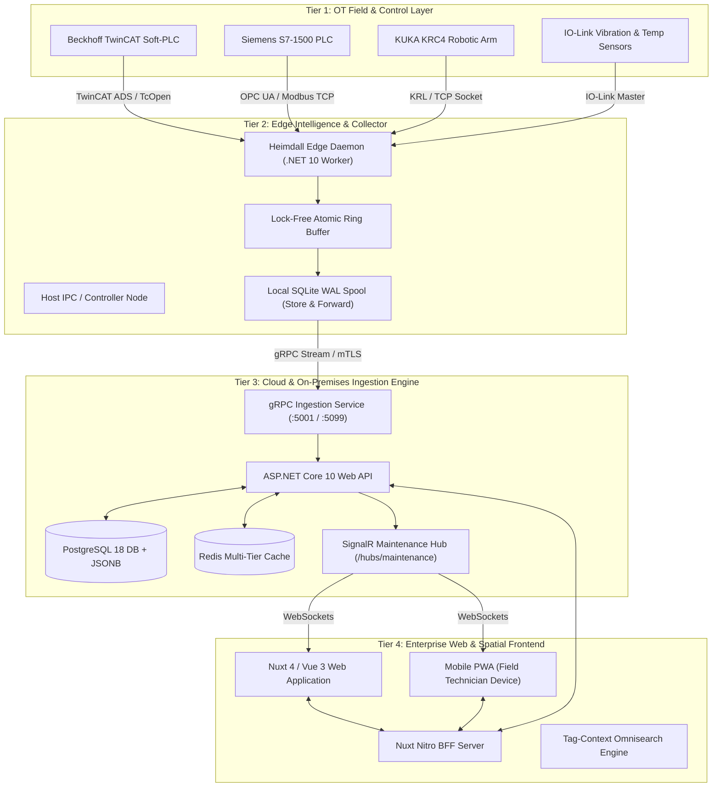

# Bachelor's Thesis Research Notes & Technical Foundations

> **Document Type:** Academic Research Notes, Architecture Specification & Literature Compendium  
> **Project:** Heimdall Industrial OT/IT Platform  
> **Target Degree:** Bachelor of Science (BSc) Thesis in Computer Science / Electrical & Software Engineering  
> **Institution:** University of Pécs, Faculty of Engineering and Information Technology (PTE MIK)  
> **Author:** Heimdall Project Core Engineering  
> **Status:** Active Reference & Academic Outline

---

## Abstract

Modern industrial manufacturing environments increasingly demand real-time visibility, automated telemetry acquisition, and synchronized maintenance orchestration across complex, heterogeneous cyber-physical systems (CPS). Historically, operational technology (OT) and information technology (IT) have operated within strictly partitioned silos defined by the traditional Purdue Enterprise Reference Architecture (ISA-95). Legacy supervisory control and data acquisition (SCADA) and manufacturing execution systems (MES) struggle to integrate high-frequency machine telemetry with flexible web-based user interfaces and predictive maintenance pipelines.

This research document details the architectural foundation, engineering principles, and implementation strategies of **Heimdall**: a unified edge-to-cloud telemetry, asset management, and reactive incident orchestration platform. The system bridges OT field devices (Beckhoff TwinCAT Soft-PLCs, Siemens S7, KUKA industrial robotics, and OPC UA endpoints) with modern IT microservices. Key contributions explored herein include:
1. A cross-platform .NET 10 Edge Daemon employing local SQLite WAL store-and-forward spooling, xxHash64 memory-delta deadband evaluation, and high-throughput gRPC streaming over mTLS.
2. An event-driven ASP.NET Core backend featuring PostgreSQL 18 JSONB persistence with dual-schema security isolation, multi-tier Redis/Memory caching, and real-time SignalR state broadcasting.
3. A responsive Nuxt 4 / Vue 3 web interface utilizing a Nitro Backend-for-Frontend (BFF), universal FZF-powered tag-context omnisearch, and optimistic UI updates backed by automatic rollback mechanisms.
4. An automated incident lifecycle engine supporting zero-dependency SVG Galois Field GF(256) QR action pickup, machine-driven watchdog auto-closure (`/auto-close`), and kiosk retraction (`/retract`).

---

## Table of Contents

1. [Background & Industrial Context](#1-background--industrial-context)
   - 1.1 [Industry 4.0 & Cyber-Physical Systems (CPS)](#11-industry-40--cyber-physical-systems-cps)
   - 1.2 [The Purdue Model (ISA-95) & The Unified Namespace (UNS)](#12-the-purdue-model-isa-95--the-unified-namespace-uns)
   - 1.3 [The IT/OT Convergence Imperative](#13-the-itot-convergence-imperative)
2. [Problem Statement & Industrial Challenges](#2-problem-statement--industrial-challenges)
   - 2.1 [Fieldbus & Protocol Heterogeneity](#21-fieldbus--protocol-heterogeneity)
   - 2.2 [Network Unreliability, Jitter & Air-Gapped Topologies](#22-network-unreliability-jitter--air-gapped-topologies)
   - 2.3 [High-Frequency Sampling vs. Ingestion Bottlenecks](#23-high-frequency-sampling-vs-ingestion-bottlenecks)
   - 2.4 [Disjointed Maintenance & Incident Workflows](#24-disjointed-maintenance--incident-workflows)
   - 2.5 [Industrial Cybersecurity & Compliance (TISAX, IEC 62443)](#25-industrial-cybersecurity--compliance-tisax-iec-62443)
3. [Heimdall Architectural Design](#3-heimdall-architectural-design)
   - 3.1 [Distributed Multi-Tier Topology](#31-distributed-multi-tier-topology)
   - 3.2 [Edge Daemon Subsystem (.NET 10 Worker)](#32-edge-daemon-subsystem-net-10-worker)
   - 3.3 [Backend Ingestion & gRPC Ingestion Engine](#33-backend-ingestion--grpc-ingestion-engine)
   - 3.4 [Data Modeling: Graph-Relational M:N Topology & Dual-Schema Isolation](#34-data-modeling-graph-relational-mn-topology--dual-schema-isolation)
   - 3.5 [Web Frontend & Nitro BFF Architecture](#35-web-frontend--nitro-bff-architecture)
   - 3.6 [Tag-Context Omnisearch Engine](#36-tag-context-omnisearch-engine)
   - 3.7 [Reactive Maintenance & Incident State Machine](#37-reactive-maintenance--incident-state-machine)
4. [Critical Analysis & Engineering Evaluation](#4-critical-analysis--engineering-evaluation)
   - 4.1 [Anti-Patterns Identified and Refactored](#41-anti-patterns-identified-and-refactored)
   - 4.2 [Store-and-Forward vs. Real-Time Streaming Trade-offs](#42-store-and-forward-vs-real-time-streaming-trade-offs)
   - 4.3 [Optimistic UI Verification & Rollback Guarantees](#43-optimistic-ui-verification--rollback-guarantees)
5. [Academic & Industry References](#5-academic--industry-references)

---

## 1. Background & Industrial Context

### 1.1 Industry 4.0 & Cyber-Physical Systems (CPS)
The Fourth Industrial Revolution (Industry 4.0) represents the convergence of digital computing, cloud infrastructure, and operational machinery into smart, autonomous Cyber-Physical Systems (CPS). In a modern smart factory, physical production equipment—such as multi-axis CNC milling centers, robotic welding cells, and automated optical inspection (AOI) lines—is no longer isolated. Instead, machines continuously generate multidimensional time-series data reflecting operating temperatures, harmonic vibration envelopes, pneumatic and hydraulic pressures, and cycle execution times.

Transforming this raw telemetry into actionable intelligence enables:
- **Condition-Based Monitoring (CBM):** Real-time tracking of asset operating parameters against safe operating envelopes.
- **Predictive Maintenance (PdM):** Algorithmic identification of mechanical and electrical wear before catastrophic failure occurs, mitigating unplanned downtime.
- **Overall Equipment Effectiveness (OEE) Optimization:** Continuous mathematical derivation of Availability, Performance, and Quality KPIs across plant cells.

### 1.2 The Purdue Model (ISA-95) & The Unified Namespace (UNS)
Historically, industrial automation was structured according to the **Purdue Enterprise Reference Architecture (PERA)**, standardized under ANSI/ISA-95 (IEC 62264):

```
┌─────────────────────────────────────────────────────────────────────────┐
│ Level 4: Enterprise Resource Planning (ERP, SAP, Business Logistics)   │
├─────────────────────────────────────────────────────────────────────────┤
│ Level 3: Manufacturing Operations Management (MES, Scheduling, Quality) │
├─────────────────────────────────────────────────────────────────────────┤
│ Level 2: Supervisory Control & Data Acquisition (SCADA, HMI, Alarms)    │
├─────────────────────────────────────────────────────────────────────────┤
│ Level 1: Basic Control (Programmable Logic Controllers - PLCs, IPCs)   │
├─────────────────────────────────────────────────────────────────────────┤
│ Level 0: Physical Process (Sensors, Actuators, Motors, Toolholders)     │
└─────────────────────────────────────────────────────────────────────────┘
```

While the Purdue Model established strict security zoning and deterministic traffic isolation, it created severe data friction:
1. **Hierarchical Point-to-Point Coupling:** Telemetry generated at Level 0/1 had to be manually translated through Level 2 SCADA, aggregated into Level 3 MES, and batch-loaded into Level 4 ERP.
2. **Loss of High-Fidelity Signal:** Lower-level drivers often downsampled or discarded critical high-frequency transient anomalies (e.g. 10 kHz vibration bursts or micro-stoppages) to accommodate legacy polling cycles.
3. **Emergence of the Unified Namespace (UNS):** Modern industrial architectures advocate for an event-driven, decoupled ecosystem where edge devices publish semantically structured data directly into a shared broker or ingestion engine, democratizing access across all organizational tiers.

### 1.3 The IT/OT Convergence Imperative
Operational Technology (OT) prioritizes **availability, determinism, and physical safety**, traditionally operating under 24/7/365 lifecycles where software updates are rare and downtime is unacceptable. Conversely, Information Technology (IT) prioritizes **confidentiality, agility, rapid iteration, and horizontal scalability**. 

Bridging this gap requires platforms that respect OT constraints (zero interference with PLC real-time scan cycles, strict bandwidth management, read-only fieldbus taps) while delivering IT capabilities (rich web dashboards, automated notifications, cryptographic access control, and containerized deployment).

---

## 2. Problem Statement & Industrial Challenges

### 2.1 Fieldbus & Protocol Heterogeneity
Manufacturing shop floors contain a heterogeneous mixture of vendors, legacy revisions, and proprietary protocols:
- **Beckhoff TwinCAT (ADS):** Communicates via AMS Net ID routing and TwinCAT ADS (Automation Device Specification) over TCP/IP, accessing symbolic variables in soft-PLC memory.
- **Siemens SIMATIC S7:** Relies on ISO-on-TCP (RFC 1006) and PROFINET, requiring DB block offsets or S7-comm handshakes.
- **OPC Unified Architecture (OPC UA):** An open standard (IEC 62541) offering platform-independent, object-oriented information modeling, but often incurring significant memory and configuration overhead on resource-constrained embedded controllers.
- **Modbus TCP:** A simple, ubiquitous industrial protocol lacking native metadata, requiring explicit register mapping (holding registers, input registers, coils).
- **Industrial Robotics (KUKA, ABB, Fanuc):** Uses specialized Cartesian and joint telemetry packages, frequently lacking standardized REST or gRPC APIs.

Without a unified abstraction layer, platform maintainers must write bespoke integration code for every workstation on the factory floor.

### 2.2 Network Unreliability, Jitter & Air-Gapped Topologies
Industrial factory environments present hostile network conditions:
- **Electromagnetic Interference (EMI):** High-power arc welding, frequency inverters, and heavy motor drives generate electrical noise that degrades Wi-Fi and industrial Ethernet runs.
- **Air-Gapped Subnets:** OT networks are frequently partitioned across isolated Virtual LANs (VLANs) with restrictive egress routing.
- **Downtime and Failures:** Telemetry collector nodes may experience transient network disconnects during machine reconfiguration or switch reboots. If edge devices fail to spool telemetry locally, critical fault data generated immediately prior to a line stoppage is permanently lost.

### 2.3 High-Frequency Sampling vs. Ingestion Bottlenecks
A production plant with 100 machines and 50 data points per machine, sampled at 100 Hz, generates:
$$\text{Throughput} = 100 \times 50 \times 100 = 500,000 \text{ samples/second}$$
Transmitting and storing half a million raw records per second into a conventional relational database creates immediate CPU, network, and I/O bottlenecks. 
An industrial edge telemetry system must perform **in-situ edge filtering**, computing:
- Deadband evaluation (only reporting when values deviate by more than $\Delta$).
- Cryptographic or fast memory hashing (`xxHash64`) to suppress transmission of static process state values while preserving heartbeat liveness.

### 2.4 Disjointed Maintenance & Incident Workflows
When a machine faults on the factory floor, existing enterprise ticketing platforms (e.g. Jira, SAP PM) suffer from critical operational disconnects:
1. **Lack of Instant Machine State:** Tickets are filed manually with vague descriptions ("Line 2 stopped"), lacking the exact function block error code, PLC state, and sensor telemetry snapshot captured at the millisecond of failure.
2. **No Reaction Time Traceability:** Without physical kiosk scanning or action QR codes, management cannot accurately measure the delta between when an alarm fired and when a technician arrived on site ($\Delta t_{\text{reaction}}$).
3. **Manual Overhead for Self-Clearing Faults:** Transient errors (e.g. safety light curtain momentarily interrupted) that clear themselves often leave orphaned "Open" tickets, cluttering the Kanban board and degrading data integrity.

### 2.5 Industrial Cybersecurity & Compliance (TISAX, IEC 62443)
Automotive and mission-critical manufacturing mandates strict cybersecurity compliance under **TISAX (Trusted Information Security Assessment Exchange / VDA ISA 6.0 Level 3)** and **IEC 62443**:
- **Field-Level Encryption:** Sensitive process recipes and diagnostic logs must be encrypted at rest using AES-256-GCM.
- **Command Authenticity:** Any remote control command dispatched to an industrial PC (e.g., triggering a diagnostic snapshot, rebooting a runtime service) must carry an asymmetric cryptographic signature (ECDSA/RSA) verifiable by the edge daemon.
- **PII Scrubbing:** Diagnostic snapshots must actively sanitize process argument strings, user directories, and sensitive system artifacts to prevent GDPR violations.

---

## 3. Heimdall Architectural Design

### 3.1 Distributed Multi-Tier Topology



### 3.2 Edge Daemon Subsystem (.NET 10 Worker)
The edge daemon (`App.Agent.Daemon`) is engineered as a lightweight, cross-platform background worker compiled for `linux-x64` and `win-x64` (self-contained, native AOT compatible). It references only `App.Contracts`, preserving total architectural decoupling from backend database entities.

Key edge mechanisms include:
- **Lock-Free Atomic Double-Buffering:** In TwinCAT environments, `FB_HeimdallTelemetryBridge.TcPOU` exposes a double-buffered shared memory struct, preventing race conditions between the hard real-time PLC task (1 ms scan) and the non-deterministic OS daemon.
- **Deadband & Delta Memory Evaluator:** Telemetry points are evaluated against configured deadbands (percentage or absolute thresholds). Discrete state strings and metadata blocks are hashed in-memory via `xxHash64`. If the hash matches the previous cycle, network transmission is suppressed until a configurable heartbeat TTL expires.
- **SQLite WAL Store-and-Forward Engine:** When network connectivity to the central gRPC collector is interrupted, the daemon automatically spools serialized Protobuf frames into a local SQLite database utilizing Write-Ahead Logging (WAL). Upon network restoration, an asynchronous drainage worker replays spooled packets with exponential backoff jitter.
- **Cryptographic Command Validation:** Remote commands arriving via gRPC or local sockets are verified against an embedded public key before execution, preventing unauthorized control actions.

### 3.3 Backend Ingestion & gRPC Ingestion Engine
The central backend (`App.Backend.Api`) is built upon ASP.NET Core (.NET 10 / C# 14):
- **High-Throughput gRPC Endpoint:** Implements `heimdall.telemetry.v1.SystemInfoCollector`, ingesting streaming metrics with bidirectional flow control and HTTP/2 multiplexing.
- **Telemetry Ingestion Service (`ITelemetryIngestionService`):** Deserializes incoming frames, applies statistical anomaly detection algorithms, updates Redis real-time time-series caches, and dispatches SignalR events.
- **Multi-Tier Caching Architecture:**
  - *L1 Memory Cache (`IMemoryCache`):* In-process caching for hot metadata, authorization claims, and configuration flags (<1 ms latency).
  - *L2 Distributed Cache (`StackExchange.Redis`):* Centralized Redis instance caching inventory trees, machine status summaries, and active ticket metrics with automated pattern-based invalidation (`inventory:*`, `tickets:*`).

### 3.4 Data Modeling: Graph-Relational M:N Topology & Dual-Schema Isolation
Industrial assembly lines do not map cleanly to rigid 1:1 hierarchical trees. In real-world automation:
- A single complex production station (e.g. Battery Module Pack EOL) may be orchestrated by **multiple controlling IPCs and Soft-PLCs**.
- Conversely, a high-performance industrial server running virtualized Soft-PLCs may control **multiple adjacent workstations**.

Heimdall models this as a **Graph-Relational Many-to-Many (M:N) Topology**:
- `Machine` (Production Station) represents the physical kinematic station on the plant CAD layout.
- `ClientPc` represents the physical or virtual computing node executing the OS and soft-PLC runtimes.
- An explicit relational join entity manages the control role (`Primary`, `Secondary`, `SafetySupervisor`) and interconnect bus (`EtherCAT`, `PROFINET`).

**Database Schema Isolation (PostgreSQL 18):**
- Schema `auth`: Dedicated tables managed by Better-Auth (`users`, `sessions`, `accounts`, `verifications`), enforcing tenant isolation.
- Schema `backend`: Enterprise domain entities (`machines`, `client_pcs`, `maintenance_tickets`, `inventory_items`, `agent_events`).
- Unstructured JSON payloads (telemetry snapshots, function block states, CAD pinned handles) leverage native PostgreSQL `JSONB` columns with GIN indexes.

### 3.5 Web Frontend & Nitro BFF Architecture
The web layer (`src/frontend/web`) utilizes Nuxt 4 (with compatibility version 4 and descriptive CS file routing) and Vue 3:
- **Nitro BFF Proxy:** All browser traffic routes through `/api/proxy/*`, which injects cryptographically verified session credentials and tenant organization headers (`X-Organization-Id`) before proxying to the internal .NET API.
- **Shadcn Vue & Tailwind CSS v4:** Accessible, dark-mode-first component system with full keyboard navigation and high visual contrast for factory floor displays.
- **Offline Progressive Web App (PWA):** Utilizes service workers and local storage to allow mobile technicians to view cached asset registries and draft offline maintenance logs in air-gapped factory areas.

### 3.6 Tag-Context Omnisearch Engine
To enable rapid navigation across tens of thousands of factory assets, the frontend incorporates a specialized tag-context search engine (`useHeimdallSearch`, `searchRegistry`, `AutoTagEngine`):
- **FZF-Inspired Fuzzy Scoring:** Utilizes Damerau-Levenshtein edit distance algorithms combined with substring matching and N-gram scoring.
- **Prefix Scoping Tokens:**
  - `@station` / `@machine`: Restricts query space to machines and stations (`[MCH]`).
  - `#ticket`: Restricts query space to maintenance tickets (`[TCK]`).
  - `!controller` / `!host`: Restricts query space to edge controllers and IPCs (`[IPC]`).
  - `*part` / `*inventory`: Restricts query space to inventory spare parts (`[PRT]`).
  - `%alarm`: Restricts query space to units currently in fault, warning, or line-stop condition.
- **Auto-Tag Tokenizer:** Automatically detects known industrial entities (e.g. manufacturer names "Beckhoff", technology categories "Robotics", part categories "Servo") as the user types, converting them into interactive filter pills.
- **Cross-Domain Ranking:** Primary results match the active page workspace, while correlated cross-table matches (e.g. parts installed on a searched machine) appear in a distinct, secondary result tier.

### 3.7 Reactive Maintenance & Incident State Machine
The maintenance subsystem implements a canonical 5-state lifecycle:


- **Zero-Dependency Action QR:** Pure SVG Galois Field GF(256) matrix QR codes encode direct action intents (`/tickets/{id}/qr-pickup`). When scanned by a technician's mobile camera, the system automatically transitions the ticket to `InProgress`, sets the assigned technician, and computes the exact reaction time ($\Delta t = t_{\text{scan}} - t_{\text{created}}$).
- **PLC Auto-Closure (`/api/v1/tickets/{id}/auto-close`):** When an edge watchdog detects that a machine fault condition (e.g. thermal overload, pressure drop) has normalized, it invokes the auto-close endpoint. The ticket transitions to `Closed`, appends an automated PLC transition comment, clears line-stop duration, and broadcasts an update via SignalR.
- **Kiosk Retract (`/api/v1/tickets/{id}/retract`):** Operators can immediately retract tickets opened by accident or resolved without technical intervention, updating the change history and appending an audit record.
- **Orthogonal Escalation:** Tickets can be escalated (e.g. to Dedicated Shift Engineer or Plant Director) at any lifecycle stage without destroying the underlying Kanban status.

---

## 4. Critical Analysis & Engineering Evaluation

### 4.1 Anti-Patterns Identified and Refactored
During the iterative development of Heimdall, several anti-patterns common in industrial telemetry platforms were identified and resolved:

| Anti-Pattern | Manifestation | Resolution in Heimdall |
| :--- | :--- | :--- |
| **Chatty Database Ingestion** | Inserting every single sensor data point into individual SQL rows in real time. | Batch aggregation, gRPC streaming buffers, xxHash64 delta evaluation, and Redis caching. |
| **Direct DB Coupling in Edge Daemon** | Referencing Entity Framework Core directly from edge daemons, leaking database schemas to the factory edge. | Edge daemons reference only `App.Contracts` and communicate exclusively via gRPC Protobuf definitions. |
| **Broadcast Notification Purge Bug** | Calling `clearNotifications(userId)` dropped broadcast notifications because `n.userId && n.userId !== userId` was falsy for broadcast items (`userId == null`). | Fixed filtering condition to `n.userId !== userId`, preserving system broadcast alerts across user-scoped clear operations. |
| **Phantom UI State on Server Failure** | Updating UI state optimistically without tracking previous state, leaving the user with false data if the backend rejects the change. | Implemented `runOptimisticAction` with formal `rollbackFn()` execution, error toasts, and rollback audit logging. |
| **Hardcoded Industrial Topology** | Assuming a strict 1:1 relationship between an IPC and a production machine. | Introduced the Graph-Relational M:N schema allowing multi-controller stations and multi-station servers. |

### 4.2 Store-and-Forward vs. Real-Time Streaming Trade-offs
A fundamental trade-off in industrial telemetry lies between **instantaneous delivery** and **guaranteed delivery**:
- Pure WebSockets or raw MQTT brokers without persistence risk silent data drops when networks fail during critical line stoppage events.
- Heimdall balances this through a tiered storage pipeline:
  1. High-frequency in-memory ring buffer (nanosecond latency).
  2. Immediate delta/deadband evaluation (reducing payload size by up to 85%).
  3. Local SQLite WAL persistence for unacknowledged frames (zero data loss across network partitions).
  4. gRPC HTTP/2 stream multiplexing with TCP windowing to the central cluster.

### 4.3 Optimistic UI Verification & Rollback Guarantees
In manufacturing execution software, operator trust is paramount. If an operator clicks "Reserve Ticket" or "Decommission Machine" and the user interface updates, but an asynchronous network timeout or RBAC rejection occurs silently in the background, the operator may proceed with dangerous physical maintenance under false assumptions.

Heimdall enforces **Verifiable Optimism**:
1. Visual state mutates immediately to provide instant feedback.
2. The asynchronous operation is wrapped in a transactional execution boundary.
3. If the server returns a 4xx/5xx status code:
   - State is reverted via the inverse mutation closure.
   - A sticky, prominent error toast appears detailing the exact rejection cause.
   - A permanent entry is recorded in the Unified Audit Log Visualizer marking the rolled-back action.

---

## 5. Academic & Industry References

### 5.1 Standards & Industrial Specifications
1. **ANSI/ISA-95.00.01-2010 (IEC 62264-1):** *Enterprise-Control System Integration – Part 1: Common Object Models and Attributes.* International Society of Automation, 2010.
2. **IEC 62541:2020:** *OPC Unified Architecture (OPC UA) – Part 1 to Part 14: Architecture, Data Access, Alarms and Conditions.* International Electrotechnical Commission, 2020.
3. **IEC 62443-3-3:2018:** *Security for industrial automation and control systems – Part 3-3: System security requirements and security levels.* International Electrotechnical Commission, 2018.
4. **VDA Information Security Assessment (ISA 6.0 / TISAX):** *Requirements for Information Security in the Automotive Industry.* Verband der Automobilindustrie (VDA), 2023.
5. **ISO 13374-1:2003:** *Condition monitoring and diagnostics of machines – Data processing, communication and presentation – Part 1: General guidelines.* International Organization for Standardization, 2003.

### 5.2 Academic Literature & Conference Proceedings
6. **L. Thames and D. Schaefer:** *Software-defined Cloud Manufacturing for Industry 4.0.* Procedia CIRP, vol. 52, pp. 12–17, 2016. [DOI: 10.1016/j.procir.2016.07.041]
7. **J. Lee, B. Bagheri, and H.-A. Kao:** *A Cyber-Physical Systems architecture for Industry 4.0-based manufacturing systems.* Manufacturing Letters, vol. 3, pp. 18–23, 2015. [DOI: 10.1016/j.mfglet.2014.12.001]
8. **M. Wollschlaeger, T. Sauter, and J. Jasperneite:** *The Future of Industrial Communication: Automation Networks in the Era of the Internet of Things and Industry 4.0.* IEEE Industrial Electronics Magazine, vol. 11, no. 1, pp. 17–27, Mar. 2017. [DOI: 10.1109/MIE.2017.2649104]
9. **F. Wortmann and K. Flüchter:** *Internet of Things: Technology and Value Added.* Business & Information Systems Engineering, vol. 57, no. 3, pp. 221–224, 2015. [DOI: 10.1007/s12599-015-0383-3]
10. **A. W. Colombo, T. Bangemann, K. Karnouskos, et al.:** *Industrial Cloud-Based Cyber-Physical Systems: The IMC-AESOP Approach.* Springer International Publishing, 2014. [DOI: 10.1007/978-3-319-05624-1]
11. **E. Sisinni, A. Saifullah, S. Han, U. Jennehag, and M. Gidlund:** *Industrial Internet of Things: Challenges, Opportunities, and Directions.* IEEE Transactions on Industrial Informatics, vol. 14, no. 11, pp. 4724–4734, Nov. 2018. [DOI: 10.1109/TII.2018.2852491]
12. **D. Georgakopoulos, P. P. Jayaraman, M. Fazia, et al.:** *Internet of Things and Edge Cloud Computing Roadmap for Manufacturing.* IEEE Cloud Computing, vol. 3, no. 4, pp. 66–73, Jul.-Aug. 2016. [DOI: 10.1109/MCC.2016.91]
13. **R. Gao, L. Wang, R. Teti, et al.:** *Cloud-enabled prognosis for manufacturing.* CIRP Annals - Manufacturing Technology, vol. 64, no. 2, pp. 749–772, 2015. [DOI: 10.1016/j.cirp.2015.05.011]
14. **B. Chen, J. Wan, L. Shu, P. Li, M. Mukherjee, and B. Yin:** *Smart Factory of Industry 4.0: Key Technologies, Application Case, and Challenges.* IEEE Access, vol. 6, pp. 6505–6519, 2018. [DOI: 10.1109/ACCESS.2017.2783682]
15. **S. Jeschke, C. Brecher, T. Meisen, D. Özdemir, and T. Eschert:** *Industrial Internet of Things and Cyber Manufacturing Systems.* In *Industrial Internet of Things*, Springer Series in Wireless Technology, pp. 3–19, 2017.

### 5.3 Software Architecture & Distributed Systems Foundations
16. **R. C. Martin:** *Clean Architecture: A Craftsman's Guide to Software Structure and Design.* Prentice Hall, 2017.
17. **M. Fowler:** *Patterns of Enterprise Application Architecture.* Addison-Wesley, 2002.
18. **J. Bonér, D. Farley, R. Kuhn, and M. Thompson:** *The Reactive Manifesto.* reactivemanifesto.org, 2014.
19. **G. Hohpe and B. Woolf:** *Enterprise Integration Patterns: Designing, Building, and Deploying Messaging Solutions.* Addison-Wesley Professional, 2003.
20. **M. Kleppmann:** *Designing Data-Intensive Applications: The Big Ideas Behind Reliable, Scalable, and Maintainable Systems.* O'Reilly Media, 2017.
