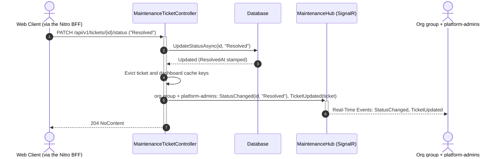

# Heimdall API & Interface Reference

This document provides the reference manual for all interfaces exposed by Heimdall:
1. **REST Web API** (`HTTP/JSON`)
2. **MQTT Telemetry Ingestion** (`MQTT 5 + Protobuf`, embedded broker)
3. **SignalR WebSocket Maintenance Hub** (`/hubs/maintenance`)
4. **Data Transfer Objects (DTOs)**
5. **OPC UA Server & Gateway Interface** (`opc.tcp://`)

---

## 1. REST Web API (`/api/v1/`)

The REST Web API is hosted on port `5099` (HTTP; dev also `5001`) behind the Nuxt Nitro BFF reverse proxy (`/api/proxy/*`).

### 1.1 Authentication & Tenant Context
All non-public endpoints require session authentication and tenant identification headers:
* `Authorization: Bearer <session_token>`
* `X-Organization-Id: <organization_uuid>`

When making calls through the frontend Nitro proxy, these headers are injected automatically from the verified user session cookie.

---

### 1.2 Production Stations (`/api/v1/stations`)

#### `GET /api/v1/stations`
Retrieves a paginated list of manufacturing stations in the active tenant organization.
* **Query Parameters**:
  * `page` (`int`, default: `1`): Page index.
  * `pageSize` (`int`, default: `25`): Maximum records per page.
  * `search` (`string`, optional): Filters by station name or custom identifier.
* **Response `200 OK`**:
```json
{
  "items": [
    {
      "id": "c39a82e4-180b-48c4-912f-2d6e3bf8e801",
      "name": "Line 01 - Body Assembly Alpha - Station 10",
      "customIdentifier": "LINE-01-OP10",
      "pinnedObjectHandle": "5A1F",
      "primaryControllerId": "e14b99f2-2b63-4c91-923a-59b43d2c1102",
      "primaryControllerHostname": "ROBOT-CELL-01",
      "isOnline": true,
      "alertCount": 0
    }
  ],
  "totalCount": 1,
  "page": 1,
  "pageSize": 25
}
```

#### `GET /api/v1/stations/{id}`
Retrieves detailed metadata, controller associations, and equipment interconnects for a specific station.
* **Response `200 OK`**:
```json
{
  "id": "c39a82e4-180b-48c4-912f-2d6e3bf8e801",
  "name": "Line 01 - Body Assembly Alpha - Station 10",
  "customIdentifier": "LINE-01-OP10",
  "pinnedObjectHandle": "5A1F",
  "organizationId": "Production Floor A",
  "controllers": [
    {
      "clientPcId": "e14b99f2-2b63-4c91-923a-59b43d2c1102",
      "hostname": "ROBOT-CELL-01",
      "ipAddress": "192.168.1.101",
      "controlRole": "Primary",
      "isPrimary": true,
      "lastOnline": "2026-09-03T18:50:00Z"
    }
  ],
  "interconnects": [
    {
      "id": "7b2e3f4a-5c6d-7e8f-9a0b-1c2d3e4f5a6b",
      "targetControllerHostname": "DISPENSER-CELL-01",
      "protocol": "EtherCAT",
      "channelInfo": "Port 1 -> Slave 04 (EK1100)"
    }
  ]
}
```

---

### 1.3 Industrial Controllers (`/api/v1/controllers`)

#### `GET /api/v1/controllers`
Lists all registered edge industrial PCs, Soft-PLCs, and devices.
* **Response `200 OK`**:
```json
[
  {
    "id": "e14b99f2-2b63-4c91-923a-59b43d2c1102",
    "hostname": "ROBOT-CELL-01",
    "macAddress": "02:42:AC:12:00:03",
    "ipAddress": "192.168.1.101",
    "lastOnline": "2026-09-03T18:58:45Z",
    "isOnline": true,
    "cpuUsagePercent": 14.2,
    "ramUsagePercent": 48.6,
    "freeDiskSpaceGb": { "C:": 124.5, "D:": 450.0 },
    "controlledStations": [
      {
        "stationId": "c39a82e4-180b-48c4-912f-2d6e3bf8e801",
        "customIdentifier": "LINE-01-OP10",
        "isPrimary": true
      }
    ]
  }
]
```

#### `POST /api/v1/controllers/{id}/commands`
Queues a signed operational command for an edge agent daemon.
* **Request Body**:
```json
{
  "type": "UPDATE_CONFIG",
  "payload": "{\"heartbeatIntervalSeconds\": 30}",
  "signature": "MEUCIQD...=="
}
```
* **Response `202 Accepted`**:
```json
{
  "commandId": "a1b2c3d4-e5f6-7a8b-9c0d-1e2f3a4b5c6d",
  "status": "Queued",
  "createdAt": "2026-09-03T18:58:50Z"
}
```

#### `POST /api/v1/ClientPc/{id}/snapshot`
Triggers an immediate, immutable diagnostic snapshot capture for an edge IPC controller. Dispatches a signed `TRIGGER_DIAGNOSTIC_SNAPSHOT` command, seals the captured JSON payload with a SHA-256 cryptographic digest, and logs a non-repudiable audit event.
* **Response `200 OK`**:
```json
{
  "id": "7b1c3d4e-5f6a-7b8c-9d0e-1f2a3b4c5d6e",
  "clientPcId": "e14b99f2-2b63-4c91-923a-59b43d2c1102",
  "hostname": "IPC-L01-01",
  "machineIdentifier": "LINE-01-OP10",
  "capturedByUserId": "usr-admin-01",
  "capturedByUserName": "Admin User",
  "capturedAtUtc": "2026-09-13T22:30:00Z",
  "payloadHashSha256": "e3b0c44298fc1c149afbf4c8996fb92427ae41e4649b934ca495991b7852b855",
  "payloadSizeBytes": 14258,
  "snapshotPayloadJson": "{ ... }"
}
```

#### `GET /api/v1/ClientPc/{id}/snapshots`
Retrieves historical diagnostic snapshots for an IPC node, ordered newest first.
* **Response `200 OK`**: Returns array of `DiagnosticSnapshotSummaryDto`.

---

### 1.4 Maintenance Tickets (`/api/v1/tickets`)

#### `GET /api/v1/tickets`
Returns incident tickets, optionally filtered by status.
* **Query Parameters**:
  * `status` (`string`, optional): `Open`, `InProgress`, `Pending`, `Resolved`, `Closed`.

#### `POST /api/v1/tickets`
Creates a new maintenance incident. Triggers real-time SignalR broadcasts.
* **Request Body**:
```json
{
  "title": "Axis X Servo Motor Thermal Warning",
  "description": "Temperature probe reads 87C during high-speed cycle. Bearing inspection required.",
  "priority": "High",
  "machineId": "c39a82e4-180b-48c4-912f-2d6e3bf8e801",
  "clientPcId": "e14b99f2-2b63-4c91-923a-59b43d2c1102"
}
```
* **Response `201 Created`**: Returns the complete `MaintenanceTicketDto`.

#### `PATCH /api/v1/tickets/{id}/status` and `PUT /api/v1/tickets/{id}`
`PATCH .../status` changes the status; the body is the new status as a JSON string (e.g. `"InProgress"`). `PUT` replaces the editable fields of the ticket (body: the full ticket, whose `id` must match the route), e.g. priority or technician assignment:
```json
{
  "id": "<ticket id>",
  "title": "Axis X Servo Motor Thermal Warning",
  "status": "InProgress",
  "priority": "High",
  "assignedTo": "Gábor Varga"
}
```

#### `POST /api/v1/tickets/{id}/escalate`
Escalates an incident orthogonally without modifying its Kanban status.
* **Request Body**:
```json
{
  "reason": "Spindle harmonic resonance critical risk — OEM specialist notified",
  "escalatedBy": "Gábor Varga (Lead Tech)",
  "handoverState": "Notification",
  "target": "DedicatedEngineer"
}
```

#### `POST /api/v1/tickets/{id}/de-escalate` (or `/deescalate`)
Closes an escalation independently of the ticket lifecycle.
* **Request Body**:
```json
{
  "resolvedBy": "Senior Plant Manager",
  "resolutionNotes": "OEM specialist reviewed telemetry. Clearance granted."
}
```

#### `PATCH /api/v1/tickets/{id}/pending`
Transitions ticket into `Pending` status with typed sub-reasons (`Parts`, `ExternalOk`, `Action`).
* **Request Body**:
```json
{
  "pendingReason": "Parts",
  "pendingDetails": "Requisition PO #88219 ordered for replacement servo amplifier."
}
```

#### `POST /api/v1/tickets/{id}/reserve`
Reserves a ticket for a technician before commencing physical work.
* **Request Body**:
```json
{
  "technician": "Gábor Varga"
}
```

#### `POST /api/v1/tickets/{id}/qr-pickup`
Directly picks up a ticket at the physical machine via action QR scan, timestamping reaction time.
* **Request Body**:
```json
{
  "technician": "Gábor Varga"
}
```

#### `POST /api/v1/tickets/{id}/auto-close`
Automatically transitions an active ticket to `Closed` when a machine PLC or watchdog condition clears.
* **Request Body**:
```json
{
  "machineId": "STATION-OP10-01",
  "controllerId": "ctrl-101",
  "clearedReason": "Vibration harmonic envelope normalized (< 1.8 mm/s RMS)",
  "resolutionNotes": "Self-cleared by edge daemon watchdog rule."
}
```

#### `POST /api/v1/tickets/{id}/retract`
Retracts a ticket directly from the workstation kiosk view.
* **Request Body**:
```json
{
  "retractedBy": "Kiosk Operator OP10",
  "reason": "False alarm; workpiece realignment cleared sensor fault"
}
```

#### `GET /api/v1/tickets/stoppage-stats`
Aggregates weekly line stoppage downtime, departmental stoppage minutes, and top worst downtime machines.
* **Response `200 OK`**:
```json
{
  "totalStoppageMinutesThisWeek": 720.0,
  "totalLineStopIncidents": 4,
  "departmentBreakdown": [
    { "department": "Motion & Drive", "stoppageMinutes": 360.0, "incidentCount": 2 },
    { "department": "Mechanical", "stoppageMinutes": 240.0, "incidentCount": 1 },
    { "department": "Robotics", "stoppageMinutes": 120.0, "incidentCount": 1 }
  ],
  "topWorstMachines": [
    { "machineName": "Line 05 – Powertrain Sub-Assembly", "totalStoppageMinutes": 360.0, "incidentCount": 1 }
  ]
}
```

#### `POST /api/v1/tickets/{id}/comments`
Appends a technician note or resolution observation.
* **Request Body**:
```json
{
  "content": "Lubrication replenished. Thermographic camera shows temperature drop to 54C."
}
```


---

### 1.5 Asset Inventory (`/api/v1/inventory`)

#### `GET /api/v1/inventory`
Retrieves equipment components supporting search, filtering, and pagination.
* **Query Parameters**:
  * `tree` (`boolean`, default: `false`): If true, returns assets structured in parent-child hierarchy.
  * `type` (`string`, optional): `HardwareComponent`, `SoftwareAsset`, `Machine`.
* **Response `200 OK`**: Array of `InventoryItemDto`.

#### `GET /api/v1/inventory/parts`
Retrieves discrete serialized high-value capital assets (`isStockItem == false`). Each part is either installed on a machine (`InMachine`), stored in warehouse inventory (`InStorage`), or in repair depot (`UnderRepair`).
* **Query Parameters**:
  * `status` (`string`, optional): Filter by `InMachine`, `InStorage`, `UnderRepair`.
  * `technology` (`string`, optional): Filter by `Assembly`, `Test`, `SMT`, `Welding`, `Fastening`, `Dispensing`, `Robotics`.
  * `machineId` (`uuid`, optional): Filter parts installed on a specific station.
* **Response `200 OK`**:
```json
[
  {
    "id": "comp-101",
    "name": "Spindle Motor Assembly 15kW",
    "displayName": "Main CNC Spindle Motor",
    "serialNumber": "SN-SPINDLE-994",
    "isStockItem": false,
    "equipmentStatus": "InMachine",
    "storageLocation": "OP10 Main Spindle Mount",
    "technology": "Assembly",
    "machineId": "024ca7de-eb1c-5af6-aad8-826caca2d75e",
    "machine": {
      "id": "024ca7de-eb1c-5af6-aad8-826caca2d75e",
      "customIdentifier": "L01-OP10",
      "displayName": "Line 01 - Body Assembly Alpha - Station 10"
    }
  }
]
```

#### `GET /api/v1/inventory/stock`
Retrieves bulk consumable and quantity-tracked stock items (`isStockItem == true`).
* **Query Parameters**:
  * `technology` (`string`, optional): Technology domain filter.
  * `lowStockOnly` (`boolean`, default: `false`): If true, returns only items where `stockQuantity <= minStockThreshold`.
* **Response `200 OK`**:
```json
[
  {
    "id": "stock-101",
    "name": "STK-SCRW-M8",
    "displayName": "M8x25mm Assembly Bolts",
    "serialNumber": "LOT-2026-B01",
    "isStockItem": true,
    "stockQuantity": 9,
    "minStockThreshold": 3,
    "storageLocation": "Bin 42-B",
    "technology": "Fastening"
  }
]
```

#### `GET /api/v1/inventory/station-tree/{id}`
Returns the hierarchical component tree for a designated production station on demand, eliminating the need for full-table recursive queries.
* **Route Parameters**:
  * `id` (`uuid`): Unique identifier of the station.
* **Response `200 OK`**:
```json
{
  "stationId": "024ca7de-eb1c-5af6-aad8-826caca2d75e",
  "customIdentifier": "L01-OP10",
  "displayName": "Line 01 - Body Assembly Alpha - Station 10",
  "installedComponents": [
    {
      "id": "comp-101",
      "name": "Spindle Motor Assembly 15kW",
      "serialNumber": "SN-SPINDLE-994",
      "equipmentStatus": "InMachine",
      "storageLocation": "OP10 Main Spindle Mount",
      "technology": "Assembly",
      "subComponents": []
    }
  ],
  "controllers": [
    {
      "id": "cpc-001",
      "hostname": "CPC-001",
      "controlRole": "Primary"
    }
  ]
}
```

#### `POST /api/v1/inventory`
Creates a new physical or logical equipment component.
* **Request Body**:
```json
{
  "name": "SRV-AX5106",
  "displayName": "Beckhoff AX5106 Single-Axis Servo Drive",
  "itemType": "HardwareComponent",
  "manufacturerId": "3a603620-1bbb-5f06-a92b-ce675965c311",
  "serialNumber": "SN-SRV-90142",
  "costInHUF": 450000.00,
  "storageLocation": "OP20 Axis Drive",
  "equipmentStatus": "InMachine",
  "isStockItem": false,
  "technology": "Welding",
  "metadata": {
    "RatedCurrent": "6.0A",
    "SupplyVoltage": "400V AC",
    "SafetyFunction": "STO"
  }
}
```

---

### 1.6 Production Machines & Lines (`/api/v1/machine`)

#### `GET /api/v1/machine/by-technology`
Retrieves machines and production stations grouped by engineering technology discipline: `Assembly`, `Test`, `SMT`, `Welding`, `Fastening`, `Dispensing`, and `Robotics`.
* **Response `200 OK`**:
```json
[
  {
    "technology": "Assembly",
    "stationCount": 133,
    "stations": [
      {
        "id": "024ca7de-eb1c-5af6-aad8-826caca2d75e",
        "name": "L01-OP10",
        "displayName": "Line 01 - Body Assembly Alpha - Station 10",
        "customIdentifier": "L01-OP10",
        "machineType": "Fitting",
        "groupId": "Line 01 - Body Assembly Alpha"
      }
    ]
  }
]
```

#### `GET /api/v1/machine/by-line`
Retrieves production lines with nested stations, controller associations, and health status indicators.
* **Response `200 OK`**:
```json
[
  {
    "line": "Line 01 - Body Assembly Alpha",
    "stationCount": 34,
    "stations": [
      {
        "id": "024ca7de-eb1c-5af6-aad8-826caca2d75e",
        "customIdentifier": "L01-OP10",
        "machineType": "Fitting",
        "technology": "Assembly",
        "isOnline": true
      }
    ]
  }
]
```

---

### 1.7 Active Directory & OU Governance (`/api/activedirectory`)

#### `GET /api/activedirectory/ous`
Lists discovered and managed Active Directory Organizational Units along with their approval status and designated access levels (`unapproved`, `read_only`, `read_write`).

#### `POST /api/activedirectory/ous/approve`
Approves or updates governance access for an OU. Requires `ITAdmin` or `SystemAdmin` role.
* **Request Body**:
```json
{
  "ouPath": "OU=Robotics,OU=VLAN10-Production,DC=factory,DC=corp",
  "accessLevel": "read_write",
  "approvedBy": "it.admin@factory.corp",
  "notes": "Approved for full telemetry ingestion and edge configuration sync"
}
```

#### `POST /api/activedirectory/ous/import`
Commits discovered candidate IPC hosts from an approved OU into the active Heimdall fleet database.

---

### 1.8 Dashboard Summary (`/api/v1/dashboard`)

#### `GET /api/v1/dashboard`
Returns high-level plant operational metrics (cached in L1 memory for 30 seconds).
* **Response `200 OK`**:
```json
{
  "totalUsers": 24,
  "activeClients": 18,
  "pendingAlerts": 2,
  "avgUptime": 99.85,
  "recentClients": [
    {
      "hostname": "ROBOT-CELL-01",
      "macAddress": "02:42:AC:12:00:03",
      "lastOnline": "2026-09-03T18:58:45Z",
      "isOnline": true
    }
  ],
  "securityEvents": [
    {
      "level": "Information",
      "source": "TwinCAT",
      "message": "Recipe sync completed for LINE-01-OP10",
      "timestamp": "2026-09-03T18:50:00Z"
    }
  ]
}
```

---

### 1.9 Predictive Maintenance & Telemetry Analytics (`/api/v1/analytics`)

Provides statistical Z-score anomaly detection, line and station-level OEE and Yield aggregations, and spatial floor plan telemetry feeds.

All analytics endpoints require authentication and are tenant-scoped through the EF Core organization filter
(`TenantScopeMiddleware`). Every value is computed from stored data; a value without a data source is `null`
and a collection without data is `[]` — no demo values are returned.

**Data sources**
* Station production telemetry: PLC ADS blocks ingested over MQTT (`TelemetryIngestionService.ProcessPlcMemoryAsync`)
  whose `structured_value` carries recognised station fields (e.g. `fVibrationRms`, `nPartsProduced`, `nScrapParts`,
  `Availability`, `Performance`, `eState`). The block is attributed to the station bound to the sending IPC
  (`StationControllers`; with several bound stations the block's `StationId`/`MachineId` metadata selects one). The merged
  snapshot is kept in the distributed cache (`telemetry:station:{machineId}`, 24 h retention).
* Tickets: `MaintenanceTickets` (incident counts, MTTR, MTBF, SLA). The backend SLA rule is *open Critical ticket older than 12 h*.
* Trend series: the in-process Lua telemetry buffer fed by ingestion (last 200 samples per station metric).

#### `GET /api/v1/analytics/station-kpis`
One entry per visible machine. Production fields are `null` until the station's PLC reports them; ticket fields come from
open maintenance tickets bound to the machine.
* **Query Parameters**:
  * `lineId` (`string`, optional): Line machine-group id or line name.
  * `stationId` (`string`, optional): Machine id, floor-plan handle or custom identifier (exact match).
* **Response `200 OK`**:
```json
[
  {
    "stationId": "6f0c2f7e-3a52-4f1c-9d55-1f4e2b9a0c11",
    "handle": "3B4F",
    "name": "L01-OP030",
    "lineId": "a1d6c5f0-8a0e-4c1e-b0b3-9b3cf2d1e7aa",
    "lineName": "Line 1 - Pre-Assembly",
    "oee": 70.56,
    "availability": 90.0,
    "performance": 80.0,
    "quality": 98.0,
    "yield": 98.0,
    "partsPerHour": 142.0,
    "targetPartsPerHour": null,
    "cycleTimeSeconds": 25.4,
    "targetCycleTimeSeconds": null,
    "totalPartsProduced": 1000,
    "scrapParts": 20,
    "operationalStatus": "RUNNING",
    "activeTicketCount": 1,
    "criticalTicketCount": 0,
    "hasSlaBreach": false,
    "lastTelemetryAt": "2026-11-09T10:00:00+00:00"
  }
]
```
`operationalStatus` is the PLC-reported state (`RUNNING`, `IDLE`, `WARNING`, `FAULTED`, `MAINTENANCE`), `MAINTENANCE` for machines
whose status is `maintenance`, otherwise `UNKNOWN`. `yield` = (parts − scrap) / parts; `quality` falls back to `yield`;
`oee` falls back to A × P × Q when all three are known. Returns `[]` when the caller sees no machines.

Live updates for the same stations are pushed on `/hubs/maintenance` (see *Real-time events* below).

#### `GET /api/v1/analytics/kpis`
Line KPIs grouped by each machine's line group (lines without machines are omitted; `[]` without data).
* `incidentCount`: tickets on the line's machines in the last 30 days.
* `mttrMinutes`: mean `ResolvedAt − CreatedAt` of those tickets; `null` without resolved tickets.
* `mtbfHours`: observed mean gap between consecutive incidents per machine (machines with ≥ 2 incidents); `null` otherwise.
* `oee`, `availability`, `performance`, `quality`: mean over the line's stations reporting telemetry; `null` if none do.
```json
[
  {
    "lineId": "a1d6c5f0-8a0e-4c1e-b0b3-9b3cf2d1e7aa",
    "lineName": "Line 1 - Pre-Assembly",
    "oee": null,
    "availability": null,
    "performance": null,
    "quality": null,
    "mtbfHours": 24.0,
    "mttrMinutes": 45.0,
    "incidentCount": 3
  }
]
```

#### `GET /api/v1/analytics/trends`
Telemetry points for one station metric from the ingested history, with Z-score anomalies, linear regression, moving
averages and standard-deviation corridors. `points` is empty when nothing was ingested (or the machine is not visible to the caller).
* **Query Parameters**:
  * `machineId` (`string`): Machine id, custom identifier or name.
  * `metric` (`string`, default: `cycle_time`): `temperature`, `vibration`, `cycle_time`, or a station metric key
    (`vibration_mms`, `spindle_rpm`, `power_kw`, `temperature_c`, `cycle_time_ms`, `parts_per_hour`, `oee_pct`, ...).
  * `range` (`string`, default: `8h`): `5m`, `15m`, `30m`, `1h`, `8h`, `24h`, `7d`, `all`.
  * `recipeId` (`string`, optional): Accepted for compatibility. Recipe forecasting has no data source, so
    `recipeForecast` is `null` and `availableRecipes` is `[]`.
* `nominalValue` / `upperTolerance` / `lowerTolerance` are the catalog limits of the metric (configuration, not measurements).

#### `GET /api/v1/analytics/fleet-summary`
Fleet maintenance figures (`FleetSummaryDto`, `Dtos/AnalyticsDtos.cs`) for a look-back window (`windowDays`, query, optional). Figures without data are `null` and their sample size is reported next to them.
* `generatedAt`, `windowDays`, `totalMachines`.
* Controller connectivity: `controllerCount`, `controllersOnline`, `controllerOnlinePercentage` (agent connectivity, not production availability; `null` without controllers), `controllerOnlineWindowSeconds`.
* Incidents: `incidentCount`, `resolvedIncidentCount`, `averageMttrMinutes` (creation to resolution of resolved tickets).
* `averageMtbfHours` with `mtbfMachineCount`: mean gap between consecutive tickets per machine (repeat-incident interval, not runtime MTBF).
* `criticalSlaHours`: an open Critical ticket older than this counts as SLA breached.
* `topFaultingMachines`: machine id, name, identifier, line, `incidentCount`, `openTicketCount`, `totalDowntimeMinutes`, `primaryAlarmCode`.
* `maintenanceBacklog`: `under24Hours`, `oneToThreeDays`, `overThreeDays`, `criticalBreached`.
* `stockDepletion` (worst first, capped) with `stockDepletionTotal`: part number, description, current stock, minimum threshold, criticality.

#### `GET /api/v1/analytics/fleet-stations`
Fleet analytics station list (`FleetStationsDto`): one row per tenant-visible machine. Query: `windowDays`, `includeDecommissioned` (default `false`).
* Envelope: `generatedAt`, `windowDays`, `windowStart`, stale-threshold settings (`telemetryStaleAfterSeconds`, `staleAfterMissedSamples`, `staleFloorSeconds`, `staleCeilingSeconds`), `controllerOnlineWindowSeconds`, `criticalSlaHours`, `stations`.
* Each station extends the station KPI overlay with grouping dimensions (organization, line, sub-line, project, business unit, machine type, cell type, lifecycle status), ticket figures for the window (`incidentCount`, `mttrMinutes`, `downtimeMinutes`, `lastIncidentAt`, `oldestOpenTicketAt`) and controller connectivity (`controllerCount`, `controllersOnline`, `controllerLastSeenAt`).
* `liveState`: `RUNNING | IDLE | WARNING | FAULTED | MAINTENANCE` (PLC state, telemetry fresh), `UNKNOWN` (fresh, no state), `STALE` (older than the station's own threshold: 3 missed samples of its learned interval, clamped 3 s to 5 min; see `staleAfterSeconds`, `sampleIntervalSeconds`, `telemetryAgeSeconds`), `OFFLINE` (every bound controller's agent sent its MQTT last will or stopped gracefully and no data arrived since), `NO_DATA` (never reported).

#### Real-time events (`/hubs/maintenance`)
Connections are placed in groups by the server from the caller's claims: organization members join `org:{OrgId}`,
platform administrators join `platform-admins`, callers without an organization join nothing. The hub has no
client-invokable methods. Every server-side event is sent to the owning organization's group plus `platform-admins`;
events for entities without an organization go to `platform-admins` only.

| Event | Arguments | Source |
| :--- | :--- | :--- |
| `TicketCreated` / `TicketUpdated` / `TicketDeleted` / `StatusChanged` | ticket / id | Ticket controller |
| `InventoryUpdated`, `TelemetryReceived` | IPC system info | MQTT system-info ingestion |
| `PlcMemoryReceived` | PLC block summary | MQTT ADS ingestion |
| `StationOscillationReceived` | `stationId`, `StationOscillationBroadcastDto` | ADS block with dynamics fields (vibration, rpm, power, temperature, cycle time, frequency) |
| `StationTelemetryReceived` | `stationId`, `StationTelemetryBroadcastDto` | ADS block with production fields (merged snapshot values) |

Station payloads carry `stationId` (machine id), `handle` (floor-plan handle) and only reported values; unreported
fields are `null` and clients keep their previous value. `timestamp` is Unix epoch milliseconds of the PLC sample.
Ingested station metrics are also fed to Lua `TelemetryChange` scripts (`ILuaAutomationService.EvaluateTelemetryChangeAsync`).

---

### 1.10 Copia Automation Git Webhook (`/api/v1/integrations/copia/webhook`)

Receives automated Git commit notifications when PLC control logic or TwinCAT projects are pushed to Copia Automation repositories.
* **Headers**: `X-Copia-Signature: sha256=...`
* **Request Body**:
```json
{
  "event": "push",
  "repository": {
    "name": "PlantA_AssemblyLine_TwinCAT",
    "url": "https://copia.io/factory/planta-assembly"
  },
  "commit": {
    "sha": "41a5383f5d57acb6b65e6dfdf79ad6ae6ea8f49d",
    "message": "Update safety interlock logic for Robot Cell 01",
    "author": "controls.lead@factory.com",
    "timestamp": "2026-09-03T18:00:00Z"
  },
  "affectedAssets": [
    {
      "softwareAssetId": "b10a92f8-3c4d-5e6f-7a8b-9c0d1e2f3a4b",
      "controllerId": "e14b99f2-2b63-4c91-923a-59b43d2c1102"
    }
  ]
}
```

---

### 1.11 Search, PKI, Plugins and Logging

* `GET /api/v1/search?q=&kinds=&limit=`: global search (PostgreSQL `ILIKE` with `pg_trgm`) over `stations`, `controllers`, `tickets`, `users`, `inventory`. `q` needs at least 2 characters, `limit` is per kind (1-50, default 6). The user directory is visible to every signed-in user.
* `/api/v1/certificatemanagement/*`: PKI. Trust store (`GET trust-store`, `POST trust-store/import`, `trust-store/{id}/disable|enable`, `GET trust-bundle`), Heimdall CA (`root-ca/import`, `root-ca/self-signed`, `root-ca/subordinate/csr` and `/complete`), issuance (`POST issue`, `POST generate`), `POST validate`, revocation, OU rules and `sync-ou-certificates`.
* `POST /api/v1/pki/workstation-identity`: validates a computer certificate (PEM) and returns the mapped client PC and its bound stations (used by the kiosk terminal).
* `POST /api/v1/plugin/signed`: installs a plugin package carrying the calling user's signature; the backend verifies the signature, certificate chain and certificate-to-user mapping, then countersigns it. `403` when any check fails.
* `GET/PUT/DELETE /api/v1/admin/logging[/levels]`: effective log levels, runtime overrides per category and output (`All`, `Console`, `File`), and the state of the bounded file logger.

---

## 2. MQTT Telemetry Ingestion

There is no gRPC service. Agents and the fleet simulator publish protobuf messages (`src/shared/App.Contracts/Protos`, messages only) to the MQTTnet broker embedded in the backend (port `1883`), using MQTT 5, credentials `heimdall_agent` / agent key and the user property `x-agent-key`. `MqttIngestionHostedService` subscribes at QoS 1 and passes messages to `TelemetryIngestionService`. Protocol details: `architecture/EDGE_AGENT_AND_PROTOCOLS.md` section 1.4.

| Topic | Direction | Message |
| :--- | :--- | :--- |
| `heimdall/devices/{machine_identifier}/system_info` | agent to backend | `SystemInfoRequest` |
| `heimdall/devices/{id}/plc_memory` | agent to backend | `AdsPlcMemoryBlock` / `AdsPlcMemoryBatch` |
| `heimdall/devices/{id}/telemetry` | agent to backend | `TelemetryBatchRequest` |
| `heimdall/devices/{id}/events` | agent to backend | `AgentEventMessage` (source `AgentLifecycle` for lifecycle and last will) |
| `heimdall/devices/{id}/commands` | backend to agent | `SystemInfoResponse` (queued `ServerCommand`s) |
| `heimdall/devices/{id}/recipes/request` / `recipes/response` | both | recipe sync |

PLC memory blocks pass `PlcMemoryChangeGate` (unchanged blocks dropped, keep-alive every 10 s; arrival is still recorded for freshness), then `StationTelemetryExtractor`; the station snapshot is cached and pushed over SignalR (see 1.9 and section 3).

---

## 3. SignalR Maintenance Hub (`/hubs/maintenance`)

The hub has no client-invokable methods; group membership (`org:{id}`, `platform-admins`) is assigned by the server from the caller's claims. Browsers connect to the hub directly. The server-to-client events and their sources are listed under *Real-time events* in section 1.9 (ticket events, `TelemetryReceived`, `PlcMemoryReceived`, `StationTelemetryReceived`, `StationOscillationReceived`).

---

## 4. Shared Contract Models (DTOs)

### `DashboardDto`
```typescript
interface DashboardDto {
  stats: {
    totalUsers: number;
    activeClients: number;
    pendingAlerts: number;
    avgUptime: number;
  };
  recentClients: Array<{
    id: string;
    hostname: string;
    macAddress: string;
    lastOnline: string;
    isOnline: boolean;
  }>;
  securityEvents: Array<{
    id: string;
    level: 'Information' | 'Warning' | 'Error' | 'Critical';
    source: string;
    message: string;
    timestamp: string;
  }>;
}
```

### `MaintenanceTicketDto`
The backend returns its `MaintenanceTicket` entity (camelCase JSON, enums as numbers); the main fields:
```typescript
interface MaintenanceTicketDto {
  id: string;
  title: string;
  description?: string;
  status: 'Open' | 'InProgress' | 'Pending' | 'Resolved' | 'Closed';
  pendingReason: number;            // 0 None, 1 Parts, 2 ExternalOk, 3 Action, 4 SignOff, 5 Custom
  pendingDetails?: string;
  isEscalated: boolean;             // escalation is orthogonal to status
  escalationReason?: string;
  escalationHandoverState: number;  // 0 None, 1 Notification, 2 HandOff, 3 ParallelWork, 4 HandedOffToField
  priority: 'Low' | 'Medium' | 'High' | 'Critical';
  isLineStop: boolean;
  machineId?: string;               // station
  clientPcId?: string;
  equipmentId?: string;
  reservedBy?: string;
  assignedTo?: string;
  createdBy?: string;
  createdAt: string;
  startedAt?: string;
  resolvedAt?: string;
  comments: Array<{
    id: string;
    author: string;
    content: string;
    createdAt: string;
  }>;
}
```

---

## 5. OPC UA Server & Gateway Interface

Design, not implemented: an integrated OPC UA Server allowing industrial SCADA packages (Ignition, Kepware, Wonderware) to consume edge telemetry without custom REST wrappers.

* **Endpoint URL** (planned): `opc.tcp://0.0.0.0:4840/Heimdall`
* **Security Policies** (planned): `Basic256Sha256` (Sign & Encrypt), `Aes128_Sha256_RsaOaep`
* **Authentication** (planned): X.509 Certificate or User Credentials

What exists today: the backend's `OpcUaGatewayService` keeps an in-memory address space behind a C# interface (browse, read, write, subscribe). It is registered for dependency injection but has no network listener and no controller. The agent's `MinimalOpcServer` (dev features only, port 4840) answers the binary HEL/ACK handshake without security policies or user authentication. Both address spaces are shown below.

### Address Space Node Layout:
```
Backend OpcUaGatewayService: in-memory address space (browse / read / write / subscribe API,
no network listener of its own; written unknown nodes are added under HeimdallFleet)
Root (ns=2;s=Root, Folder)
└── Objects (ns=2;s=Root.Objects, Folder)
    └── HeimdallFleet (ns=2;s=Root.Objects.HeimdallFleet, Folder)
        ├── CycleTime (ns=2;s=Heimdall.Line01.CycleTime, Double, ms)
        ├── SpindleSpeed (ns=2;s=Heimdall.Line01.SpindleRPM, Int32, RPM)
        ├── LaserPower (ns=2;s=Heimdall.Line01.LaserPower, Double, kW)
        ├── EmergencyStopActive (ns=2;s=Heimdall.Line01.EStopState, Boolean)
        └── CoolantTemperature (ns=2;s=Heimdall.Line01.CoolantTemp, Double, °C)

Agent MinimalOpcServer (dev features, opc.tcp://0.0.0.0:4840, HEL/ACK handshake, simulated values)
├── ns=0;i=2256  Server_ServerArray = "Heimdall OPC UA Embedded Server"
├── ns=0;i=2259  Server_ServerStatus_State = "Running"
└── ns=2;s=Line01.DriveSpeed / .MotorCurrent / .QualityOk / .PartCount
```


### 2.5 Real-Time Maintenance Event Sequence



---

## 6. Edge Extension REST API & Plugin Management

### 6.1 Edge Extension REST API (Local Daemon Interface)
Hosted on the edge compute node (default port `5180` or daemon internal loopback) for external hardware/software integrations. Requires `X-Extension-Key: <token>` or `Authorization: Bearer <token>` matching `ExtensionApiKey`.

#### `GET /api/v1/agent/status`
Retrieves agent health, uptime, active driver counts, and registered extension statistics.
* **Response `200 OK`**:
```json
{
  "status": "Healthy",
  "version": "0.1.0-alpha",
  "activeExtensions": 2,
  "registeredComponents": 4,
  "lastSyncUtc": "2026-09-13T22:30:00Z"
}
```

#### `POST /api/v1/extensions/components`
Registers or updates custom peripheral sensors, test benches, or field equipment attached to the host IPC.
* **Request Body**:
```json
{
  "componentId": "sensor-laser-head-01",
  "name": "High-Precision Laser Head",
  "componentType": "LaserOptic",
  "parentComponentName": "OP20-Weld",
  "metadata": {
    "wavelengthNm": 1064,
    "maxPowerKw": 4.5
  }
}
```
* **Response `200 OK`**:
```json
{
  "success": true,
  "componentId": "sensor-laser-head-01",
  "attachedToParent": "OP20-Weld"
}
```

#### `POST /api/v1/extensions/telemetry`
Ingests custom time-series tags into the agent telemetry pipeline.
* **Request Body**:
```json
{
  "componentId": "sensor-laser-head-01",
  "timestampUtc": "2026-09-13T22:30:05Z",
  "tags": {
    "OpticTemperatureC": 34.2,
    "FocalOffsetMm": 0.04
  }
}
```
* **Response `200 OK`**: `{"success": true, "buffered": true}`

#### `POST /api/v1/extensions/events`
Streams operational alarms, interlock triggers, or hardware fault events.
* **Request Body**:
```json
{
  "componentId": "sensor-laser-head-01",
  "severity": "Warning",
  "code": "W_OPTIC_DIRT_HIGH",
  "message": "Protective glass contamination index exceeded 85%"
}
```
* **Response `200 OK`**: `{"success": true}`

#### `POST /api/v1/agent/sync`
Triggers an immediate MQTT publish of buffered telemetry, registered components, and events to the central backend.
* **Response `200 OK`**: `{"success": true, "flushedRecords": 42}`

### 6.2 Plugin Management Endpoints (`/api/v1/plugins`)

#### `POST /api/v1/plugins/install`
Installs and signs a plugin package bundle for edge distribution. Validates and signs manifest files using the master RSA-2048 signing authority.
* **Request Body**:
```json
{
  "pluginId": "beckhoff-ads-advanced",
  "version": "1.2.0",
  "packageUrl": "https://artifacts.heimdall.internal/plugins/beckhoff-ads-advanced-1.2.0.tar.gz"
}
```
* **Response `200 OK`**:
```json
{
  "pluginId": "beckhoff-ads-advanced",
  "version": "1.2.0",
  "payloadHash": "3f79...8b21",
  "signature": "MEUCIQD...==",
  "status": "SignedAndQueued"
}
```

---

## 7. Enterprise Notifications & Unified Audit Logging API

The notification subsystem provides real-time in-app alerts, browser notifications, optimistic state rollback records, and comprehensive multi-entity audit event tracking.

### 7.1 Notification Endpoints (`/api/notifications`)

#### `GET /api/notifications`
Retrieves in-app notifications for the active user session or system broadcast events.
* **Query Parameters**:
  * `unreadOnly` (`boolean`, default: `false`): Filter only unread notifications.
  * `limit` (`int`, default: `50`, max: `100`): Maximum entries returned.
* **Response `200 OK`**:
```json
{
  "notifications": [
    {
      "id": "notif-001",
      "title": "Spindle Vibration Harmonic Warning",
      "message": "Machine STATION-OP10-01 exceeded harmonic vibration envelope threshold (4.5 mm/s RMS).",
      "type": "critical",
      "timestamp": "2026-10-04T19:45:00Z",
      "read": false,
      "source": "machine",
      "link": "/dashboard/machines"
    }
  ],
  "total": 1,
  "unreadCount": 1
}
```

#### `POST /api/notifications`
Dispatches a new notification to the active user or system broadcast channel.
* **Request Body**:
```json
{
  "title": "Ticket Escalated to Field",
  "message": "Ticket TKT-20260928-0001 escalated to Gábor Varga for toolholder inspection.",
  "type": "warning",
  "source": "ticket",
  "link": "/dashboard/tickets"
}
```
* **Response `200 OK`**: `{"success": true, "notification": { ... }}`

#### `PATCH /api/notifications/{id}/read`
Marks an individual notification as read.
* **Response `200 OK`**: `{"success": true, "notification": { ... }}`

#### `POST /api/notifications/mark-all-read`
Marks all notifications as read for the active user.
* **Response `200 OK`**: `{"success": true, "count": 3}`

### 7.2 Unified Audit Trail (`/api/analytics/audit-logs`)

#### `GET /api/analytics/audit-logs`
Returns the consolidated cryptographic audit trail of all administrative and machine operations across the plant floor.
* **Query Parameters**:
  * `entityType` (`string`, default: `'all'`): Filter by entity (`Ticket`, `Machine`, `InventoryItem`, `SystemPolicy`, `SecurityGroup`, `ClientPc`).
  * `query` (`string`, optional): Case-insensitive search query across summary, actor, entity ID, and action.
  * `limit` (`int`, default: `50`, max: `100`): Maximum entries returned.
* **Response `200 OK`**:
```json
{
  "total": 42,
  "entries": [
    {
      "id": "aud-esc-tkt-001",
      "timestamp": "2026-10-04T19:30:00Z",
      "action": "ESCALATION",
      "entityType": "Ticket",
      "entityId": "tkt-001",
      "entityName": "TKT-20260928-0001",
      "userId": "usr-tech-01",
      "userName": "Gábor Varga (Lead Tech)",
      "summary": "Escalated ticket TKT-20260928-0001 to DedicatedEngineer (HandOff): Spindle harmonic resonance critical risk",
      "severity": "warning",
      "details": {
        "handoverState": "HandOff",
        "target": "DedicatedEngineer",
        "reason": "Spindle harmonic resonance critical risk"
      }
    }
  ]
}
```


