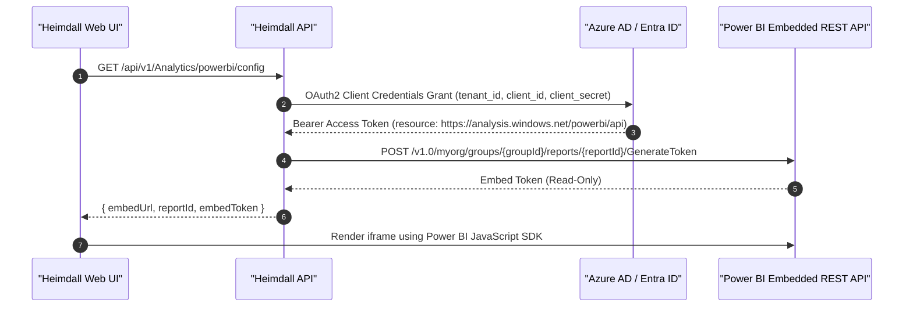

# Business Intelligence, Power BI Embedded & Reporting Integration

This document outlines the architecture, authentication, and data contracts for integrating Heimdall telemetry and operational data with enterprise BI platforms (Milestone 12, PM-005 and PM-006).

---

## 1. Supported BI Platforms

Three external reporting mechanisms are specified:
1. **Microsoft Power BI Embedded**: Azure AD Service Principal direct embedding. Evaluated (PM-005), not implemented.
2. **Grafana**: Infinity JSON datasource plugin integration. The endpoint exists but serves sample series (section 3).
3. **Microsoft Excel / PowerQuery**: OData v4 style JSON feeds. The endpoints exist with the limits in section 4.

The backend endpoints live in `ReportExportController` and require an authenticated caller (`[Authorize]`).

---

## 2. Microsoft Power BI Embedded (PM-005)

### Authentication Flow (Azure Service Principal)

> Proposed flow from the PM-005 evaluation, not implemented: the backend has no `/api/v1/Analytics/powerbi/config` endpoint yet. The Grafana and OData feeds below exist (`ReportExportController`).



### DirectQuery & Dataset Push Architecture
Design, not implemented: no code pushes data to Power BI, and there is no Power BI dashboard tile (real or simulated) in the web UI.
- Planned: edge IPC telemetry pushed periodically into the Power BI dataset via `POST /v1.0/myorg/groups/{groupId}/datasets/{datasetId}/tables/{tableName}/rows`.
- Planned: in offline or local development environments, a simulated executive dashboard tile bound to real-time plant telemetry.

---

## 3. Grafana Infinity Datasource (PM-006)

Grafana dashboards ingest Heimdall metrics using the **Infinity** JSON datasource plugin:

- **Endpoint**: `GET /api/v1/ReportExport/grafana/metrics`
- **Data**: fixed sample series (fleet availability, overall OEE, cycle time) with timestamps relative to the request time; they are not computed from fleet data yet.
- **Format**:
```json
[
  {
    "target": "heimdall.fleet.availability_pct",
    "datapoints": [
      [97.4, 1726190400000],
      [98.2, 1726204800000]
    ]
  },
  {
    "target": "heimdall.telemetry.cycle_time_ms",
    "datapoints": [
      [1195, 1726190400000],
      [1202, 1726204800000]
    ]
  }
]
```

---

## 4. Excel & PowerQuery Live OData Feeds (PM-006)

Engineers can connect Excel to plant data:
1. In Excel, go to **Data > Get Data > From Other Sources > From Web** (the feeds are OData-style JSON, not full OData services).
2. Enter the URL and send the session bearer token (`Authorization: Bearer <token>`), since the endpoints require authentication:
   - Controllers: `http://<heimdall-host>:5099/api/v1/ReportExport/odata/telemetry` (up to 50 controllers with name, hostname, IP, online status and last report; the CPU, RAM and latency columns are placeholder values derived from the controller id, not measurements)
   - Inventory: `http://<heimdall-host>:5099/api/v1/ReportExport/odata/machines` (the first 100 inventory items with name, serial number, status, stock quantity and storage location)
3. PowerQuery expands the JSON `value` array into tabular rows. The context property is `odataContext` (not `@odata.context`), it points at `localhost:5099`, and there is no `$metadata` document, so the **OData Feed** connector cannot use these URLs.
