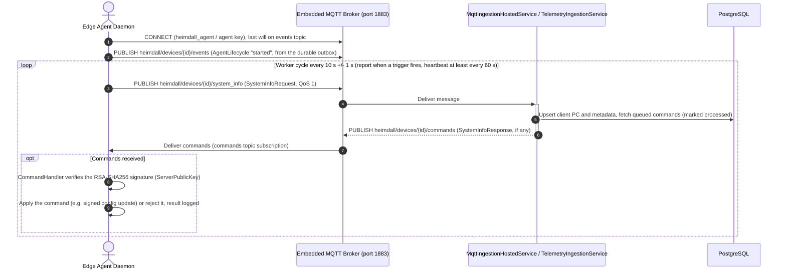

# Industrial Edge Agent & Protocol Specification

This document details the architecture, execution lifecycle, scheduling algorithms, bandwidth throttling, offline spooling, and industrial protocol drivers of the Heimdall Edge Agent daemon (`App.Agent.Daemon`).

---

## 1. Daemon Lifecycle & Execution Architecture

The Heimdall Agent runs as a continuous background daemon on edge compute hardware: as a Windows service (e.g. Windows IoT Enterprise) or as a systemd service on Linux (e.g. Debian, Ubuntu). Beckhoff TwinCAT/BSD is not a supported target. It reports operating-system, hardware and software inventory to the central backend; the PLC side (ADS, OPC UA, Modbus) exists today only as simulations and decoding helpers (section 7).

```
┌──────────────────────────────────────────────────────────────────────────────┐
│                          HEIMDALL EDGE AGENT DAEMON                          │
│                                                                              │
│  ┌──────────────────────────┐   ┌─────────────────────────────────────────┐  │
│  │ Collectors               │   │ Worker loop: 0-3 s start delay, then    │  │
│  │ SystemInfoService (OS,   │   │ every 10 s +/- 1 s                      │  │
│  │ hardware, drives, procs) │   │ TelemetryTriggerEngine: heartbeat 60 s, │  │
│  │ ADS: simulated PLC server│──►│ thresholds, ADS state change, on demand │  │
│  │ (dev features only)      │   │ -> selective slices (HW / SW only when  │  │
│  │ OPC UA: MinimalOpcClient │   │    a trigger asks for them)             │  │
│  │ (HEL/ACK, simulated data)│   │ dev: AdsMemoryReporter -> plc_memory    │  │
│  └──────────────────────────┘   └────────────────────┬────────────────────┘  │
│                                                      ▼                       │
│  ┌──────────────────────────┐   ┌─────────────────────────────────────────┐  │
│  │ LocalTelemetrySpooler    │   │ SystemInfoReporter                      │  │
│  │ DurableRecordQueue:      │   │ contributors (HW, SW, drives, drivers,  ├─┐│
│  │ one plaintext file per   │   │ extensions, industrial OT), sanity      │ ││
│  │ record, atomic write,    │   │ filter, size limit -> SystemInfoRequest │ ││
│  │ SHA-256 envelope, FIFO,  │   │ (protobuf, QoS 1 via MqttAgentClient)   │ ││
│  │ disk quota; damaged      │◄──│ publish failed: spool the report        │ ││
│  │ records go to corrupt/   │──►│ next publish succeeds: drain the spool  │ ││
│  └──────────────────────────┘   └─────────────────────────────────────────┘ ││
│                                                                             ││
│  ┌──────────────────────────┐   ┌─────────────────────────────────────────┐ ││
│  │ Local services           │   │ AgentLifecycleService                   │ ││
│  │ HTTP API :5998 (status,  │   │ started (classifies the previous run),  │ ││
│  │ config, trigger-report,  │   │ stopping, connection_lost = last will,  │ ││
│  │ extension API)           │   │ online after a reconnect; reports wait  │ ││
│  │ PluginManager (double-   │   │ in a durable outbox (DurableRecordQueue)│ ││
│  │ signed plugins, sandbox) │   │ until they are delivered                │ ││
│  │ RecipeWatcherService     │   │                                         │ ││
│  └──────────────────────────┘   └────────────────────┬────────────────────┘ ││
│                                                      ▼                      ││
│  ┌──────────────────────────┐   ┌─────────────────────────────────────────┐ ││
│  │ CommandHandler           │   │ MqttAgentClient                         │◄┘│
│  │ RSA-SHA256 signature     │   │ MQTT 5, heimdall_agent / agent key,     │  │
│  │ check (ServerPublicKey), │◄──│ x-agent-key on every publish, QoS 1,    │  │
│  │ then config, file check, │   │ last will on the events topic,          │  │
│  │ diagnostics, plugins     │   │ subscribed to the commands topic        │  │
│  └──────────────────────────┘   └────────────────────┬────────────────────┘  │
│                                                      │                       │
│  ┌────────────────────────────────────────────┐      │                       │
│  │ Runtime/ library, unit-tested, not yet in  │      │                       │
│  │ the send path: MultiRecipeRuntimeMerger,   │      │                       │
│  │ DeadbandEvaluator (xxHash64),              │      │                       │
│  │ PriorityBandwidthThrottler (gzip)          │      │                       │
│  └────────────────────────────────────────────┘      │                       │
│                                                      │                       │
└──────────────────────────────────────────────────────┼───────────────────────┘
                   MQTT 5 over TCP, protobuf payloads  │
                (commands come back on the same link)  ▼
                              Heimdall backend: embedded MQTT broker (port 1883)
```

### 1.1 Initialization & Anti-Thundering-Herd Jitter
When hundreds of industrial controllers restart simultaneously (for example, following a plant-wide power interruption), immediate simultaneous network connections can overwhelm network switches and central collectors.

The daemon prevents this by introducing a randomized startup delay (`Worker.cs`):
$$\Delta t_{\text{startup}} \sim \text{Uniform}(0, 3\,000\text{ ms})$$

After repeated abnormal ends (two or more in a row) the collectors additionally wait $5\text{ s} \cdot 2^{n-2}$, capped at 5 minutes (`SessionTracker.BackoffFor`).

### 1.2 Polling Loop & Drift Compensation
The background worker evaluates its report triggers every 10 seconds with $\pm 1$ s jitter to avoid cyclical lockstep with other nodes:
$$T_{\text{cycle}} = 10\,\text{s} + \text{Uniform}(-1\,\text{s}, +1\,\text{s})$$
A report is sent only when a trigger fires (section 11); the heartbeat trigger fires at least every 60 seconds. On-demand requests (`POST /api/trigger-report`, tray icon) are picked up at the next cycle.

### 1.3 Local Diagnostic Web API
The daemon hosts an HTTP listener on port 5998. It binds to `AGENT_URLS`, which defaults to `http://0.0.0.0:5998` (all interfaces); the packaged Linux service sets `http://127.0.0.1:5998`. These endpoints have no authentication:
* `GET /`: Agent web dashboard (section 12).
* `GET /api/status`: Host, ADS / OPC UA simulation, trigger engine, MQTT, spool and lifecycle state.
* `GET /api/diagnostics/dump`: Diagnostic snapshot of the same state.
* `POST /api/trigger-report`: Requests an immediate report.
* `POST /api/ads/toggle`: Switches the simulated ADS runtime between RUN and STOP (dev features).
* `GET /api/config`: Returns the active configuration as stored, not anonymized (it includes `ExtensionApiKey`).
* `POST /api/config`: Changes `BackendUrl` only (validated before it is applied).

The extension API (`/api/v1/...`, section 8.4) requires `X-Extension-Key` (or a Bearer token) once `ExtensionApiKey` or `HEIMDALL_EXTENSION_KEY` is set; without a key, and for `GET /api/v1/agent/status`, it is open. There is no `/api/health` endpoint.

---

## 2. Declarative Recipe Engine & Schema

A **Recipe** is a declarative configuration document specifying what data points to collect, from which hardware driver, at what frequency, and under what deadband thresholds.

**Implementation status**: designed, not wired in. The recipe models exist (`Domain/Recipes/RecipeModels.cs`), and the runtime merger, deadband evaluator and egress throttler that would execute them (sections 3 to 5) are unit-tested, but none of them is registered in `Program.cs`. The running agent does not load or execute recipes, and nothing verifies a recipe signature. Signed commands (section 1.4) use RSA-SHA256 only; `Ed25519` in the schema below is not implemented.

### 2.1 JSON Schema
```json
{
  "$schema": "https://json-schema.org/draft/2020-12/schema",
  "title": "HeimdallRecipe",
  "type": "object",
  "required": ["recipeId", "version", "name", "targetSelector", "dataPoints", "security"],
  "properties": {
    "recipeId": { "type": "string", "format": "uuid" },
    "version": { "type": "string", "pattern": "^[0-9]+\\.[0-9]+\\.[0-9]+$" },
    "name": { "type": "string" },
    "description": { "type": "string" },
    "targetSelector": {
      "type": "object",
      "properties": {
        "osPlatform": { "type": "string", "enum": ["Windows", "Linux", "Any"] },
        "controllerRoles": { "type": "array", "items": { "type": "string" } },
        "tags": { "type": "object", "additionalProperties": { "type": "string" } }
      }
    },
    "security": {
      "type": "object",
      "required": ["keyId", "algorithm", "signature", "canonicalHash"],
      "properties": {
        "keyId": { "type": "string" },
        "algorithm": { "type": "string", "enum": ["RSA-SHA256", "Ed25519"] },
        "signature": { "type": "string" },
        "canonicalHash": { "type": "string" }
      }
    },
    "dataPoints": {
      "type": "array",
      "items": {
        "type": "object",
        "required": ["pointId", "sourceDriver", "target", "category", "strategy"],
        "properties": {
          "pointId": { "type": "string" },
          "sourceDriver": { 
            "type": "string", 
            "enum": ["BeckhoffAds", "BeckhoffEtherCat", "SystemCim", "SystemProcess", "SystemDisk", "SystemFileSystem", "OpcUaSubscription", "ModbusTcp"] 
          },
          "target": { "type": "object" },
          "category": { 
            "type": "string", 
            "enum": ["Scalar", "List", "Map", "NestedObject", "Metric", "DeviceState"] 
          },
          "strategy": {
            "type": "object",
            "required": ["type", "intervalMs"],
            "properties": {
              "type": { "type": "string", "enum": ["Periodic", "ChangeOfValue", "OnDemand"] },
              "intervalMs": { "type": "integer", "minimum": 10 },
              "deadband": {
                "type": "object",
                "properties": {
                  "type": { "type": "string", "enum": ["Absolute", "Percentage", "StateChangeOnly"] },
                  "threshold": { "type": "number" },
                  "maxQuietPeriodMs": { "type": "integer" }
                }
              }
            }
          }
        }
      }
    }
  }
}
```

---

## 3. Multi-Recipe Runtime Merger DAG

Multiple operational teams (e.g., Quality Assurance, Maintenance, Controls Engineering) may independently deploy recipes to the same edge node. Executing them as separate independent pollers would cause redundant network traffic, redundant PLC CPU cycles, and duplicate fieldbus packets.

The **Multi-Recipe Runtime Merger** consolidates multiple recipes into a single execution Directed Acyclic Graph (DAG):

**Implementation status**: `Runtime/Merger/MultiRecipeRuntimeMerger.cs` builds the merged probe set (deduplication, minimum interval, property union, deepest inspection level) and is covered by `AgentRecipeMergerTests`, but it is not registered in `Program.cs` and does not poll or dispatch readings yet.

### 3.1 Canonical Source Target Key (CSTK) Deduplication
Every data point target is normalized into a deterministic string key:
$$\text{CSTK} = \text{DriverType} : \text{TargetAddress} : \text{ResourcePath}$$

* Example: Two separate recipes requesting Beckhoff TwinCAT tag `MAIN.stRobot.fActualTorque` generate identical CSTKs:
  `Beckhoff.Ads:192.168.1.10.1.1:851:MAIN.stRobot.fActualTorque`
* The engine merges these into **exactly one physical hardware probe**.

### 3.2 Strictest Minimum-Interval Scheduling
If recipe $A$ requests a tag every $1\,000\text{ ms}$ and recipe $B$ requests the same tag every $250\text{ ms}$, the merged probe executes at:
$$T_{\text{exec}} = \min(T_1, T_2, \dots, T_k) = 250\text{ ms}$$
Design (not implemented): when a sample arrives, it is dispatched immediately to the $250\text{ ms}$ subscriber, and decimated (downsampled) for the $1\,000\text{ ms}$ subscriber.

### 3.3 Scope & Property Union
* For WMI / CIM queries: When multiple queries inspect `Win32_OperatingSystem`, their projected property lists are merged via set union ($\bigcup \text{Columns}$), running a single query rather than multiple WMI round-trips.
* For Process monitoring: Inspection depth promotes to $\max(\text{Depth}_1, \dots, \text{Depth}_k)$.

---

## 4. Deadband & Delta Evaluator

To prevent transmission of unchanged readings, every incoming measurement is meant to pass through the `DeadbandEvaluator`.

**Implementation status**: `Runtime/Evaluation/DeadbandEvaluator.cs` is unit-tested (`DeadbandAndThrottlingTests`) but not registered in `Program.cs`, so the running agent does not filter readings. Unchanged PLC memory blocks are filtered on the backend instead: `PlcMemoryChangeGate` compares a SHA-256 hash of each block with the previous one and forwards an unchanged block only as a keep-alive every 10 seconds.

1. **Absolute Deadband**:
   Suppresses readings where:
   $$|V_{\text{current}} - V_{\text{previous}}| < \text{Threshold}$$
2. **Percentage Deadband**:
   Suppresses readings where:
   $$\frac{|V_{\text{current}} - V_{\text{previous}}|}{|V_{\text{previous}}|} \times 100 < \text{Threshold}\%$$
3. **High-Speed Non-Cryptographic Layout Hashing (`xxHash64`)**:
   For complex DUT structs, array payloads, and maps, numeric deadband calculations are impractical. The evaluator serializes the value to JSON and computes a 64-bit hash via `System.IO.Hashing.XxHash64`. If the hash matches the previous sample, the reading is dropped as zero-delta.
4. **Heartbeat TTL Synchronization (`maxQuietPeriodMs`)**:
   If a measurement remains steady for longer than `maxQuietPeriodMs` (default: 15 minutes), the deadband filter is bypassed and a forced heartbeat reading is emitted (`isHeartbeatForced = true`). This confirms to the backend that the edge sensor is alive and operational.

---

## 5. Bandwidth Throttling & Priority Egress

The agent design uses a 4-tier prioritized queue architecture to protect factory network bandwidth.

**Implementation status**: `Runtime/Throttling/PriorityBandwidthThrottler.cs` implements the queues, batching and token accounting below and is unit-tested, but it is not registered in `Program.cs`: live reports are published directly over MQTT 5 (QoS 1) without priority queues, rate limiting or compression. The trigger engine's priority (section 11) is only recorded in the report.

| Priority Tier | Max Queue Size | Target Flush Latency | Flush Trigger Condition | Typical Payload Types |
| :--- | :--- | :--- | :--- | :--- |
| **`P0_CriticalAlarm`** | Unbounded | **< 10 ms** | Immediate (0 batch delay) | Emergency stops, safety interlocks, EtherCAT frame drop, thermal limits. Not batched. |
| **`P1_HighOperational`** | 5,000 items | **< 200 ms** | ≥ 10 items or 200 ms elapsed | Soft-PLC state transitions (`Run` → `Stop`), drive error fault codes. |
| **`P2_MediumMetrics`** | 20,000 items | **1 s - 5 s** | ≥ 100 items or 2,000 ms elapsed | Spindle speed RPM, pneumatic line pressure, motor torque. |
| **`P3_LowInventory`** | 50,000 items | **5 m - 15 m** | ≥ 1,000 items or 5 mins elapsed | Installed software versions, SMART disk wear metrics, OS patch levels. |

### Dynamic Alarm Threshold Escalation
Design (not implemented): if a standard metric in tier `P2` (e.g., motor temperature) breaches an alarm threshold ($T > 85^\circ\text{C}$), the evaluator promotes that specific telemetry packet to **`P0_CriticalAlarm`**, flushing it to the network immediately. No code promotes packets yet; the live trigger engine (section 11) escalates whole reports instead.

### Token Bucket Rate Limiter
Designed ceiling: 256 KB/s by default (constructor default; `AgentConfig.MaxNetworkEgressBytesPerSec` defaults to 1 MB/s but is not read). Tokens refill continuously based on elapsed wall-clock time. The current code only accounts for tokens: every packet, `P0` included, consumes them, and a send is never delayed when the bucket is empty, so egress is not limited yet.

### Adaptive Compression
Outgoing batch payloads ≥ 256 bytes are compressed with **GZip** (`GZipStream`, `CompressionLevel.Fastest`). Zstandard is not used, and no compression ratio has been measured.

---

## 6. Offline Store-and-Forward Spooling

During network partitions or central server maintenance, the agent keeps every system_info report whose MQTT publish failed in a local file queue (`LocalTelemetrySpooler` on `DurableRecordQueue`). The SQLite (WAL) spool with priority tiers that this section originally specified was not built; there are no priorities in the spool.

* **Location** (`AgentPaths.Resolve`, first writable directory): `HEIMDALL_SPOOL_DIR` when set (the packaged Linux service uses `/var/lib/heimdall-agent/spool`), otherwise `<install dir>/telemetry_spool`, otherwise `<state dir>/telemetry_spool`. Crash dumps live in `<spool>/crash_dumps`.
* **Record format**: one file per record, written atomically (temp file, flush to disk, rename). Each file holds a checksum envelope `{"format":"heimdall.spool","version":1,"enqueuedAtUtc":"...","sha256":"...","payload":"..."}` around the report JSON. Records are plaintext: `SpoolEncryptionMode` exists in the configuration but is not applied.
* **Quota**: `MaxSpoolDiskMb` (default 500 MB); when it is reached the oldest records are evicted first.
* **Damaged records**: an empty, zero-filled, truncated or checksum-failing file (what a power loss or BSOD can leave behind) is moved to `corrupt/` (the last 20 are kept) and skipped; a record whose processing throws 3 times is set aside as poison. Neither blocks the records behind it.
* **Drain Algorithm**: after the next live report has been published successfully, the spool is drained oldest-first, one drain at a time. The drain stops at the first record that cannot be sent, which stays queued. There is no backoff schedule; the next drain follows the next successful report.

---

## 7. Industrial Protocol Drivers & Specifications

**Implementation status**: the PLC drivers in this section are designs. The agent references no Beckhoff, OPC Foundation or Modbus library: the ADS endpoint is an in-process simulation server (dev features only, section 9), the OPC UA client performs only the HEL/ACK handshake and generates simulated values (section 10), and Modbus support consists of decoding helpers. The operating-system probes (7.5) are real.

### 7.1 Beckhoff TwinCAT ADS & EtherCAT Diagnostics
* **ADS Architecture**: Design, not implemented: an ADS client built on `Beckhoff.TwinCAT.Ads` with a managed in-process router (`AmsTcpIpRouter`) over TCP port 48898, without the TwinCAT XAE runtime on Linux hosts. Today `AdsSimulationServer` (port 48898, dev features) stands in for the PLC, and `AdsMemoryReporter` publishes its simulated variables as `plc_memory` blocks.
* **Standard Ports**:
  * Port `10000`: TwinCAT System Service (queries runtime state: Run, Config, Stop).
  * Port `851`: TwinCAT 3 PLC Runtime 1 (symbol browsing and data reading).
  * Port `0xFFFF`: EtherCAT Master diagnostics.
* **ADS Sum Commands (`0xF080`)** (design, not implemented):
  Rather than issuing hundreds of individual network requests, the driver packs multiple symbol handles into a single ADS Sum Command request. The TwinCAT PLC resolves all tags in memory in a single cycle and returns a single concatenated response buffer.
* **EtherCAT Master Diagnostic Registers**: `EtherCatDiagnosticsHelper` decodes these values (unit-tested); there is no live EtherCAT master connection to read them from.
  * IndexGroup `0x00000003`, Offset `0x00000100`: EtherCAT Master State (`0x1`=INIT, `0x2`=PREOP, `0x3`=BOOT, `0x4`=SAFEOP, `0x8`=OP).
  * `DevState` Bitmask:
    * `0x0001`: Physical link error on primary port.
    * `0x0002`: I/O locked.
    * `0x0008`: Missing cyclic frames (frame dropped by network switch or cable defect).
    * `0x0800`: At least one slave in error state.
    * `0x1000`: Distributed Clocks (DC) synchronized flag lost.
  * IndexGroup `0x00000009`: Reads full slave topology array (`ST_EcSlaveState`).
  * IndexGroup `0xF302`: CAN application protocol over EtherCAT (CoE) SDO read/write.
  * Register range `0x0300..0x0307`: Hardware ESC physical CRC error counters per port.

### 7.2 TcOpen OOP Standard & Standalone Double-Buffered Bridge
* **`ITcoHeimdallTelemetry` Contract**:
  Industrial software implementing the TcOpen framework standardizes telemetry via an interface defining:
  ```pascal
  INTERFACE ITcoHeimdallTelemetry EXTENDS ITcoComponent
  METHOD UpdateTelemetry : BOOL
  PROPERTY SequenceId : ULINT
  ```
  Components output their data into a flat, strongly-typed `_data` variable containing pure IEC standard types (scalars, DUTs, flat arrays).
* **Pointer-Free Network Safety**:
  The Heimdall Agent is designed to read `<SymbolPath>._data` as a fixed byte layout. It never attempts to dynamically traverse `POINTER TO` or `REFERENCE TO` fields across the network, eliminating memory violation risks in real-time PLC kernels. The byte-layout decoder (`StructTelemetryBinder`) exists and is unit-tested; without an ADS client it is not connected to a PLC yet.
* **`FB_HeimdallTelemetryBridge` (Standalone TwinCAT 3)**:
  For vanilla TwinCAT projects not using TcOpen, Heimdall provides a drop-in Function Block (`FB_HeimdallTelemetryBridge.TcPOU`) implementing lock-free double buffering (`stTelemetryBuffer[0..1]`). While the PLC cyclic task writes to buffer index $i$, external ADS clients read from index $1 - i$. A sequence counter validates that no torn reads occurred during copy.

### 7.3 OPC UA Client Driver
Design, not implemented. What exists is `MinimalOpcClient` (section 10): it performs the binary HEL/ACK handshake and then fills its monitored nodes with simulated values, whether or not a server answered. The planned driver:
* **Protocol Implementation**: Utilizes the OPC Foundation standard stack (`OPCFoundation.NetStandard.Opc.Ua`).
* **Security Policies Supported**: `Basic256Sha256`, `Aes128_Sha256_RsaOaep`, and `None` (test environments).
* **Session Resilience**: Keepalive heartbeat loop monitors server reachability and triggers automated reconnection sequences with session state recovery upon PLC reboots.
* **Address Space Traversal**: Uses continuation points to paginate large address spaces without exceeding server PDU limits.
* **Subscription Management**: Configures server-side analog deadbands to minimize network events at the source.

### 7.4 Modbus TCP Driver
Design, not implemented: there is no Modbus TCP client. `ModbusEndiannessConverter` provides the register decoders and the contiguous-block optimizer described below (unit-tested).
* **Supported Function Codes** (planned):
  * `FC01`: Read Coils
  * `FC02`: Read Discrete Inputs
  * `FC03`: Read Holding Registers
  * `FC04`: Read Input Registers
  * `FC16`: Write Multiple Registers
* **Endianness Conversion**:
  Different PLC manufacturers represent 32-bit floating-point numbers across two 16-bit registers differently. `ModbusEndiannessConverter` provides 4 decoders:
  * `CDAB`: Word-Swapped / Mid-Big Endian (Standard for Schneider Electric, ABB, and most industrial meters).
  * `ABCD`: Big-Endian (Siemens S7).
  * `BADC`: Mid-Little Endian.
  * `DCBA`: True Little-Endian (Intel x86 native).
* **Contiguous Register Optimizer**:
  If multiple requests target registers separated by a gap of ≤ 5 unused registers, `OptimizeRegisterBlocks` merges them into a single contiguous block read (up to 120 registers) to eliminate network latency.

### 7.5 Operating System & Hardware Inspection Probes
* **Windows Hardware Probes**:
  * P/Invoke queries against `setupapi.dll` and `cfgmgr32.dll` matching `GUID_DEVCLASS_NET` to detect installed Beckhoff Real-Time Virtual Ethernet adapters (`TcRTEthernet`, `TcEth`).
  * Registry scanner querying 32-bit and 64-bit uninstall hives:
    * `HKLM\SOFTWARE\Microsoft\Windows\CurrentVersion\Uninstall`
    * `HKLM\SOFTWARE\WOW6432Node\Microsoft\Windows\CurrentVersion\Uninstall`
* **Linux Kernel Probes**:
  * Directly reads and parses `/proc/cpuinfo` and `/proc/meminfo`.
  * Network adapters and their link state come from .NET's `NetworkInterface` API; `/proc/net/dev`, `/sys/class/net/*/speed` and `operstate`, and a systemd D-Bus service tracker are not implemented.
* **Process CPU Delta Sampling**:
  Measures process CPU usage by recording user/kernel time deltas divided by system wall-clock elapsed time across sampling intervals, rather than relying on instantaneous, uncalibrated counters.


### 1.4 Agent-Backend Transport: MQTT 5

There is no gRPC in Heimdall. Agents and the fleet simulator publish protobuf messages (`src/shared/App.Contracts/Protos`, messages only) to the MQTTnet broker embedded in the backend (port 1883). The backend's `MqttIngestionHostedService` subscribes with wildcards at QoS 1 and passes each message to `TelemetryIngestionService`.

**Authentication**: MQTT credentials `heimdall_agent` / agent key, plus the MQTT 5 user property `x-agent-key` on every publish. There is no mTLS on this path; client certificates are used for kiosk terminals only (see `SECURITY_AND_COMPLIANCE.md`).

**Topics** (`src/shared/App.Contracts/Mqtt/MqttTopics.cs`):

| Topic | Direction | Payload |
| :--- | :--- | :--- |
| `heimdall/devices/{machine_identifier}/system_info` | agent to backend | `SystemInfoRequest` (hardware, OS, metrics) |
| `heimdall/devices/{id}/plc_memory` | agent to backend | `AdsPlcMemoryBlock` (or `AdsPlcMemoryBatch`) |
| `heimdall/devices/{id}/telemetry` | agent to backend | `TelemetryBatchRequest` |
| `heimdall/devices/{id}/events` | agent to backend | `AgentEventMessage` |
| `heimdall/devices/{id}/commands` | backend to agent | `SystemInfoResponse` with queued commands (QoS 1) |
| `heimdall/devices/{id}/recipes/request` | agent to backend | recipe sync request: topic defined and subscribed by the backend, but no handler and no publisher yet (a `recipes/response` topic is defined as well) |

**Commands**: when a `system_info` report arrives and commands are queued for the device, the backend publishes them to the device's `commands` topic. The agent verifies the RSA-SHA256 signature against its `ServerPublicKey` and applies the command, or rejects it. The outcome is only logged locally; no `AgentEventMessage` is sent for it.

**Lifecycle and last will**: the agent sends `AgentEventMessage` with source `AgentLifecycle` on the `events` topic: `started` (with a classification of the previous run: clean stop, service stop, crash, killed, power loss / OS crash), `stopping`, and `connection_lost`, which is registered as the MQTT last will and published by the broker when the agent disappears. `AgentLifecycleIngestor` stores them in `agent_events` and `client_pcs.system_metadata.AgentLifecycle`; the field contract is the comment above `AgentEventMessage` in `system_info.proto`. Stations whose controllers' agents sent their last will are shown OFFLINE.

**Backend processing** of PLC memory blocks: `PlcMemoryChangeGate` drops unchanged blocks (keep-alive every 10 s; arrival is still recorded for freshness), `StationTelemetryExtractor` builds the station snapshot, which is cached and pushed over SignalR (`StationTelemetryReceived`, `StationOscillationReceived`).



---

## 8. Cryptographically Signed Plugins, Sandboxing & Extension API

### 8.1 Master RSA-2048 Signing & Verification Pipeline
To prevent unauthorized code execution on critical OT controllers while enabling safe third-party extensibility, the agent implements cryptographic verification for dynamic plugins:
- **Central Authority**: `PluginService` in the backend API maintains an RSA-2048 signing authority. When a plugin package is published, all files are canonically sorted and hashed using SHA-256 to compute a deterministic `PayloadHash`.
- **Digital Signatures**: The backend signs the payload hash using `RSA-SHA256` with `Pkcs1` padding.
- **Agent Verification**: `PluginManager` independently re-hashes extracted files and validates the digital signature against `ServerPublicKey`. Any modification or file tampering fails validation immediately.

### 8.2 Production Fail-Secure vs. Development Sandboxing
- **Production Mode**: When running in Production (`Environment == "Production"`), unsigned or invalidly signed plugins are strictly rejected with `ErrorCode.PluginSignatureInvalid`. Unsigned execution is impossible.
- **Development Sandboxing**: In non-production environments with `AllowUnsignedPlugins == true`, developers can test experimental sensor drivers inside an isolated sandbox (`sandboxes/{pluginId}/`).

### 8.3 Secret Scrubbing & Path Traversal Protections
- **Secret Scrubbing**: Sensitive environment variables (`HEIMDALL_AGENT_KEY`, `HEIMDALL_MASTER_PRIVATE_KEY`, `HEIMDALL_ENCRYPTION_KEY`) are stripped before spawning child plugin processes.
- **Path Containment**: `PathSanitizer.IsWithinRoot` ensures extraction targets cannot escape the plugin root directory via directory traversal sequences (`../`).
- **Process Supervision**: Plugin processes run with strict execution timeouts controlled via `CancellationTokenSource`.

### 8.4 Local Extension REST API (`/api/v1/extensions/*`)
For local applications (e.g., Python vision algorithms, barcode scanners, proprietary C++ test benches), the daemon exposes an authenticated HTTP REST interface:
- `GET /api/v1/agent/status`: Status check and health reporting.
- `POST /api/v1/extensions/components`: Register custom hardware sensors or sub-devices.
- `POST /api/v1/extensions/telemetry`: Push custom time-series measurements.
- `POST /api/v1/extensions/events`: Stream custom alarms and operational events.
- `POST /api/v1/agent/sync`: Trigger immediate synchronization to the backend.
- Guarded by `ExtensionAuthFilter` using constant-time token comparisons (`CryptographicOperations.FixedTimeEquals`) once `ExtensionApiKey` or `HEIMDALL_EXTENSION_KEY` is set; `GET /api/v1/agent/status` is not guarded.

### 8.5 Component Tree Integration & Inventory Attachment
Custom components registered via the Extension API are merged into the machine hierarchy:
- `ExtensionComponentContributor` packages active sensors into the agent's telemetry payload.
- `TelemetryIngestionService` links the sensor to its parent equipment using `BaseInventoryItem.ParentId`.
- The Station Component Tree modal (`StationComponentTreeModal.vue`) displays custom sensors with `[Signed]` and `[Dev Sandbox]` trust badges, allowing operators to inspect dynamic JSON state directly from the CAD map or machinery views.

---

## 9. Beckhoff TwinCAT ADS Simulation Server (Port 48898)

The agent daemon includes a high-performance in-memory Beckhoff TwinCAT ADS simulation server (`AdsSimulationServer.cs`) listening on standard ADS TCP port **48898**:
* **AMS Net ID**: `5.80.201.44.1.1:851` (TwinCAT 3 PLC Runtime 1).
* **AMS/TCP Protocol Framing**:
  * Decodes 6-byte AMS/TCP headers and 32-byte AMS packet headers.
  * `0x0001` (`ADSCMD_READ_DEVICE_INFO`): Returns TwinCAT 3.1 PLC Runtime, Build 4026.11.
  * `0x0004` (`ADSCMD_READ_STATE`): Returns current PLC state (`ADSSTATE_RUN = 5` or `ADSSTATE_STOP = 6`).
  * `0x0005` (`ADSCMD_WRITE_CONTROL`): Allows remote or local switching between RUN, STOP, and RESET states.
  * `0x0002` (`ADSCMD_READ`) / `0x0009` (`ADSCMD_READ_WRITE`): Serves live simulated PLC variables:
    * `MAIN.CycleCounter` (incrementing 32-bit counter)
    * `MAIN.TemperatureDegC` (sine-wave oscillation: 62.0 °C ± 8.5 °C)
    * `MAIN.PressureBar` (harmonic oscillation: 6.0 bar ± 0.35 bar)
    * `MAIN.MachineRunning` (Boolean: true)
    * `MAIN.PartsProduced` (DINT part accumulation)
    * `MAIN.DriveSpeedRpm` & `MAIN.LineCurrentAmps`
* **Zero-Allocation Struct Unmarshalling**: Compatible with `StructTelemetryBinder.cs` for direct memory-mapped buffer translation.

---

## 10. Minimal OPC UA Client (Port 4840)

To connect with third-party controllers without external heavy SDK dependencies, the agent provides `MinimalOpcClient.cs`:
* **OPC UA Binary Protocol**: Implements standard binary socket communication (`HEL`/`ACK` handshake with message sizing and buffer negotiation).
* **Virtual Simulation Fallback**: When an external OPC UA server is offline, the client automatically engages simulated telemetry generation, ensuring uninterrupted local diagnostics.
* **Monitored Node Registry**:
  * `ns=2;s=Line01.DriveSpeed`: Main motor speed (RPM)
  * `ns=2;s=Line01.MotorCurrent`: Load current (Amperes)
  * `ns=2;s=Line01.QualityOk`: Automated yield qualification (Boolean)
  * `ns=2;s=Line01.PartCount`: Batch cycle accumulation
* **Telemetry Pipeline Integration**: Polled OPC metrics are attached to `IndustrialOtData` and published over MQTT to the central ingestion service.

---

## 11. Reporting Trigger Engine & Selective Slice Filtering

To eliminate redundant bandwidth usage across industrial OT networks, telemetry dispatch is governed by `TelemetryTriggerEngine.cs`:
* **`HeartbeatTrigger`**: Ensures connectivity liveness at configurable intervals (default: 60s). Sends lightweight liveness slices (`HeartbeatOnly`).
* **`ThresholdTrigger`**: Monitors metric thresholds:
  * OS Drive free space $\le 15$ GB: Triggers `P1_HighOperational`.
  * OS Drive free space $\le 5$ GB: Escalates to `P0_CriticalAlarm`.
  * TwinCAT PLC temperature $\ge 75.0$ °C: Escalates to `P0_CriticalAlarm`.
* **`StateChangeTrigger`**: Detects state transitions:
  * TwinCAT ADS state change (e.g. `RUN (5)` &rarr; `STOP (6)` or `ERROR (11)`).
  * Network interface state change or machine identity reconfiguration.
* **`OnDemandTrigger`**: Fires at the next worker cycle (section 1.2) after a manual request via the Agent Web Dashboard or the Taskbar Tray Icon (`POST /api/trigger-report`). `POST /api/v1/agent/sync` (extension API) sends a report at once. No backend command requests a report.
* **Selective Data Slice Filtering**:
  * When only a metric or PLC variable changes, unchanged static hardware (`HardwareInfo`) and installed software (`SoftwareInfo`) slices are omitted, achieving up to 90% bandwidth reduction.

---

## 12. Windows Taskbar Tray Icon & Modernized Agent Web-View

* **Taskbar Tray Runner (`HeimdallTrayRunner.ps1`)**:
  * Lives in the Windows system tray notification area with a Heimdall shield icon.
  * Real-time tooltip: `Heimdall Industrial Edge Agent | ADS: 48898 RUN | OPC: Connected`.
  * Context Menu:
    * *Open Agent Web Dashboard* (launches `http://localhost:5998`)
    * *Trigger Immediate Telemetry Report* (dispatches instant telemetry with balloon confirmation)
    * *Toggle TwinCAT ADS State* (RUN / STOP)
    * *View Agent Status Summary*
    * *Restart Agent Service*
* **Modernized Web Dashboard (`http://localhost:5998`)**:
  * Industrial dark-theme interface matching Heimdall design language.
  * Live status cards: Host Environment, TwinCAT ADS Simulation, Minimal OPC UA Client, and Trigger Engine.
  * Diagnostic and control APIs: `GET /api/status`, `POST /api/trigger-report`, `POST /api/ads/toggle`, and `GET/POST /api/config`.


