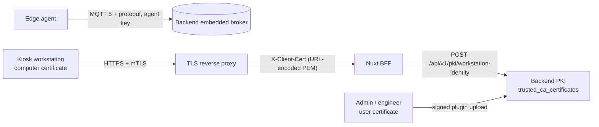
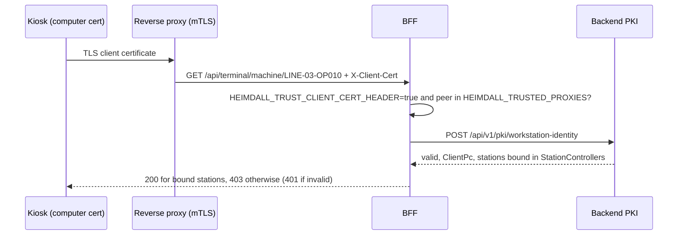
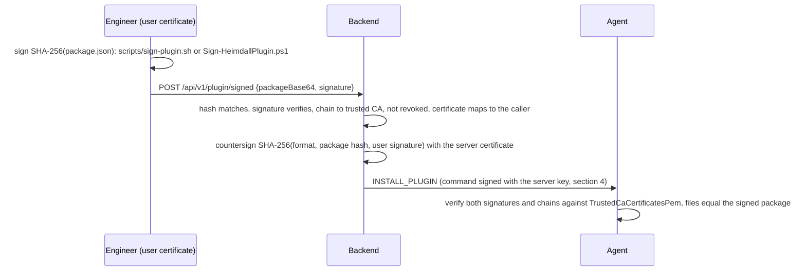

# Security, Encryption & Compliance Specification

This document provides the technical specification for cryptographic controls, data protection at rest and in transit, PII exclusion mechanisms, and TISAX (VDA ISA 6.0) / GDPR compliance mappings implemented across Heimdall.

---

## 1. Threat Model & Protection Objectives

Industrial Operational Technology (OT) networks connect edge controllers with enterprise services. In this environment, security risks include:
* **Compromise of Sensitive Factory Spatial Data**: Plant layouts (`FloorPlan.SvgContent`) reveal proprietary machinery placement, assembly sequencing, and throughput capacity.
* **Unauthorized Command Injection**: Malicious or corrupted commands sent to IPCs or PLCs could alter machine state, disrupt assembly lines, or damage physical equipment.
* **Credential & License Theft**: Soft-PLC runtime licenses (`SoftwareAsset.LicenseKey`) and system access tokens must be protected against local disk inspection and database backup leaks.
* **Inadvertent PII Ingestion**: Edge agents scanning filesystems for industrial project files must never ingest personal user data, browser histories, or credentials.

```
┌─────────────────────────────────────────────────────────────────────────────┐
│                             DEFENSE-IN-DEPTH                                │
│                                                                             │
│  [ Transport Security ]                                                     │
│  └── TLS 1.3 for REST/HTTPS, MQTT 5 + agent key, mTLS only at the kiosk    │
│      reverse proxy, SSL for PostgreSQL                                      │
│                                                                             │
│  [ Field-Level Authenticated Encryption at Rest ]                           │
│  └── AES-256-GCM with unique 96-bit nonces and 128-bit authentication tags  │
│                                                                             │
│  [ Cryptographic Command Signing & Fail-Secure Verification ]               │
│  └── Digital signatures validated on edge daemons prior to execution        │
│                                                                             │
│  [ Edge Envelope Encryption & Hardware Binding ]                            │
│  └── Windows DPAPI / Linux HKDF-SHA256 from /etc/machine-id + 0600 seed     │
│                                                                             │
│  [ PII Exclusion & Scrubber Engine ]                                        │
│  └── Directory blacklist, sensitive file zero-traverse, process scrubber    │
│                                                                             │
│  [ Multi-Tenant Isolation & Least Privilege ]                               │
│  └── EF Core Global Query Filters & separated DML/DDL database roles        │
└─────────────────────────────────────────────────────────────────────────────┘
```

---

## 2. AES-256-GCM Field-Level Encryption

To protect confidential data at rest independently of database-level encryption, Heimdall implements field-level authenticated encryption using **AES-256-GCM (Galois/Counter Mode)** (NIST SP 800-38D).

### 2.1 Cryptographic Parameters
* **Cipher**: `AES-256-GCM` authenticated symmetric encryption.
* **Key Size**: 256 bits (32 bytes), loaded at startup from `HEIMDALL_ENCRYPTION_KEY`.
* **Initialization Vector (Nonce)**: 96 bits (12 bytes), generated freshly for every encryption operation using a cryptographically secure random number generator (`RandomNumberGenerator.Fill`).
* **Authentication Tag**: 128 bits (16 bytes), verifying ciphertext integrity and authenticity.
* **Serialized Wire Format**:
  $$\text{Payload} = \text{Base64}\Big(\text{Nonce}\,[12\text{B}] \;\mathbin{\Vert}\; \text{Tag}\,[16\text{B}] \;\mathbin{\Vert}\; \text{Ciphertext}\,[N\text{B}]\Big)$$

### 2.2 Protected Entities & Fields

| Entity | Encrypted Property | Sensitivity Level | Justification |
| :--- | :--- | :--- | :--- |
| **`FloorPlan`** | `SvgContent` | **Confidential** | Proprietary plant layout geometry and machine coordinates. |
| **`SoftwareAsset`** | `LicenseKey` | **Confidential** | Commercial Soft-PLC and SCADA activation keys. |
| **`QueuedAgentCommand`** | `Payload` | **Restricted** | Operational command parameters dispatched to edge daemons. |
| **`ClientPc`** | `SystemMetadata` | **Restricted** | Network adapter configurations, installed patches, system accounts. |

### 2.3 Entity Framework Core ValueConverter
Field encryption is handled transparently on database writes and reads via `EncryptedStringConverter` in `AppDbContext`:

```csharp
public class EncryptedStringConverter : ValueConverter<string, string>
{
    public EncryptedStringConverter(byte[] masterKey)
        : base(
            plain => Encrypt(plain, masterKey),
            cipher => Decrypt(cipher, masterKey))
    {
    }

    public static string Encrypt(string plaintext, byte[] key)
    {
        if (string.IsNullOrEmpty(plaintext)) return plaintext;

        byte[] nonce = new byte[12];
        RandomNumberGenerator.Fill(nonce);

        byte[] plainBytes = Encoding.UTF8.GetBytes(plaintext);
        byte[] cipherBytes = new byte[plainBytes.Length];
        byte[] tag = new byte[16];

        using var aesGcm = new AesGcm(key, 16);
        aesGcm.Encrypt(nonce, plainBytes, cipherBytes, tag);

        byte[] combined = new byte[nonce.Length + tag.Length + cipherBytes.Length];
        Buffer.BlockCopy(nonce, 0, combined, 0, 12);
        Buffer.BlockCopy(tag, 0, combined, 12, 16);
        Buffer.BlockCopy(cipherBytes, 0, combined, 28, cipherBytes.Length);

        return Convert.ToBase64String(combined);
    }

    public static string Decrypt(string cipherPayload, byte[] key)
    {
        if (string.IsNullOrEmpty(cipherPayload)) return cipherPayload;

        byte[] combined = Convert.FromBase64String(cipherPayload);
        if (combined.Length < 28) throw exciting CryptographicException("Ciphertext payload truncated.");

        byte[] nonce = new byte[12];
        byte[] tag = new byte[16];
        byte[] cipherBytes = new byte[combined.Length - 28];

        Buffer.BlockCopy(combined, 0, nonce, 0, 12);
        Buffer.BlockCopy(combined, 12, tag, 0, 16);
        Buffer.BlockCopy(combined, 28, cipherBytes, 0, cipherBytes.Length);

        byte[] plainBytes = new byte[cipherBytes.Length];
        using var aesGcm = new AesGcm(key, 16);
        aesGcm.Decrypt(nonce, cipherBytes, tag, plainBytes);

        return Encoding.UTF8.GetString(plainBytes);
    }
}
```

---

## 3. Edge Cryptographic Key Management & Storage

Edge daemons must persist configuration locally (such as API tokens, backend endpoints, and custom thresholds) without leaving credentials in plaintext on disk:

### 3.1 Windows Deployments (DPAPI)
On Windows IoT hosts, the daemon uses Windows Data Protection API (DPAPI) under `DataProtectionScope.LocalMachine`, augmented with application-specific secondary entropy:
```csharp
byte[] entropy = Encoding.UTF8.GetBytes("Heimdall.OT.Agent.Entropy.v1");
byte[] ciphertext = ProtectedData.Protect(plaintextBytes, entropy, DataProtectionScope.LocalMachine);
```

### 3.2 Linux Deployments (HKDF Machine Binding Envelope)
On Linux systems lacking DPAPI, the daemon uses AES-256-GCM with a key derived via **HKDF-SHA256** combining two distinct factors:
$$\text{IKM} = \text{MachineIdentifier} \mathbin{\Vert} \text{LocalMasterSeed}$$

1. **`MachineIdentifier`**: Immutable hardware UUID read from `/etc/machine-id` (or `/var/lib/dbus/machine-id`).
2. **`LocalMasterSeed`**: A 32-byte cryptographically secure random value stored in `/etc/heimdall/master.seed` with strict POSIX file permissions:
   ```bash
   chmod 0600 /etc/heimdall/master.seed
   chown root:root /etc/heimdall/master.seed
   ```
This envelope scheme ensures that even if a disk image or configuration file is copied to another machine, it cannot be decrypted without the source machine's hardware identity.

---

## 4. Signed Remote Command Execution Pipeline

To eliminate the risk of unauthorized remote command execution, all commands queued for edge agents are cryptographically signed by the backend:

```
[ Backend API ]                                                    [ Edge Daemon ]
       │                                                                  │
       │ 1. Admin issues command (e.g., UPDATE_CONFIG)                    │
       │ 2. Backend signs payload:                                        │
       │    Signature = Sign_RSA(SHA256(Payload), PrivateKey)             │
       │ 3. Enqueues in backend.queued_agent_commands                     │
       │                                                                  │
       │─────────────── 4. Deliver via MQTT 5 (ServerCommand) ───────────►│
       │                                                                  │
       │                                                                  │ 5. Verify:
       │                                                                  │    Verify_RSA(Payload,
       │                                                                  │               Signature,
       │                                                                  │               ServerPublicKey)
       │                                                                  │
       │                                                                  │─┐ [Signature Valid]
       │                                                                  │ │ Execute Command
       │                                                                  │◄┘
       │                                                                  │
       │                                                                  │─┐ [Signature Invalid]
       │                                                                  │ │ Fail-Secure: Reject &
       │                                                                  │ │ Raise Critical Alert
       │                                                                  │◄┘
```

1. **Signing**: When an administrator queues an agent command via `POST /api/AgentCommand`, the backend signs the canonical payload bytes using RSA-4096 / SHA-256.
2. **Transmission**: The base64-encoded signature is attached to `ServerCommand.Signature`.
3. **Edge Verification**: `ConfigurationService.VerifyCommandSignature` validates the signature against the pre-configured `ServerPublicKey`.
4. **Fail-Secure Rejection**: If the signature does not match or the public key is missing, execution is immediately aborted. The daemon logs a `Critical` security event to `backend.agent_events` and records the rejected payload for auditing.

---

## 5. PII & Sensitive Data Exclusion Engine

Edge agents collect hardware telemetry and industrial file inventories (PLC programs, CAD drawings). To strictly enforce GDPR Article 25 (Privacy by Design) and automotive compliance, the agent incorporates deterministic exclusion engines.

### 5.1 Directory Blacklist (Zero-Traverse Policy)
The recursive filesystem scanner immediately prunes and refuses to descend into directories matching any of the following patterns:
* **Web Browsers & Session Data**:
  * `AppData/Local/Google/Chrome`, `AppData/Local/Microsoft/Edge`, `AppData/Roaming/Mozilla`
  * `AppData/Local/BraveSoftware`, `AppData/Local/Opera Software`
  * `.config/google-chrome`, `.config/chromium`, `.mozilla`
  * Subdirectories named `Cookies`, `History`, `Login Data`, `Web Data`, `Sessions`
* **OS System Internals & Cache**:
  * `Windows/WinSxS`, `Windows/System32/config`, `Windows/ServiceProfiles`
  * `/var/cache`, `/tmp`, `/proc`, `/sys`
* **Developer & Dependency Stores**:
  * `node_modules`, `.git`, `.venv`, `bin`, `obj`

### 5.2 Sensitive File Blacklist (Zero-Read Policy)
Files matching any of the following patterns are skipped during inventory scans:
* User profile registry hives: `NTUSER.DAT*`, `UsrClass.dat*`
* Shell history files: `.bash_history`, `.zsh_history`, `.history`, `PowerShell_history.txt`
* Cryptographic private keys: `id_rsa`, `id_ed25519`, `id_ecdsa`, `*.pem`, `*.key`
* Operating system hives & dumps: `sam`, `security`, `system`, `pagefile.sys`, `hiberfil.sys`, `swapfile.sys`

### 5.3 Process Secret Scrubber (`ProcessSecretScrubber`)
Command-line arguments of running processes are sanitized prior to telemetry packaging:
* **Password & Token Parameters**: Any argument matching `--password`, `--token`, `--secret`, `--apikey`, or `connectionstring` has its value replaced with `[REDACTED]`.
* **JSON Web Tokens (JWT)**: Base64-encoded three-segment bearer tokens (`eyJ...`) are replaced with `[REDACTED_JWT]`.
* **User Home Paths**: File paths containing user account directories (e.g., `C:\Users\jdoe\` or `/home/jdoe/`) are replaced with `[USER_ACCOUNT]`.

---

## 6. TISAX VDA ISA 6.0 Compliance Mapping

The platform aligns with the **VDA Information Security Assessment (VDA ISA 6.0)** catalog for **Assessment Level 3 (High Protection Needs)**:

| VDA ISA ID | Control Name | Heimdall Implementation | Verification Evidence |
| :--- | :--- | :--- | :--- |
| **ISA 1.1** | **Identity & Access Management** | Multi-tenant authentication via Better-Auth. Session tokens required on all REST and WebSocket endpoints; agents authenticate to MQTT with the agent key. Multi-factor authentication (MFA) supported. | `AuthSession` token validation; unit tests in `auth.test.ts`. |
| **ISA 1.2** | **Tenant & Data Isolation** | EF Core Global Query Filters automatically scope every query by `organization_id`. Cross-tenant data retrieval is blocked at the database engine level. | `MultiTenancyAndGovernanceTests` verify tenant isolation across all repositories. |
| **ISA 1.3** | **Role-Based Access Control** | Fine-grained roles (`admin`, `engineer`, `technician`, `operator`). Role mappings supported via Entra ID and Active Directory security groups. | Dynamic claims transformer and API authorization policies. |
| **ISA 2.1** | **Cryptography & Key Management** | AES-256-GCM authenticated encryption for sensitive database columns; RSA/ECDSA digital signatures for agent commands; no hardcoded keys in repository. | `EncryptedStringConverter` test suite; key validation startup checks. |
| **ISA 2.2** | **Transport Security** | TLS 1.3 mandatory for HTTP; MQTT 5 with the agent key and signed commands (no gRPC, no telemetry mTLS); mTLS only at the kiosk terminal reverse proxy (section 9.1); SSL required for PostgreSQL connections; Redis password authentication (`requirepass`). | Docker Compose network certificates; `Program.cs` Kestrel endpoints. |
| **ISA 2.3** | **Least Privilege & Role Separation** | Separation between DDL migration role (`ef_admin`) and runtime DML role (`dotnet_backend`). Zero shell access required by backend containers. | PostgreSQL `init-roles.sql` permissions; container non-root execution. |
| **ISA 5.1** | **System Auditability & Logging** | Immutable change logging (`audit_logs`), security event logging (`agent_events`), and dead-letter quarantine (`malformed_telemetry_quarantine`). | Dedicated database tables with UTC timestamps and user attribution. |
| **ISA 5.2** | **Network Segmentation** | Clear demarcation between IT management plane (HTTP/JSON port 5099) and OT telemetry (MQTT 5 broker embedded in the backend). Local spooling handles network partitions. | Agent `LocalTelemetrySpooler` and architecture topology. |

---

## 7. Audit Trail & Log Retention

1. **System Audit Trail (`backend.audit_logs`)**:
   Captures administrative mutations (user role modifications, organization provisioning, asset deletion). Fields: `id`, `user_id`, `user_name`, `action`, `entity_type`, `entity_id`, `old_values_json`, `new_values_json`, `ip_address`, `organization_id`, `timestamp`.
2. **Security & System Events (`backend.agent_events`)**:
   Records operational security alerts emitted by edge agents. Severity levels:
   * `Information`: Normal operational transitions (agent connected, recipe synchronized).
   * `Warning`: Approaching storage thresholds, soft-PLC cycle jitter.
   * `Error`: Driver communication timeout, Modbus connection drop.
   * `Critical`: Command signature verification failure, unauthorized access attempt, tampering alert.
3. **Dead-Letter Quarantine (`backend.malformed_telemetry_quarantine`)**:
   Corrupted, oversized, or unparseable telemetry payloads are routed into quarantine tables with raw payload bytes, source IP, channel, and parse error explanation for forensic analysis.
4. **Retention Policy**: Audit logs and security events are preserved for a minimum of 12 months in compliance with automotive auditing guidelines.

---

## 8. Multi-Factor Authentication (MFA) Governance

To balance stringent security compliance (TISAX ISA 1.1) with operator usability on the factory floor, Heimdall enforces role-based **MFA Timeout Thresholds**:

| Role / Group | Re-Authentication Interval | Enforcement Rationale |
| :--- | :--- | :--- |
| **`SystemAdministrator`** | **Always (Every Session)** | Maximum privilege level. Full tenant access and impersonation authority requires continuous challenge. |
| **`Engineer`** | **Once a week (7 days)** | Balances OT change management authority with daily engineering station workflows. |
| **`Technician`** | **Once a month (30 days)** | Minimizes distraction during physical line interventions while ensuring periodic identity verification. |
| **Custom Groups** | **Configurable** | Custom intervals defined per security group via `/dashboard/admin/system-settings`. |

### 8.1 Live Session Evaluation Engine (`server/utils/mfaPolicyStore.ts`)
The server validates session freshness on protected mutations by evaluating:
$$\Delta t = t_{\text{current}} - t_{\text{last\_mfa}}$$
If $\Delta t > \text{Threshold}_{\text{role}}$, the request is intercepted with HTTP 403 / `MFA_CHALLENGE_REQUIRED`.

---

## 9. PKI: Trust Store, Certificates and Identity Mapping

Transport overview: agents talk **MQTT 5 + protobuf** to the backend's embedded broker and authenticate
with the agent key (`HEIMDALL_AGENT_KEY` as MQTT password); commands are signed (section 4). There is
**no gRPC and no transport-level mTLS for telemetry**. Client certificates are used for kiosk terminals
(mTLS terminated at the reverse proxy) and for plugin signatures (section 11).



**Trust store** (`backend.trusted_ca_certificates`, one place of truth; the BFF `/api/pki/*` routes proxy
to it). Each CA certificate has a source and a status:

| Source | Meaning |
|---|---|
| `heimdall-self-signed` | Heimdall's own root (created on first use, RSA-4096, key encrypted at rest with `HEIMDALL_ENCRYPTION_KEY`) |
| `heimdall-subordinate` | Heimdall's CA signed by an AD / enterprise CA: `POST root-ca/subordinate/csr` returns a CSR, `POST root-ca/subordinate/complete` imports the signed certificate + chain (validated: key match, CA flag, chain) |
| `ad` | AD CS chain imported by an admin (`POST trust-store/import`, or the chain of a subordinate) |
| `imported` | any other CA certificate |

Statuses: `Active` and `Superseded` are trusted (only the active Heimdall CA issues), `Disabled` and
`PendingSignature` are not. Endpoints live under `/api/v1/certificatemanagement` (policy `ItAdministration`);
`GET trust-bundle` (anonymous, public CA certificates) gives agents their `TrustedCaCertificatesPem`.

**Issuance** (`POST issue`, OU sync, `generate`): user and computer certificates from the active Heimdall CA,
or from AD CS auto-enrolment with the same conventions:

- users: SAN `otherName` UPN (1.3.6.1.4.1.311.20.2.3) and/or `rfc822Name` e-mail; EKU clientAuth + codeSigning;
- computers: SAN `dNSName` = hostname (or FQDN) and URI `urn:heimdall:machine:<machine identifier>`; EKU clientAuth + serverAuth.
  `heimdall-server` is reserved for the server's own countersigning certificate.

Without a CSR the generated key is returned once as PKCS#12 and not stored.

**Validation** (`PkiService.ValidateAsync`, BCL `X509Chain` with a custom root trust store, no AIA downloads):
validity, chain to a trusted CA, end-entity only. Revocation: Heimdall-issued certificates must be in
`client_certificates` and not `Revoked` (unknown ones fail closed). For AD-issued certificates CRL/OCSP is
**best effort**: `Heimdall:Pki:ExternalRevocationMode=Online` enables it (unreachable CRL = warning);
the default `NoCheck` is a documented gap, reported as a warning.

**Identity mapping**: a user certificate maps to the Better-Auth user whose e-mail equals the UPN or the
e-mail SAN; a computer certificate maps to a ClientPc by machine URI, else DNS name = hostname (full or
first label), else the registered `certificate_thumbprint`.

### 9.1 Kiosk terminals

`/api/terminal/*` accepts, in this order: a workstation token from `HEIMDALL_TERMINAL_TOKENS` (documented
fallback), a signed-in session (Better-Auth or the dev SSO simulation), the workstation certificate, and
in dev / demo (`HEIMDALL_ENABLE_DEV=true`, never with `NODE_ENV=production`, logged at startup) no
authentication at all.



The proxy must verify the client certificate against the same CAs and overwrite the header
(nginx: `proxy_set_header X-Client-Cert $ssl_client_escaped_cert;`). The header name is configurable
(`HEIMDALL_CLIENT_CERT_HEADER`).

### 9.2 OU rules

OU certificate rules (`ou_certificate_rules`) issue computer certificates for ClientPcs in matching AD OUs
(`POST sync-ou-certificates`) from the Heimdall CA with the conventions above.

---

## 10. Entra ID & Active Directory Security Group Claims Governance

Heimdall integrates enterprise identity providers with Better-Auth multi-tenancy:
- **Directory Claims Extraction**: Evaluates incoming Entra ID GUIDs and on-prem Active Directory Distinguished Names (`CN=...,OU=Groups,DC=factory,DC=corp`).
- **Dynamic Organization Provisioning**: Auto-provisions tenant organizations in PostgreSQL (`auth.organization`) and enrolls users with calculated roles (`owner`, `admin`, `member`) via `server/utils/securityGroupOrgSync.ts`.
- **Claims Evaluation Sandbox**: Allows administrators to simulate directory claim payloads and inspect resolved tenant memberships directly in the UI (`/dashboard/security-groups`).

---

## 11. Plugin Signing (user signature + server countersignature)

Plugin endpoints (`/api/v1/plugin`) require the `EndpointConfigManagement` policy. Outside dev mode a plugin
is installed only when it carries two valid signatures:



- **Envelope** (detached JSON, no CMS): `format` (`heimdall-plugin-signature/v1` or `heimdall-plugin-countersignature/v1`),
  `algorithm` (`RSA-PKCS1-SHA256` or `ECDSA-SHA256`; DER or P1363), `packageSha256`, `certificateChainPem`
  (signer first, root left out), `signature` (Base64), `signedAt`.
- **Server certificate**: issued by the Heimdall CA on first use (`urn:heimdall:machine:heimdall-server`, key
  encrypted in `client_certificates`); agents require that URI on the countersigner.
- **Agent**: `PluginManager.VerifyDoubleSignature` checks both chains against `AgentConfig.TrustedCaCertificatesPem`
  (from `GET /api/v1/certificatemanagement/trust-bundle`). Unsigned or single-signed plugins are rejected unless
  `Environment` is not `Production` or `AllowUnsignedPlugins` is set (dev mode, sandboxed).
  Revocation is checked by the backend at upload time; agents do not check CRLs.
- **Dev only**: `POST /api/v1/plugin` (no user signature) answers 403 unless `HEIMDALL_ENABLE_DEV=true` or Development.

