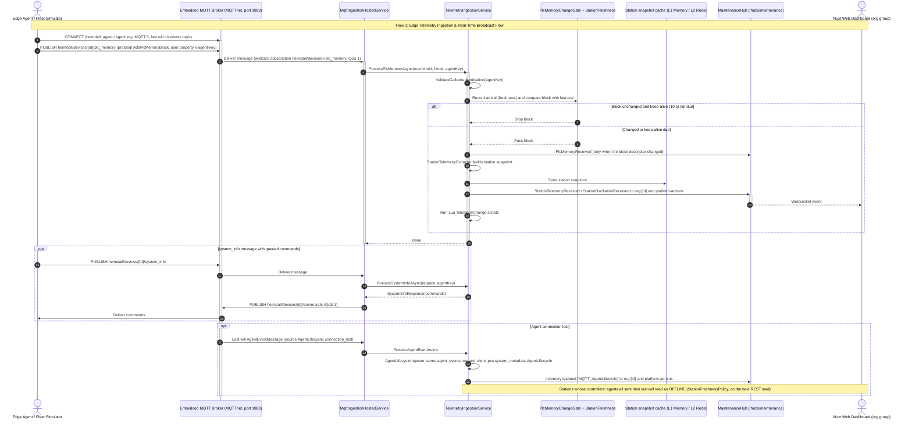
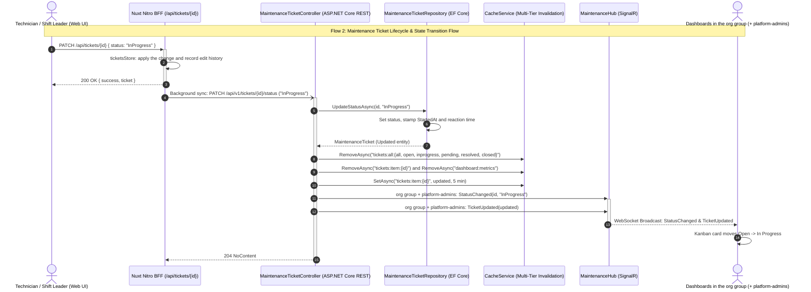
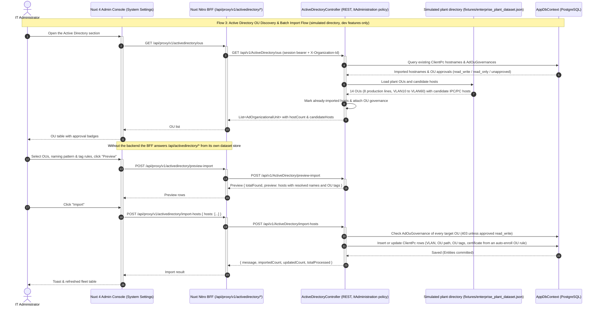
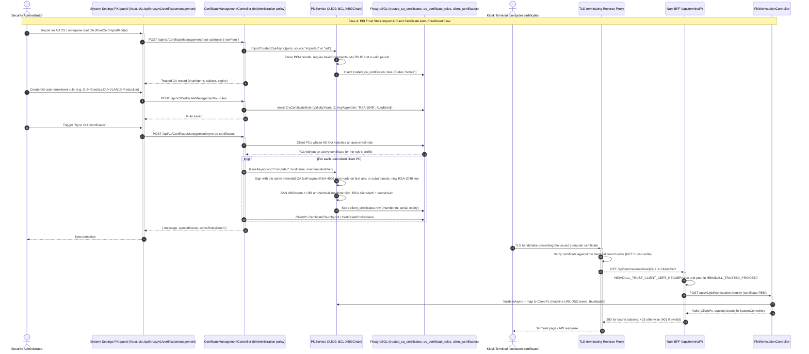
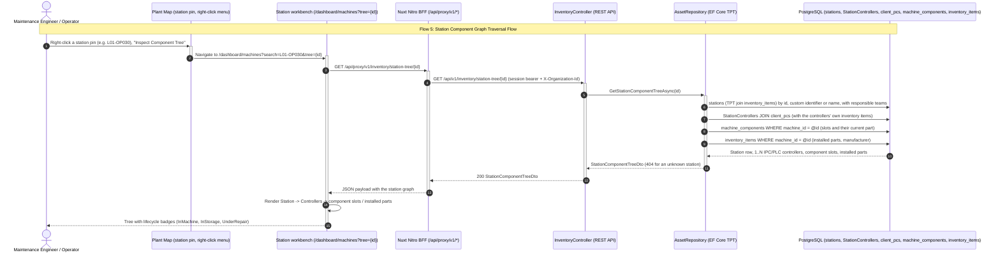
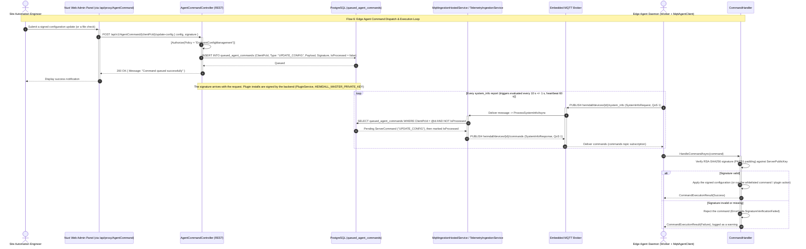

# Master Sequence Diagrams & Protocol Interaction Gallery

This document serves as the canonical visual reference gallery for the Heimdall manufacturing intelligence and telemetry platform.
It documents all core communication protocols, end-to-end data flows, real-time event broadcasting, and edge device lifecycle operations.

---

## 1. Edge Telemetry Ingestion & Real-Time Broadcast Flow

Agents (and the fleet simulator) publish protobuf messages over MQTT 5 to the MQTTnet broker embedded in the backend, authenticated by an agent key. The ingestion hosted service hands them to the telemetry ingestion service: unchanged PLC memory blocks are dropped by the change gate (arrival is still recorded for station freshness), changed blocks become station snapshots in the cache and SignalR events to organisation-scoped groups. Agent lifecycle events, including the MQTT last will, are stored as agent events.

---

## 2. Maintenance Ticket Lifecycle & State Transition Flow

Incident reports and automated alarms create maintenance tickets that move through five Kanban statuses (Open, In Progress, Pending, Resolved, Closed); escalation is a separate flag. The BFF applies a change to its ticket store and syncs it to the backend, which updates the database, evicts the multi-tier cache entries and broadcasts SignalR events to the owning organization's group.

---

## 3. Active Directory OU Discovery & Batch Import Flow

The IT administration module lists the plant's Active Directory organizational units and production VLANs with their candidate industrial PCs. In this build the directory is simulated from the enterprise plant dataset and only available with dev features. Hosts of OUs approved for read/write are imported into the central inventory in one batch.

---

## 4. PKI Trust Store Import & Client Certificate Auto-Enrollment Flow

The Heimdall PKI issues X.509 computer certificates. This flow illustrates importing an enterprise CA into the trust store, declarative OU enrollment rules, certificate issuance by the Heimdall CA, and a kiosk terminal authenticating with its computer certificate, which a TLS-terminating reverse proxy verifies and forwards to the BFF in the X-Client-Cert header. Agent telemetry itself is authenticated by an agent key over MQTT, not by client certificates.

---

## 5. Station Component Graph Traversal Flow

Manufacturing stations model complex multi-controller assemblies using Table-per-Type (TPT) inheritance and many-to-many junction entities. Opening a station's component tree (from the plant map's context menu or the machines page) traverses the component graph to render connected IPCs, PLCs, component slots, and installed parts.

---

## 6. Edge Agent Command Dispatch & Execution Loop

Engineers issue remote configuration updates and diagnostic recipes through authenticated REST APIs. Commands are queued in PostgreSQL, delivered to edge agents over MQTT on the commands topic after their next system_info report, verified cryptographically, and executed locally.

---

*Generated automatically by `tools/generate_sequence_diagrams.py` based on source code analysis.*
