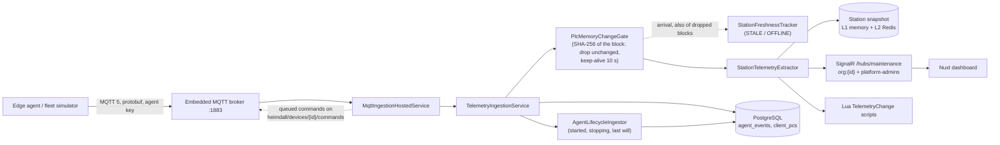

# Heimdall System Architecture & Data Model

This document defines the system architecture, domain data model, database schema, and service layers of the Heimdall platform.

---

## 1. Domain Topology & The Graph-Relational Model

In manufacturing automation environments, production lines do not follow rigid hierarchical trees. A single manufacturing station (such as a robotic welding cell or an automated packaging station) often involves multiple controllers:
* A primary **Industrial PC (IPC)** running human-machine interface (HMI) software and telemetry agents.
* A **Hardware PLC** or **Soft-PLC** (e.g., Beckhoff TwinCAT) executing real-time cyclic control logic.
* Specialized controllers for safety gates, vision inspection, motion control, and dispensing heads.

Conversely, a high-performance multi-core IPC may control multiple physical stations or process zones simultaneously.

To model this reality without artificial constraints, Heimdall implements a **graph-relational data model** with explicit many-to-many (M:N) junctions and typed directional interconnects between equipment.

```
┌────────────────────────────┐                M:N                ┌────────────────────────────┐
│ ProductionStation          │◄─────────────────────────────────►│ IndustrialController       │
│ Machine, table stations    │    StationController junction     │ ClientPc, table client_pcs │
│ e.g. LINE-A-OP10           │       (Role, e.g. Primary)        │ IPC / PLC / Soft-PLC       │
└─────────────┬──────────────┘                                   └─────────────┬──────────────┘
              │                                                                │
              │ 1:N                                                            │
              ▼                                                                │
┌────────────────────────────┐                                                 │ 1:N
│ MachineComponent (slot)    │                                                 │ PC components
│ table machine_components   │                                                 │ (client_pc_id)
└─────────────┬──────────────┘                                                 │
              │ current part                                                   │
              │ (installed parts also carry machine_id)                        │
              ▼                                                                ▼
┌─────────────────────────────────────────────────────────────────────────────────────────────┐
│              BaseInventoryItem (table inventory_items, Table-per-Type children)             │
│     HardwareComponent, PcHardware, SoftwareAsset; parent_id = recursive assembly tree       │
└──────────────────────────────────────────────┬──────────────────────────────────────────────┘
                                               │
                                               │ HardwareComponent.Firmware 1:N
                                               ▼
                                   ┌───────────────────────┐
                                   │     SoftwareAsset     │
                                   │   (Firmware, Logic)   │
                                   └───────────────────────┘
```

---

## 2. Core Entity Specifications

The platform uses Entity Framework Core with Table-per-Type (TPT) inheritance for asset tracking, combined with explicit graph edge tables and JSONB document columns for dynamic metadata.

### 2.1 Base Inventory Asset (`inventory_items`)
The abstract foundation for all physical and logical assets:
* `id` (`uuid`, PK): Immutable unique identifier.
* `name` (`varchar(255)`): Internal asset name (e.g., `L01-OP10`).
* `display_name` (`varchar(255)`): Human-readable descriptive name (e.g., `Line 01 - Body Assembly Alpha - Station 10`).
* `organization_id` (`varchar(128)`): Multi-tenant ownership identifier. Filtered globally across queries.
* `manufacturer_id` (`uuid`, FK): Reference to the equipment manufacturer (`manufacturers` table).
* `supplier_id` (`uuid`, FK): Reference to the procurement vendor (`suppliers` table).
* `serial_number` (`varchar(255)`): Vendor hardware serial number or batch lot code.
* `cost_in_huf` (`numeric(18,2)`): Procurement or replacement valuation in Hungarian Forints.
* `purchase_date` (`timestamptz`): Acquisition date.
* `parent_id` (`uuid`, FK, nullable): Self-referencing link supporting recursive assembly trees.
* `metadata` (`jsonb`): Semi-structured attributes indexed via PostgreSQL GIN (`jsonb_path_ops`). Stores cycle time targets, electrical ratings, pneumatic limits, and bus parameters.
* `storage_location` (`varchar(255)`): Shelf, cabinet, bin, or factory cell location (e.g. `Shelf B3`, `Bin 42-B`, `L01-OP10 Mount Bay 1`).
* `equipment_status` (`varchar(50)`): Lifecycle operational status:
  * `InStorage`: Spare unit or stock kept in warehouse storage awaiting deployment.
  * `InMachine`: Installed component actively operating on a physical production station.
  * `UnderRepair`: Component pulled from line undergoing diagnostic service or repair depot maintenance.
  * `Decommissioned`: Obsolete asset retired from service.
* `machine_id` (`uuid`, FK, nullable): Navigation link to the parent `Machine` where this component is installed (when `equipment_status == InMachine`).
* `stock_quantity` (`int`, nullable): Current quantity on hand for bulk consumable/spare stock items (e.g. 9 bolts, 24 quick couplers).
* `min_stock_threshold` (`int`, nullable): Safety reorder threshold for automated inventory alerts.
* `is_stock_item` (`boolean`): Discriminator flag distinguishing bulk quantity-tracked stock (`true`) from discrete, high-value one-of serialized capital assets (`false`).
* `technology` (`varchar(100)`): Manufacturing technology domain (e.g. `Assembly`, `Test`, `SMT`, `Welding`, `Fastening`, `Dispensing`, `Robotics`).

### 2.2 Production Stations & Lines (`stations`)
Extends `BaseInventoryItem` (TPT child) representing a process node or machine cell on the factory floor:
* `custom_identifier` (`varchar(255)`): Factory floor station code (e.g., `L01-OP10`, `STATION-OP20-02`).
* `machine_type` (`varchar(100)`): Functional automation classification (e.g. `Automatic Optical Inspection`, `Gap Filler`, `Screwing Station`, `Soldering`, `Milling`, `Fitting`, `Pressing`, `Manipulator`, `Tester Cell`).
* `group_id` (`varchar(100)`): Production line envelope identifier (e.g. `Line 01 - Body Assembly Alpha`, `Line 06 - Automated Battery Module Line`).
* `pinned_object_handle` (`varchar(64)`): AutoCAD DXF block entity handle or SVG element ID linking the station to factory CAD drawings.
* `preferred_technician_id` / `preferred_technician_name`: Designated primary technician for dedicated station servicing.
* Relationships:
  * `Controllers`: Navigation collection to `StationController` junctions.
  * `Tickets`: Incident tickets associated with this station.
  * `InstalledComponents`: Components where `machine_id == station.id`.

### 2.3 Discrete Parts vs. Bulk Stock Inventory Model
Heimdall enforces a strict distinction between two categories of inventory assets:
1. **Discrete High-Value Parts (`is_stock_item = false`)**:
   * Individual one-of serialized pieces of equipment (e.g., Siemens S7-1500 PLC, Cognex In-Sight 9000 camera, KUKA servo drive, Fanuc robot controller).
   * Tracked by unique `serial_number`.
   * Exactly located: either installed on a machine (`InMachine`, linked to `machine_id`), resting in central storage (`InStorage`, linked to `storage_location`), or in repair depot (`UnderRepair`).
   * Tree visualization: Station component trees are rendered on-demand via modal dialog (`StationComponentTreeModal`) rather than cluttering the primary inventory view with an inflexible tree page.
2. **Bulk Stock Consumables (`is_stock_item = true`)**:
   * Quantity-tracked components and consumable hardware (e.g., M8 bolts, pneumatic quick couplers, dispenser nozzles, solder paste, fuses, terminal blocks).
   * Monitored via `stock_quantity` against `min_stock_threshold`.
   * Bin storage tracking (e.g., `Bin 18-A`, `Bin 42-B`).
   * Low-stock reorder warnings triggered dynamically when `stock_quantity <= min_stock_threshold`.

### 2.4 Enterprise Engineering Organization & Governance Role Hierarchy
The security and permission model reflects real-world plant organizational structures, strictly separating engineering administrative domains from operational shift management:
* **`system_admin`**: Superuser / god user with root permissions across all platform subsystems and administrative role overrides.
* **`it_admin` / `it_site_admin`**: IT infrastructure administrator. Authoritative for Active Directory and Microsoft Entra ID OU read/write approval, PKI certificates, and IT security policies.
* **`heimdall_admin`**: OT platform administrator managing overall Heimdall operational settings, telemetry pipelines, and security group mappings. May inherit pseudo-IT admin capabilities when enabled by system admin.
* **`engineering_admin`**: Engineering technical administrator managing users, functional engineering configurations, recipes, and machine profiles from the application UI (strictly segregated from production management).
* **`plant_director`**: Executive engineering director with plant-wide read access and final sign-off authority for line stops and capital investments.
* **`plant_engineering_manager` & `senior_engineering_manager`**: Senior engineering leaders managing maintenance strategy, technology disciplines, and equipment life-cycles.
* **`group_leader`**: First-line engineering supervisors organized either by industrial technology domain (`Assembly`, `Welding`, `SMT`, `Test`, `Robotics`) or by production line envelope.
* **`engineer`**: Automation, controls, vision, and process engineers with execution permissions for PLC logic, calibration, and diagnostics.
* **`technician`**: Mechatronics and maintenance technicians with work order execution, parts replacement, and field repair logging permissions.
* **`operative_planner`**: Line planning managers responsible for production scheduling, takt time monitoring, and requesting/authorizing scheduled line stops.

### 2.5 Industrial Controllers (`client_pcs`)
Represents edge compute nodes, industrial PCs, and soft-PLC hosts:
* `mac_address` (`varchar(17)`, unique index): Normalized primary hardware identifier (`XX:XX:XX:XX:XX:XX`).
* `hostname` (`text`): Network device hostname, indexed for lookup.
* `ip_address` (`text`): Current primary IPv4 address.
* `machine_identifier` (`text`): Persistent hardware UUID (Windows `MachineGuid` or Linux `/etc/machine-id`).
* `last_online` (`timestamptz`): Timestamp of the most recent heartbeat.
* `free_disk_space` (`jsonb`): Drive letters, total space, and free space in gigabytes.
* `monitoring_config` (`jsonb`): Node-specific telemetry collection overrides (sampling rates, enabled adapters).
* `resource_averages` (`jsonb`): Rolling window CPU load, memory utilization, and network egress metrics.
* `alerting_limits` (`jsonb`): Configurable thresholds (disk space alerts, memory warnings).
* `system_metadata` (`jsonb`, GIN indexed): Detailed OS specifications, kernel version, installed Beckhoff driver versions, and network adapter hardware info.

### 2.6 Station-to-Controller Junction (`StationControllers`)
Models the many-to-many (M:N) mapping between physical stations and managing edge computers:
* `id` (`uuid`, PK): Junction row identifier.
* `machine_id` (`uuid`, FK): Production station (`stations`).
* `client_pc_id` (`uuid`, FK): Industrial controller (`client_pcs`).
* `role` (`text`): Operational role (e.g. `Primary`, `Secondary`, `Gateway`, `Safety`, `Vision`). There is no separate primary flag, and no code treats `Primary` specially: PLC telemetry is attributed to the station bound to the sending IPC, and an IPC serving several stations names the station in the block metadata (`StationId`, `MachineId` or `Station`).
* `created_at` (`timestamptz`) and `metadata` (`jsonb`): Edge properties.

### 2.7 Equipment Interconnects (`equipment_interconnects`)
Directional fieldbus and network connections between edge nodes:
* `id` (`uuid`, PK): Interconnect identifier.
* `source_controller_id` (`uuid`, FK): Originating controller.
* `target_controller_id` (`uuid`, FK): Destination device or controller.
* `protocol` (`varchar(32)`): Protocol type (`EtherCAT`, `PROFINET`, `ModbusTCP`, `OPC_UA`, `EtherNet_IP`).
* `channel_info` (`text`): Physical interface, subnet, or slave address details (e.g., `Port 1 -> Slave 04 (EK1100)`).

### 2.8 Incident Maintenance Tickets (`maintenance_tickets`)
Tracks equipment malfunctions, maintenance requests, and repairs:
* `id` (`uuid`, PK): Unique ticket identifier. There is no separate ticket number column.
* `title` (`varchar(255)`): Short summary of the defect or task.
* `description` (`text`): Detailed observations, error codes, or symptoms.
* `status` (`text`): Lifecycle state, one of five (`Open`, `InProgress`, `Pending`, `Resolved`, `Closed`).
* `pending_reason` (`text`) / `pending_details` (`text`): Why a `Pending` ticket waits (`None`, `Parts`, `ExternalOk`, `Action`, `SignOff`, `Custom`).
* `is_escalated` (`boolean`) with `escalation_reason`, `escalation_target`, `escalation_handover_state`, `escalated_at` / `escalated_by`, `escalation_closed_at` / `escalation_closed_by`: Escalation, orthogonal to the status.
* `priority` (`text`): Urgency (`Low`, `Medium`, `High`, `Critical`).
* `is_line_stop` (`boolean`) / `line_stop_duration_minutes`: Line-stop flag and duration.
* `machine_id` (`uuid`, FK, nullable): Affected production station.
* `client_pc_id` (`uuid`, FK, nullable): Affected IPC/controller.
* `equipment_id` (`uuid`, FK, nullable): Specific failed hardware component.
* `created_by` (`text`): Reporter; `assigned_to` (`text`, nullable) and `reserved_by` (`varchar(128)`, nullable): Technician.
* `created_at`, `started_at`, `qr_scanned_at`, `resolved_at` (`timestamptz`) and `reaction_time_minutes`: Audit timestamps and reaction time. There is no `updated_at` and no stored SLA deadline.

### 2.9 OmniSearch 2.0 Language-Server Search Pipeline
Heimdall includes an advanced industrial search engine styled after autocompletion language servers:
* **3-Stage Search Engine**:
  1. *Prefix Tokenizer*: Identifies filter directives (`@technology`, `#status`, `!priority`, `typ:`, `org:`).
  2. *Live Tag Suggestions*: Floating completion dropdown offering matching technology tags, operational statuses, and equipment categories with keyboard navigation (`ArrowUp`, `ArrowDown`, `Enter`, `Tab`).
  3. *Fuzzy Ranking*: Exact prefix matches are scored highest (100), followed by token substring matches (50), case-insensitive matches (25), and fuzzy typo-tolerant matches.
* Search scopes include stations, controllers, discrete serialized parts, bulk stock items, and maintenance tickets with instantaneous sub-5ms UI filtering.

---

## 3. Database Architecture & Schema Isolation

The relational store is partitioned into two schemas to enforce separation of concerns and least-privilege database access:

```
Database: heimdall_dev_db (staging: heimdall_staging_db, production: heimdall_db)
├── Schema: backend (Managed by EF Core Migrations, snake_case naming)
│   ├── inventory_items / stations / hardware_assets / software_assets / software_components / pc_hardware
│   ├── client_pcs / StationControllers / equipment_interconnects
│   ├── machine_groups / machine_group_memberships / machine_components / component_recipes
│   ├── component_part_histories / machine_service_logs / machine_documents / license_assets
│   ├── maintenance_tickets / ticket_comments / ticket_attachments
│   ├── technician_rules / shift_absences / delegation_recipes / machine_delegation_bindings
│   ├── personnel_groups / personnel_group_members / personnel_skills / skill_definitions
│   ├── floor_plans / floor_plan_anchor / generic_templates / lua_scripts
│   ├── agent_events / queued_agent_commands / diagnostic_snapshots
│   ├── audit_logs / malformed_telemetry_quarantine
│   ├── client_certificates / trusted_ca_certificates / ou_certificate_rules
│   ├── security_group_mappings / security_groups / ad_ou_governances / system_settings
│   └── manufacturers / suppliers / responsible_teams / known_tags / inventory_item_tags / ...
│
└── Schema: auth (Managed by Better-Auth Drizzle migrations; user, session, organization and
    │           member are also mapped in AppDbContext, excluded from EF migrations)
    ├── user (id, name, email, role, username, image, banned, permissions, createdAt, updatedAt)
    ├── session (id, userId, token, expiresAt, activeOrganizationId, ipAddress, userAgent)
    ├── account (id, userId, accountId, providerId, accessToken, ...)
    ├── verification (id, identifier, value, expiresAt)
    ├── organization (id, name, slug, logo, metadata, createdAt)
    ├── member (id, organizationId, userId, role, createdAt)
    ├── invitation (id, organizationId, email, role, status, expiresAt, inviterId)
    └── auth_events (id, type, timestamp, status, userId, sessionId, organizationId, ...)
```

### Database Roles & Least Privilege:
1. `ef_admin`: Owns the `backend` schema. Used strictly for schema migration execution (`CREATE TABLE`, `ALTER TABLE`, `CREATE INDEX`).
2. `dotnet_backend`: Used by the backend application runtime. Granted `SELECT`, `INSERT`, `UPDATE`, `DELETE` privileges on tables and sequences in `backend`. Has no DDL (`DROP`/`ALTER`) rights.
3. `nuxt_frontend`: Used by the Nuxt Nitro BFF runtime. Granted DML privileges on the `auth` schema and read access to necessary reporting views.

### Multi-Tenancy via Global Query Filters
Multi-tenancy is enforced at the data access level in `AppDbContext`:
```csharp
modelBuilder.Entity<ClientPc>().HasQueryFilter(e => 
    _tenantService.IsSuperAdmin || e.OrganizationId == _tenantService.CurrentOrganizationId);

modelBuilder.Entity<BaseInventoryItem>().HasQueryFilter(e => 
    _tenantService.IsSuperAdmin || e.OrganizationId == _tenantService.CurrentOrganizationId);

modelBuilder.Entity<MaintenanceTicket>().HasQueryFilter(e => 
    _tenantService.IsSuperAdmin || e.OrganizationId == _tenantService.CurrentOrganizationId);
```
Every query issued by EF Core automatically appends `AND (organization_id = @currentOrg OR @isSuperAdmin)` to the generated SQL, preventing cross-tenant data leakage.

---

## 4. Backend Service Architecture

The backend adopts clean separation between controllers, business services, and repository layers:

```
  Nitro BFF / clients            Edge agents / fleet simulator                  Browsers
  [ HTTP REST / JSON ]    [ MQTT 5 + protobuf, embedded broker :1883 ]  [ WebSockets / SignalR ]
           │                                   │                                    ▲
           ▼                                   ▼                                    │
┌──────────────────────┐  ┌──────────────────────────────────────────┐  ┌───────────┴──────────┐
│ BetterAuthHandler +  │  │ MqttBrokerService (MQTTnet, agent key)   │  │    MaintenanceHub    │
│ TenantScopeMiddleware│  │ MqttIngestionHostedService               │  │  /hubs/maintenance   │
│ API Controllers (v1) │  │ TelemetryIngestionService: change gate,  │  │ org:{id} + platform- │
│                      │  │ freshness, lifecycle, queued commands    │  │ admins (server push) │
└──────────┬───────────┘  └────────────────────┬─────────────────────┘  └───────────▲──────────┘
           │                                   │                                    │
           └─────────────────┬─────────────────┘                                    │
                             ▼                                 IHubContext events   │
        ┌──────────────────────────────────────────────────────────────┐            │
        │                 Application Domain Services                  │            │
        │ PredictiveMaintenance, LuaAutomation, PkiService,            ├────────────┘
        │ GlobalSearch, CopiaIntegration, ReportExport, PluginService  │
        └───────────────────────────────┬──────────────────────────────┘
                                        │
         ┌──────────────────────────────┴──────────────────────────────┐
         ▼                                                             ▼
┌──────────────────┐                                    ┌─────────────────────────────┐
│   CacheService   │                                    │ Repositories and services   │
│  (L1/L2 Hybrid)  │                                    │ (App.Infrastructure),       │
└────────┬─────────┘                                    │ AppDbContext (EF Core)      │
         │                                              └──────────────┬──────────────┘
         ▼                                                             ▼
 [ Redis / Memory ]                                            [ PostgreSQL 18 ]

 Cross-cutting: Logging/ (bounded rotating file log, runtime levels via /api/v1/admin/logging)
```

### 4.1 Hybrid Multi-Tier Caching (`CacheService`)
To handle frequent telemetry queries without saturating the database, a two-level caching strategy is employed:
1. **L1 Local Memory (`IMemoryCache`)**: Sub-millisecond reads for high-frequency reads (dashboard summary KPIs, system settings). Keys are tracked in a thread-safe dictionary to allow wildcard and prefix invalidation.
2. **L2 Distributed Cache (`StackExchange.Redis`)**: Shared cache across API instances with structured keys (`heimdall:{tenant}:{entity}:{id}`).
3. **Resilient Offline Bypass**: If Redis is unreachable, `CacheService` catches connection exceptions, logs a warning, and falls back to L1 local memory without failing incoming user requests.
4. **Write-Through Pattern Invalidation**: When an entity is updated (e.g., ticket status change), the repository executes `RemoveByPatternAsync("heimdall:tickets:*")`, evicting matching L1 regex patterns and executing batch key deletions in Redis.

### 4.2 Real-Time Event Broadcasting
Modifications to maintenance tickets or incoming critical alarms trigger real-time notifications:
1. Controller or service updates entity in the database.
2. Relevant cache keys are evicted.
3. `IHubContext<MaintenanceHub, IMaintenanceClient>` broadcasts the event to the owning organization's group (`org:{id}`) and to `platform-admins`, never to all clients. Events (`IMaintenanceClient`): `TicketCreated`, `TicketUpdated`, `TicketDeleted`, `StatusChanged`, `ReceiveNotification`, `InventoryUpdated`, `TelemetryReceived`, `PlcMemoryReceived` (only when a PLC block's descriptor changes), `StationTelemetryReceived`, `StationOscillationReceived`. The hub exposes no client-callable methods.


### 4.3 Telemetry Ingestion Pipeline

Agents and the fleet simulator publish protobuf messages over MQTT 5 to the MQTTnet broker embedded in the backend (`heimdall/devices/{machine_identifier}/system_info | plc_memory | telemetry | events`), authenticated by an agent key. `MqttIngestionHostedService` subscribes with wildcards and hands each message to `TelemetryIngestionService`. See `EDGE_AGENT_AND_PROTOCOLS.md` for the protocol and `SEQUENCE_DIAGRAMS.md` for the full flow.



* **Freshness**: arrival of every PLC memory block is recorded, even when the block is dropped as unchanged. A station is stale after 3 missed samples of its learned interval (clamped 3 s to 5 min) and OFFLINE when its controllers' agents sent their MQTT last will.
* **Lifecycle**: `AgentEventMessage` with source `AgentLifecycle` (started, stopping, connection_lost as last will) is stored by `AgentLifecycleIngestor` in `agent_events` and `client_pcs.system_metadata.AgentLifecycle`.
* **Events**: `StationTelemetryReceived` and `StationOscillationReceived`.
